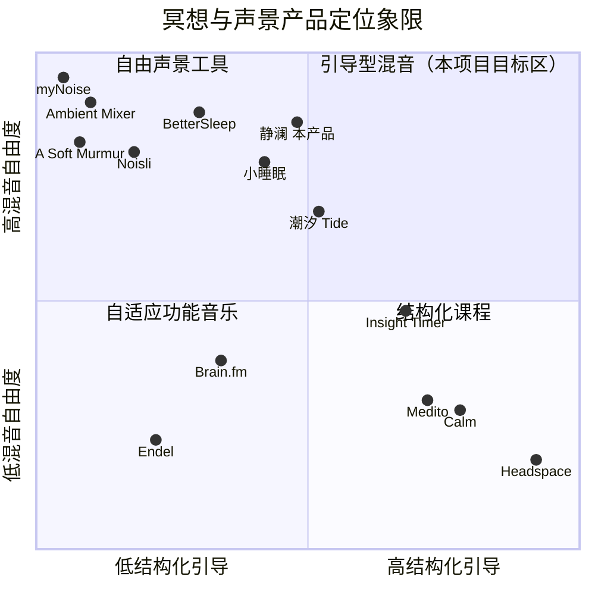

# 冥想网站「静澜 Stillwave」产品需求文档（PRD · 完整版）

> 文档类型：完整 PRD（用户明确要求「联网充分调研清楚同类产品」）
> 阶段：第 1 阶段（竞品调研 + 产品定义）
> 作者：产品经理 许清楚（Xu）
> 日期：2026-11-09（v1.1 增补：在线曲库实测落地）
> 语言：简体中文
> 上游输入 1：`docs/00-audio-sources-research.md`（主理人实测的音频资源客观事实：CORS、端点可用性、硬约束）
> 上游输入 2：`docs/00-verified-tracks.json`（主理人已完成曲库发现与逐条验证：30 首真实可播音频，全部 HTTP 206 + `audio/*` + CORS `*`）
> 本文所有音源描述与上述两份实测输入严格一致，未作任何臆造。

> **v1.1 增补说明**（第 1 阶段收尾时纳入主理人补充输入）：在线曲库已完成发现与逐条 HTTP 验证，**「必须真实接入在线音乐」由「待落地能力」升级为「已具备客观事实、可直接验收的能力」**，不再作为风险项或待确认项。据此新增 P0-15 / P0-16 / P0-17 三条可验收条目、S-11 / S-12 两条资源约束、A13 / A14 两条成功判据、D22 / D23 两条决策，并新增「中文展示名」产品规则。原有结论、定位、象限图、UI 设计稿与 A1–A12 判据均不变。

---

## 0. 项目信息

| 项 | 内容 |
|---|---|
| Language | 简体中文（界面、文案、文档全程简体中文） |
| Project Name | `stillwave_meditation`（snake_case） |
| 产品名 | 静澜 / Stillwave —— 「让心，慢下来」 |
| Programming Language / 技术栈 | **原生 HTML5 + CSS3 + 原生 JavaScript（ES Modules），零框架、零构建、零运行时依赖** |
| 部署目标 | GitHub Pages（也不排除任意静态托管）；同时满足 `file://` 双击直接打开可用 |
| 原始需求复述 | 开发一个冥想网站，配合在线音乐/音频洗涤心灵，覆盖学习、助眠、放空、冥想；联网充分调研同类产品后设计、开发、测试、真实验证直至全部稳定通过；尽量按纯静态前端开发以便放 GitHub Pages；使用的资源问题很多，需寻找稳定资源接入并设计一套能动态获取和更新的机制，避免以后失效。所有问题自行研究决定，不向用户提问。 |

> **技术栈覆盖默认模板的决策**：团队默认 PRD 模板推荐 `Vite + React + MUI + Tailwind CSS`，但用户硬约束为「纯静态前端、方便放 GitHub Page」且上游实测文件明确「无后端、无构建步骤、无 API key、无服务端渲染」。因此本次**覆盖默认**，改用原生三件套。理由：构建步骤和框架运行时会引入 `npm install` / CI 产物 / 路由 base 路径等额外复杂度，与「上传仓库即可运行」的目标冲突；原生实现也让 `file://` 双环境可用成为可能。理由与替代方案见第 9 节决策 D1。

### 本文边界

本文只做**联网竞品调研 + 产品定义 + 需求与验收标准 + UI 设计稿 + 产品侧约束**。不含代码、不含架构设计（音源分层与自愈的具体实现由架构师在 `00` 文件「决策提示」基础上定稿）、不含测试用例编写。凡涉及实现的地方，本文只写「必须做到什么」，不写「怎么实现」。

---

## 1. 执行摘要

联网调研了 **14 个**同类产品，覆盖结构化课程型（Calm、Headspace、Insight Timer、Medito）、中文场景型（潮汐 Tide、小睡眠）、混音/声景工具型（BetterSleep、A Soft Murmur、Noisli、myNoise、Ambient Mixer）、生成式功能音乐型（Endel、Brain.fm）。

**核心结论：**

1. 「多声轨独立音量混音 + 睡眠定时器渐弱 + 深色低刺激界面 + 场景分类 + 呼吸引导」已是行业标配，**不是差异化点，而是准入门槛**，P0 必须全部具备。
2. 市场被一条明显的裂缝切开：**结构化引导型产品（付费 App、需登录、内容锁在订阅墙后）** 与 **自由混音型产品（免费网页、免登录、但纯噪声无引导、无真实音乐）** 几乎不重叠。中文场景化只存在于 App 端（潮汐、小睡眠）。
3. **所有竞品都不具备「音源自愈不失效」能力**。网页类产品（A Soft Murmur / Noisli / myNoise / Ambient Mixer）音频多托管于自有或第三方固定 CDN，链接一旦失效即静默无声；上游实测已证实这一风险真实存在（Google 声音库某直链已 404、SomaFM 流空响应、Wikimedia Commons 查询 API 高频 403）。
4. 因此本项目定位为：**免费 + 纯网页免安装 + 无需登录 + 中文四场景化 + 真实在线音乐 + 音源失效自愈**。前四项各有一个竞品做到，第五项有部分竞品做到，**六项同时做到且含自愈机制的，调研范围内为零**。

**给架构师的一句话**：产品的第一性价值不是「又一个白噪音混音器」，而是「一个永远不会突然没声音的、能放真实在线音乐的中文冥想网页」。

---

## 2. 竞品调研（真实联网调研）

### 2.1 调研方法

| 步骤 | 执行 |
|---|---|
| 关键词组生成 | 由需求反推 3 组互斥关键词：①「冥想 App 功能与定价对比」②「白噪音/声景混音器 独立音量 定时器」③「中文助眠产品 + 免费网页声景 + 自适应功能音乐」 |
| 检索 | 每组发起多次 WebSearch，取头部结果；对 6 个官网（asoftmurmur.com、noisli.com、mynoise.net、tide.fm、endel.app、brain-fm.com 相关的对比页）用 WebFetch 抓原文 |
| 去重 | 同一产品多来源交叉核对，去除重复与纯转载；定价以厂商定价页/帮助中心为准，评测站只作补充 |
| 交叉验证 | 例：Calm 定价在 CNET（$80/年）与 rankite（$79.99/年）与 calm.com 官网 FAQ 之间核对，采信「约 $79.99/年」；A Soft Murmur 的定时器/Meander/免登录由官网 + 3 个第三方评测页交叉确认 |
| 质量控制 | 关键来源 URL 全部列于第 11 节；对无法确认的说法（如某产品的具体用户数）只做定性描述，不写入可量化结论 |

### 2.2 竞品逐个档案

#### A 组 · 结构化课程型（付费订阅为主，内容驱动）

| 产品 | 定位 | 核心功能 | 声景/内容形态 | 定时器与混音 | 免费/付费 | 优点 | 缺点 | 可借鉴点 |
|---|---|---|---|---|---|---|---|---|
| **Calm** | 「#1 睡眠与冥想 App」，助眠为王 | 500+ Sleep Stories（名人配音）、Daily Calm 每日 10 分钟、声景、呼吸 Bubble、大师课、Panic SOS、儿童内容 | 叙事型睡眠故事 + 自然声景 + 专属 focus/relax/sleep 音乐曲库；背景声景音量可调 | 有睡眠定时/渐弱；**无多轨自由混音**，声景是内容附属 | 需订阅，约 $79.99/年、$16.99/月、$499.99 买断；7 天试用且需绑卡自动续费 | 内容产能与制作质量顶级、助眠口碑强、多端覆盖 | 贵、订阅墙、网页版需登录、桌面版缺 mood check-in、名人内容两极分化 | 「场景 → 内容」的直接映射、每日一句的克制文案、声景作为可独立调音量的背景层 |
| **Headspace** | 结构化冥想教学，最适合零基础 | Basics 渐进课程 + 动画讲解、每日 10 分钟、SOS 焦虑急救、Focus 专注音乐、AI 对话式个性化会话 | 引导口播为主 + focus 音乐频道；无自由声景混音 | 有冥想定时器；无混音 | $69.99/年 或 $12.99/月，14 天试用 | 教学路径最清晰、动画降低理解门槛、有同行评审的成效数据 | 免费内容极少、网页版拆成 meditate/focus 两 tab 且缺 mood tracking、结构化对进阶者束缚 | 「首次进入给一条最短路径」、把抽象概念可视化（对应本项目呼吸圆环） |
| **Insight Timer** | 全球最大免费引导冥想库 | 150,000+ 免费引导冥想、高度可定制的**冥想定时器（环境钟声）**、课程、呼吸、日记、瑜伽、直播共修、社区 | UGC 口语引导 + 环境音 + 钟声；内容海量但质量参差 | **最佳的无引导定时器**（可配间隔钟声）；无多轨混音 | 免费层极慷慨；Member Plus 约 $59.99/年（解锁离线与课程） | 免费、定时器可定制、社区独特 | 界面杂乱、质量不可控、无临床验证、无中文场景化 | 「定时器可配置间隔提示音」是冥想场景的高价值细节（本项目列 P1） |
| **Medito** | 非营利、100% 永久免费、开源 | 引导冥想、课程、30 天挑战、睡眠故事与声音、呼吸练习、**带环境音的无引导定时器**、每日更新 | 引导口播 + 雨/海浪/白噪音等基础声景；深色友好 | 有定时器（配 ambient sounds）；无自由混音 | **完全免费**：无试用、无高级层、无广告、**无需账号**、开源 AGPL | 零摩擦（30 秒内开始）、零付费墙、无暗黑模式设计、隐私友好 | 仅 App、无中文场景化、声景种类少、无混音 | 价值观对齐：**无账号、无广告、无追踪、免费**——本项目直接继承；「选心情/目标 → 选时长 → 播放」三步式极简流程 |

#### B 组 · 中文场景型（最贴近本项目的用户心智）

| 产品 | 定位 | 核心功能 | 声景/内容形态 | 定时器与混音 | 免费/付费 | 优点 | 缺点 | 可借鉴点 |
|---|---|---|---|---|---|---|---|---|
| **潮汐 Tide** | 「和大自然一起，平静身心」，中文极简美学标杆 | **四大模块：睡眠 / 专注 / 冥想 / 呼吸**；高清自然声音、轻唤醒闹钟、番茄专注计时、每日灵感格言、潮汐日记、锁屏操作 | 森林、海洋、雨天、雷雨、流水、远山、林风、夜海、长路等场景声；**音乐融合播放**（一边听歌一边听自然）、睡眠故事「声音慢剧场」 | **混音创作功能**（自定义专属空间）；专注计时器（番茄 25/5、自定义时长、白名单）；睡眠定时器 | App 为主，含免费与内购 | **中文四场景化与本项目完全同构**、极简设计获奖（App Store 2017 年度精选）、随时光变化的情感动效、字体排印讲究、4-7-8 与平衡呼吸引导 | 仅 App、需安装、部分内容付费、音源封闭不可自愈 | **直接借鉴四场景划分、场景文案调性、极简低刺激美学、随时段变化的光感、呼吸引导的两种节奏** |
| **小睡眠** | 8000 万用户的中文睡眠健康超级 App | 1400+ 白噪音（**800+ 永久免费**）、3 音源组合叠加、7 大音效、Hi-Res、助眠故事/冥想/正念/ASMR/明星哄睡、睡眠监测与梦话打鼾记录、无痛唤醒、CBT-I 数字疗法、睡觉搭子 | 22 个分类（雨声、课堂、脑波、ASMR…）；自然白噪音 + 脑波 + 放松旋律 | **支持 3 个声音组合播放、各音轨独立音量、保存声音方案**；**拖动播放按钮即可设置定时关闭**（极佳的微交互） | 大量内容永久免费，核心助眠不强制开会员；存在会员内购 | 免费量大、中文场景覆盖全（夜间/午休/自习/通勤/母婴）、混音自由度高、定时交互极简 | 仅 App、体量重（185MB+）、功能过载、含社交与监测等隐私敏感能力、无网页版 | **「最多 3 轨叠加」的克制上限**（本项目采纳）、**拖动设置定时**的微交互灵感、场景覆盖到通勤/午休 |

#### C 组 · 混音/声景工具型（纯网页、免安装，最直接的竞品）

| 产品 | 定位 | 核心功能 | 声景/内容形态 | 定时器与混音 | 免费/付费 | 优点 | 缺点 | 可借鉴点 |
|---|---|---|---|---|---|---|---|---|
| **A Soft Murmur** | 「互联网上最安静的东西」，独立开发者作品 | 10 种环境音：**Rain / Thunder / Waves / Wind / Fire / Birds / Crickets / Coffee shop / Singing Bowl / White noise**；TIMERS、MIXES（保存命名/分享/Random mix）、**Meander/Wander 模式让音量自动缓慢漂移** | 纯环境音循环，无音乐、无口播 | **每轨独立音量滑块**、定时器可「到时停止」或「渐弱淡出」、记住上次混音 | **网页免费、免登录、无需安装**；iOS App 免费 4 音，其余内购；网页另有付费层更多声音 | 零摩擦、免登录、渐弱定时器、Meander 消除循环感、混合保存 | 音源仅 10 种且无真实音乐、需常开标签页、iPhone Safari 功能被阉割、**无任何音源失效自愈** | **本项目最直接的形态蓝本**：独立音量 + 渐弱定时器 + 记住上次混音 + 自动漂移。其短板（无音乐、无引导、无自愈、无中文）正是本项目要补的 |
| **Noisli** | 「你的平静与专注数字空间」，声景 + 轻生产力 | 28 种高质量声音（雨/海/鸟/风/落叶/溪流/篝火/雷/瀑布 + 白/粉/棕噪 + 风扇/咖啡馆/城市/火车/飞机/洗衣机）、精选歌单、**背景色随混音变化**、番茄钟、**无干扰 Markdown 文本编辑器**、Oscillation 音量渐变、Shuffle | 环境噪声 + 彩色视觉，无音乐 | 每轨混音 + Countdown Timer（默认 25 分钟）+ Work in Sessions | **免费层需注册账号**：16 声音 / 1.5 小时每天 / 3 歌单 / 5 收藏 / 简单定时器；Pro 解锁 28 声音、无限时长、高级定时器、Oscillation/Shuffle；Business $12/人/月 | 声音分类最系统（自然/噪声/机械三类齐全）、视觉与声音联动、音色质量高 | **免费层要注册且限 1.5h/天**、声音数量锁在付费墙、无中文、无真实音乐、桌面浏览器限定 | 声音分类体系（自然声 / 彩色噪声 / 机械环境声）本项目采纳；「渐变 Oscillation」对应本项目 P1 自动漂移；避免其付费墙与登录 |
| **myNoise** | 音频工程师打造的发烧级噪声生成器库 | 数百个噪声生成器，**每个生成器带十段均衡器**、可生成白/粉/棕/灰任意频谱色、听力校准测试、Fractal / Anthropogenic 演化噪声（永不重复）、婴儿睡眠专区 | 工程化合成噪声 + 自然声景，无音乐、无引导 | 十段 EQ 精调（自定义自由度全行业最高）；无混音器式多轨叠加概念 | **网页免费、无需登录**，部分高级功能自愿付费支持 | 自定义自由度天花板、无循环感（演化噪声）、专业可信 | 界面极客向、学习成本高、无场景引导、无中文、无音乐、**依赖自有音频托管无自愈** | 「避免明显循环接缝」的产品意识；棕噪/粉噪对助眠更友好这一声学常识 |
| **BetterSleep（原 Relax Melodies）** | 专注混音的助眠神器 | 300+ 声音与音轨、每轨独立音量、**智能混音防循环断音**、5 分钟至 12 小时定时器、**渐弱淡出**、收藏混音（创建/命名/排序）、睡眠故事、呼吸、双声拍、睡眠监测 | 自然声、白噪、ASMR、双声拍、SleepTales | **多声混音 + 独立音量 + 定时渐弱 + 收藏** | 免费版开放混音器与部分声音；完整曲库/冥想/故事需订阅（需绑卡的试用） | 混音能力最完整、「智能混音」正面解决循环接缝、收藏体系成熟 | 需账号、订阅墙、仅 App、无中文场景化、无网页版 | 「智能混音防断音」与「混音可保存为预设」列为本产品 P1 |
| **Ambient Mixer** | 社区驱动的在线声景混音站 | 在线免费创建/编辑/分享氛围混音模板，海量主题模板（霍格沃茨、雨林、暴风雨等） | 社区 UGC 循环音轨，**CC Sampling Plus 授权可商用** | 网页多轨混音、模板可编辑 | **完全免费、免登录** | 免安装免登录、可商用授权清晰、社区内容丰富 | 界面老旧、无定时器（模板依赖）、无引导、无中文、音频托管稳定性未知 | **许可/署名清晰**的做法（本项目清单必须带 `source` / `license` / `item` 等来源字段，见 §7.3） |

#### D 组 · 生成式功能音乐型（科学叙事、自适应）

| 产品 | 定位 | 核心功能 | 声景/内容形态 | 定时器与混音 | 免费/付费 | 优点 | 缺点 | 可借鉴点 |
|---|---|---|---|---|---|---|---|---|
| **Endel** | AI 神经科学驱动的自适应声景引擎 | 依据**时间、天气、地理位置、心率、步频**实时生成声音；Focus / Relax / Sleep / Move / 晨间唤醒；多端（iOS/Android/Mac/Win/Web/Watch/TV/Alexa）；与 Warner Music 合作 | 缓慢演化的生成式 ambient 纹理，无歌词、无固定曲目 | 全自动，**用户几乎不控制混音**；会话制 | $6.99/月、$39.99/年、$249.99 买断；免费层仅 10 分钟会话 | 每次都不一样、永不重复、环境自适应、多端最广 | 无免费长期使用、有效性主要依赖厂商自有研究、用户控制感低 | 「声音随时间缓慢演化不重复」的产品价值；但本项目**反其道**，把控制权交还用户（免登录+自由混音） |
| **Brain.fm** | 「功能音乐，不是娱乐音乐」 | 按**脑波夹带**原理 AI 作曲，专利 phase-lock；Focus / Relax / Meditate / Sleep / Nap 模式 + **效果强度滑块**；入场校准问卷；2024 年 *Communications Biology* 同行评审研究、NSF 资助 | 带快速振幅调制的器乐（lo-fi/钢琴/电子/古典），无歌词、无突兀动态 | 选模式 + 强度，非自由混音；会话制 | $9.99–14.99/月或 $49.99–99.99/年；**无免费层**，仅短期试用 | 科学背书最强、强度可调、目标状态明确 | 贵、无免费层、长期听同一模式易重复、效果因人而异 | 「**无歌词、无突兀动态、窄音域**」的功能音乐三原则，直接写入本项目四大场景声学特征 |

### 2.3 共性能力矩阵

✅ = 具备且完整；◐ = 部分具备/受限；✗ = 不具备

| 能力 | Calm | Headspace | Insight Timer | Medito | 潮汐 | 小睡眠 | BetterSleep | A Soft Murmur | Noisli | myNoise | Ambient Mixer | Endel | Brain.fm | **静澜（本项目）** |
|---|---|---|---|---|---|---|---|---|---|---|---|---|---|---|
| 场景化分类 | ✅ | ✅ | ◐ | ◐ | ✅ | ✅ | ◐ | ✗ | ◐ | ✅ | ◐ | ✅ | ✅ | **✅ 中文四场景** |
| 多声轨混音 + 独立音量 | ✗ | ✗ | ✗ | ✗ | ✅ | ✅ | ✅ | ✅ | ✅ | ◐(EQ) | ✅ | ✗ | ✗ | **✅ ≤3 轨** |
| 睡眠定时器 + 渐弱 | ✅ | ◐ | ✅ | ◐ | ✅ | ✅ | ✅ | ✅ | ✅ | ✗ | ✗ | ◐ | ◐ | **✅ P0** |
| 深色 / 低刺激界面 | ✅ | ◐ | ◐ | ✅ | ✅ | ✅ | ✅ | ✅ | ✅ | ✗ | ✗ | ✅ | ◐ | **✅ 可降亮度** |
| 呼吸 / 正念引导 | ✅ | ✅ | ✅ | ✅ | ✅ | ✅ | ✅ | ✗ | ✗ | ✗ | ✗ | ✗ | ◐ | **✅ 可视化** |
| 一键即播 / 零学习成本 | ◐ | ✗ | ✗ | ✅ | ✅ | ✅ | ◐ | ✅ | ◐ | ✗ | ✅ | ✅ | ◐ | **✅ P0** |
| 无明显循环接缝 | ◐ | ◐ | ◐ | ◐ | ◐ | ◐ | ✅ | ✅(Meander) | ✅(Oscillation) | ✅ | ◐ | ✅ | ◐ | **✅ P1** |
| 免费可长期使用 | ✗ | ✗ | ✅ | ✅ | ◐ | ✅ | ◐ | ✅ | ◐ | ✅ | ✅ | ◐ | ✗ | **✅ 全免费** |
| 纯网页免安装 | ◐(需登录订阅) | ◐(需登录订阅) | ✗ | ✗ | ✗ | ✗ | ✗ | ✅ | ✅ | ✅ | ✅ | ◐ | ✅ | **✅ P0** |
| 无需登录 / 无账号 | ✗ | ✗ | ✗ | ✅ | ✗ | ✗ | ✗ | ✅ | ✗ | ✅ | ✅ | ✗ | ✗ | **✅ P0** |
| 中文场景化文案 | ✗ | ✗ | ✗ | ✗ | ✅ | ✅ | ✗ | ✗ | ✗ | ✗ | ✗ | ✗ | ✗ | **✅ P0** |
| **真实在线音乐（非仅合成噪）** | ✅ | ✅ | ◐ | ◐ | ✅ | ✅ | ✅ | ✗ | ✗ | ✗ | ◐ | ✅(生成) | ✅(生成) | **✅ P0** |
| **音源失效自动回退 / 动态更新** | ✗ | ✗ | ✗ | ✗ | ✗ | ✗ | ✗ | ✗ | ✗ | ✗ | ✗ | ✗ | ✗ | **✅ P0 独占** |

### 2.4 差异化机会（市场空白点）

| # | 空白 | 证据 | 本项目对策 |
|---|---|---|---|
| 1 | **音源自愈不失效**：14 个竞品无一具备；网页类竞品音频托管固定，链接失效即无声 | 上游 `00` 文件实测：Google 声音库直链已 404、SomaFM 流空响应、Wikimedia Commons 查询 API 高频 403；A Soft Murmur / Noisli / myNoise 均无「刷新曲库」或失效回退的产品概念 | **第一差异化点**，P0：分层音源 + 多候选 + 健康探测 + 静默回退到永不失效的合成底座 + 手动「刷新曲库」 |
| 2 | 免费 × 纯网页 × 免登录 × 中文 × 真实在线音乐，五者交集为空 | 免费网页免登录的（A Soft Murmur / myNoise / Ambient Mixer）都只有合成噪声、英文、无引导；中文场景化的（潮汐 / 小睡眠）都要装 App | 一次补齐五项，且**全免费无账号无追踪**（对齐 Medito 价值观） |
| 3 | 「结构化引导」与「自由混音」被割裂 | 象限图左上（自由声景）与右下（结构化课程）之间几乎无产品；潮汐/小睡眠是仅有的两个中间派，但都是 App | 定位右上「引导型混音」：四场景给出推荐默认配置（引导），同时允许完全自由改混音（自由） |
| 4 | 网页类产品无「场景 → 声学处方」的设计 | Noisli / myNoise 只给声音清单，让用户自己试；Brain.fm 只按状态分 | 四场景各自给出默认音轨、默认音量、默认时长、默认渐弱与界面基调，开箱即用 |
| 5 | 许可与来源不透明 | Ambient Mixer 是少数明确 CC 授权的；多数网页站不标注音源出处 | 每条在线曲目展示中文展示名 / 来源 / 许可 / 原始条目页，可点击查证；实测清单保留 `url` / `scene` / `license` / `item` / `source` / `display` / `originalTitle` / `kind` 字段（见 §7.3） |
| 6 | 夜间高亮度刺激与动效过载 | 多数网页站仍是常亮白底，仅潮汐/Medito/Calm 有深色友好 | 深色低刺激为默认、可一键「熄屏」降至极低亮度、全部动效可随 `prefers-reduced-motion` 关闭 |

### 2.5 竞争象限图

> 横轴 = 结构化引导程度（低 → 高）；纵轴 = 自定义 / 混音自由度（低 → 高）。分数均匀分布于 0–1。



**读图**：本项目「静澜」落在**右上象限（引导型混音）**，与潮汐 Tide、小睡眠同区，但比二者更靠上（更高的混音自由度、纯网页免安装），并叠加了图中所有产品都不具备的第三维能力——音源自愈。右下（Calm / Headspace / Medito）是付费或纯引导的内容型产品，左上（A Soft Murmur / myNoise / Noisli）是自由但无引导的工具型产品，中间地带正是机会。

### 2.6 定价与商业模式观察

- 订阅型集中在 **$60–100/年**（Headspace $69.99、Calm $79.99、Insight Timer Plus $59.99、Brain.fm $49.99–99.99、Endel $39.99），普遍要求绑卡试用并自动续费，用户抱怨集中在「免费层是诱饵」。
- 免费可持续模式存在且被验证：**Medito（非营利捐赠 + 开源）**、**myNoise / A Soft Murmur / Ambient Mixer（自愿支持 + 高级层）**、**小睡眠（800+ 白噪音永久免费 + 会员增值）**。
- 网页工具型普遍采用「免费基础 + 高级层」：Noisli 免费层限制 16 声音与 1.5 小时/天，A Soft Murmur 网页免费但更多声音付费。
- **本项目决策：全功能永久免费、无账号、无广告、无内购、无数据变现**。理由见第 9 节 D3。零成本由「零后端 + 免费开放音源 + GitHub Pages 免费托管」支撑，商业上可持续。

---

## 3. 产品定义

### 3.1 一句话定位

> **静澜是一个打开网页就能用、完全免费、无需登录的中文冥想声景站——用真实在线音乐配合可自由混音的自然声景，陪你学习、入睡、放空与冥想，而且声音永远不会突然消失。**

### 3.2 三条价值主张（正交）

| # | 价值主张 | 对应差异 |
|---|---|---|
| V1 | **永不静音**：在线曲库可动态发现与更新，链接失效自动降级到永不失效的本地合成声，用户可感知、不打断、可手动刷新 | 全行业空白，本项目第一性价值 |
| V2 | **零摩擦的中文场景化**：打开即播、四场景一键切换、每个场景自带经过设计的默认声学处方，无需账号、无需安装、无需学习 | 补齐「中文场景化只在 App 端」的空白 |
| V3 | **把控制权交还用户**：全免费、无追踪、混音叠加与音量完全自定义、界面亮度与动效可自行调低 | 对抗订阅墙、登录墙与暗黑留存设计（对齐 Medito 价值观） |

### 3.3 产品目标（3 个正交、可度量）

| ID | 目标 | 度量方式 |
|---|---|---|
| G1 | **可用性**：让用户在无任何前置条件下 10 秒内获得符合当前场景的声音 | 从打开页面到首次出声 ≤ 10s（含合成层 ≤ 2s）；首次交互后必出声，无「点了没反应」 |
| G2 | **健壮性**：任何单一在线音源失效都不导致静音或报错弹窗 | 注入 404 / 超时 / 断网三类故障，均 ≤ 3s 内自动回退且播放连续；P0 功能在 `file://` 与 https 双环境均可用 |
| G3 | **克制性**：低刺激、无负担、无隐私成本 | 首屏资源 < 300KB（不含在线音频）、零第三方上报请求、无登录表单、无广告、全部交互可键盘到达 |

### 3.4 四大场景的产品定义与推荐声学特征

> 说明：以下为**产品侧处方**（默认音轨、时长、界面基调、用户预期），不是音频工程实现规范。声学原则引用调研所得共识：Brain.fm「无歌词、无突兀动态、窄音域」三原则；Noisli/mynoise 对「带歌词音乐会干扰读写」的观察；myNoise 与 BetterSleep 对「棕噪/粉噪低频更宜夜间」的实践；A Soft Murmur Meander 与 Endel 对「缓慢演化避免循环感」的处理。

| 维度 | 🧠 学习（专注） | 🌙 助眠（入睡） | 🌿 放空（减压） | 🧘 冥想（正念/呼吸） |
|---|---|---|---|---|
| **用户目标** | 屏蔽环境干扰、进入并维持心流 | 缩短入睡时间、避免被声音惊醒 | 从紧绷里退出来、什么都不做 | 跟随节奏安住当下、练习呼吸 |
| **典型时段** | 白天 / 办公学习 / 图书馆 | 夜间睡前、午休 | 通勤、下班后、间隙 | 晨起、睡前、任意碎片时间 |
| **典型时长** | 25–50 分钟（番茄节律） | 20–60 分钟（到时自动停） | 10–30 分钟 | 5–20 分钟 |
| **声音倾向** | 平稳、可预测、无叙事；细雨、咖啡馆低语、缓慢氛围音乐、棕噪垫底 | 低频为主、渐弱；绵雨、远海、缓慢 drone、棕噪/粉噪 | 自然声景、有缓慢演化但无叙事；雨、溪流、林风、海浪、篝火 | 极简底噪 + 可选颂钵 / 呼吸节拍；默认几乎「空」 |
| **应规避** | 人声、歌词、强节拍、突发动态、明显旋律起伏 | 高频突发（雷声、鸟鸣、蟋蟀）、音量跳变、突然结束 | 明显循环接缝、过于热闹的咖啡馆人声 | 任何口播导词（版权/体积/干扰）、复杂配器 |
| **默认配置（决策）** | 主音源=已验证氛围音乐 1 首；叠加=细雨 30% + 棕噪 15%；音量 45%；定时器 45 分；渐弱关 | 主音源=同一氛围音乐（低通更柔）；叠加=绵雨 35%；音量 30%；定时器 30 分；**渐弱 60s 默认开** | 主音源=氛围音乐；叠加=林风 40% + 溪流 25%；音量 40%；定时器关 | 主音源关闭或极轻底噪；叠加=颂钵 20%；音量 25%；定时器 10 分；**呼吸圆环默认显示** |
| **界面基调** | 偏冷、低饱和、几乎静止；亮度默认中低 | 近黑暖暗色；**默认最低亮度**，一键熄屏；动效最慢 | 柔和中性、留白大、微缓光晕 | 单一焦点（呼吸圆环）、大面积留白、动效与呼吸同频 |
| **成功感受** | 「忘了声音的存在」 | 「没注意到什么时候睡着的」 | 「肩膀松下来了」 | 「呼吸慢下来了」 |

### 3.5 目标用户与使用场景

| 用户分层 | 画像 | 主要场景 | 核心诉求 | 对应设计 |
|---|---|---|---|---|
| **U1 夜间入睡困难者**（核心） | 都市年轻白领/学生，躺下后脑子停不下来，手机是最后陪伴 | **夜间/睡前**：关灯后把手机放枕边，设 30 分钟定时渐弱 | 别被打扰、别突然没声、屏幕别刺眼 | 最低亮度 + 熄屏、渐弱默认开、音源自愈静默、无通知无弹窗 |
| **U2 深度工作者 / 备考学生** | 开放式办公室、宿舍、图书馆，环境嘈杂 | **办公学习**：戴耳机开 25/45 分钟专注块 | 屏蔽人声、别有歌词、时间长且不断 | 无歌词音源、棕噪垫底、长定时器、番茄节奏（P1） |
| **U3 通勤与间隙放空者** | 地铁/公交/午休，碎片时间，不想被内容绑架 | **通勤放空**：单手操作、10–20 分钟、不看屏幕 | 一按即播、免登录、流量友好 | 移动端大按钮、免登录、记住上次配置、低流量提示 |
| **U4 正念练习者** | 有冥想习惯或想入门，不需要被课程牵着走 | **冥想**：晨起/睡前 5–20 分钟 | 可自定义的无引导定时器、呼吸节奏可视化 | 呼吸圆环、4-7-8 / 平衡呼吸、间隔钟声（P1） |
| **U5 隐私敏感 / 反订阅用户** | 不愿注册、反感绑卡试用与追踪 | 全场景 | 零账号、零追踪、零付费墙 | 全免费无账号、无第三方请求、本地设置可一键清除 |
| **U6 部署者 / 二次使用者** | 想 fork 到自己的 GitHub Pages | 部署 | 上传即用、链接长期不失效 | 零构建、相对路径、曲库可动态更新 |

### 3.6 用户故事（共 16 条，v1.1 新增 US-15 / US-16）

| ID | 用户故事 |
|---|---|
| US-01 | 作为**夜间入睡困难者**，我希望**打开网页点一下就能出声、不用注册也不用装 App**，以便**躺下后不用再折腾就能开始放松**。 |
| US-02 | 作为**夜间入睡困难者**，我希望**设定 30 分钟后声音自动渐弱到停止**，以便**睡着后不被突然的静音或音乐吵醒**。 |
| US-03 | 作为**夜间入睡困难者**，我希望**能把屏幕亮度降到几乎全黑**，以便**关灯后手机不刺眼**。 |
| US-04 | 作为**深度工作者**，我希望**一键切到「学习」就得到一套配好的无歌词声音**，以便**不必逐个试音就能立刻进入专注**。 |
| US-05 | 作为**深度工作者**，我希望**同时叠加 2–3 种声音并各自调音量**，以便**按需盖住办公室人声与空调低频**。 |
| US-06 | 作为**通勤放空者**，我希望**单手在手机上就能播放/暂停/调音量**，以便**在地铁里不用看屏幕也能操作**。 |
| US-07 | 作为**正念练习者**，我希望**有一个跟着呼吸缩放的圆环和可选的 4-7-8 节奏**，以便**没有口播也能稳住呼吸**。 |
| US-08 | 作为**任何用户**，我希望**在线音乐链接失效时声音自动换成另一种可用声音、且我正在听的内容不被打断**，以便**不会在放松到一半时突然一片死寂**。 |
| US-09 | 作为**任何用户**，我希望**能看到当前音源状态（在线 / 回退 / 合成）并有一个「刷新曲库」按钮**，以便**知道发生了什么、并能自己主动修复**。 |
| US-10 | 作为**注重版权的听众**，我希望**能展开看到当前曲目的名称、作者、来源和许可并点开原始链接**，以便**确认这些音乐是合法可用的**。 |
| US-11 | 作为**再次访客**，我希望**网页记住我上次的场景、混音与音量**，以便**每次打开不必重新调一遍**。 |
| US-12 | 作为**隐私敏感用户**，我希望**全程没有登录、没有广告、没有数据上报**，以便**放松时不担心被记录**。 |
| US-13 | 作为**键盘用户 / 使用读屏器的用户**，我希望**所有控件都能用 Tab 到达并有明确标签**，以便**不依赖鼠标也能完整使用**。 |
| US-14 | 作为**部署者**，我希望**把仓库推到 GitHub Pages（或直接双击 index.html）就能跑、不需要 npm install 和构建**，以便**零成本长期使用且不因工具链过时报废**。 |
| US-15 |（v1.1 新增）作为**追求真实声景的用户**，我希望**每个场景都能听到真实在线音频——既有 CC 氛围音乐，也有真实的雨、溪流、森林等野外录音**，以便**洗涤心灵时听到的是真实世界而不是机械合成噪**。 |
| US-16 |（v1.1 新增）作为**中文用户**，我希望**曲目名是简洁的简体中文意境名（如「晨雾」「轻雨」）**，以便**界面始终安静统一，不被冗长的外文原始标题、地名和编号打扰**。 |

---

## 4. 需求池（P0 / P1 / P2）

> 优先级定义：**P0 = 必须有（Must have，缺任一条不验收）**；**P1 = 应该有（Should have）**；**P2 = 锦上添花（Nice to have）**。
> 验收标准均为可客观判定的条件，供 QA 阶段直接转成测试用例。

### 4.1 P0 · 必须有

| ID | 需求 | 验收标准 |
|---|---|---|
| P0-01 | **场景切换**：学习 / 助眠 / 放空 / 冥想四场景，切换即套用该场景的默认音轨、音量、定时器与界面基调 | 4 个场景Tab均可点击/键盘选中；切换后 UI 反馈 ≤ 300ms；场景对应的默认配置（见 3.4）实际生效并与文档一致；切换时正在播放的音频平滑过渡、不出现爆音或双声重叠 |
| P0-02 | **播放 / 暂停**：单一主按钮控制全局播放态，状态在全站唯一且可见 | 首次点击必出声（受浏览器策略约束，见 P0-11）；播放/暂停图标与 `aria-pressed` 同步；暂停后所有声轨（含叠加层）同步静默；暂停不丢失进度与混音配置 |
| P0-03 | **音量控制**：主音量 + 每条叠加声轨独立音量 | 滑块 0–100% 可调、`aria-valuenow` 正确；调节实时生效无杂音；主音量与分轨音量相乘关系正确；0% 时该轨完全静默 |
| P0-04 | **混音叠加**：最多 3 条声景同时叠加（主音源 + 最多 2 层，或 3 层声景），可增删、可命名 | 可同时播放 ≥ 3 条独立音轨且各自音量独立；达到上限时「添加」给出明确提示且不崩溃；移除音轨后资源释放、无残留声音；混音配置在会话内保持 |
| P0-05 | **睡眠定时器 + 渐弱**：可选 15/30/45/60/90 分钟与自定义，结束时渐弱至静音并停止 | 倒计时可见且误差 ≤ 1s；渐弱可开关并可选 30/60/120s；到时音量连续下降至 0 后停止，无突然截断；可中途取消；取消后音量恢复原设定值 |
| P0-06 | **音频源状态与自动回退**：每条在线音源多候选 URL + 播放错误/超时探测 + 自动降级；状态对用户可见 | 人为把主源改为 404 / 超时 / 直接断网，系统均在 ≤ 3s 内切换到可用候选或本地合成层；**播放不中断、不弹模态框、不自动暂停**；状态徽标准确显示「在线 / 备用 / 合成」；控制台无未捕获异常 |
| P0-07 | **纯静态零依赖**：无后端、无构建、无 API key、无框架运行时、无 npm 依赖 | 仓库内无 `node_modules` / 构建配置 / 服务端代码；`index.html` 用相对路径引用全部本地资源；直接把目录推到 GitHub Pages 即可运行；全站网络请求均为公开匿名 GET，无密钥、无鉴权头 |
| P0-08 | **响应式 + 深色低刺激 UI**：移动端/桌面自适应，默认深色，可降亮度 | 320px / 768px / 1440px 三档无横向溢出、无控件重叠、文字可读；默认深色背景且对比度满足 WCAG AA（正文 ≥ 4.5:1）；提供亮度档位（至少「常规 / 暗 / 极暗熄屏」）；夜间场景默认最低亮度 |
| P0-09 | **无登录、不采集隐私**：无账号体系、无表单、无广告、无第三方追踪与数据上报 | 全站无登录/注册入口、无 cookie 横幅、无第三方统计脚本；除公开音源/清单的 GET 外，无向任何域名发送含用户标识的请求；本地设置仅存 `localStorage`，提供「清除本地设置」且清除后恢复默认 |
| P0-10 | **真实在线音乐接入 + 许可署名**：必须实际播放来自在线资源的音乐（非仅本地合成声），并展示来源与许可 | 默认配置下可听到来自 `archive.org` 的真实 MP3（**30 首实测曲库，见 7.3**）；「音源信息」可展开显示中文展示名/来源/许可/原始条目页；清单每条带 `url` / `scene` / `license` / `item` / `source` / `display` / `originalTitle` / `kind` 字段；原始条目页链接可点击且可访问 |
| P0-11 | **首次交互后才允许出声**：遵守浏览器自动播放策略 | 页面加载完成时不产生任何声音、AudioContext 处于 suspended；首次用户手势（点击/键盘）后才 resume 并开始播放；无手势时不出现自动播放报错；Safari / Chrome / Firefox 行为一致 |
| P0-12 | **记住上次配置**：场景、混音、音量、亮度、定时器偏好持久化 | 关闭标签页再打开，配置 100% 还原；「清除本地设置」后回到出厂默认；`localStorage` 不可用时（如隐私模式）静默降级为内存态、不报错 |
| P0-13 | **手动「刷新曲库」入口**：用户可主动触发曲库重新拉取/校验 | 存在可见且键盘可达的「刷新曲库」按钮；点击后有进行中/完成/失败三态反馈；成功时更新「上次更新时间」与条目数；失败时保留现有可用清单、不清空、不打断播放 |
| P0-14 | **失效可感知但不打断**：降级过程对用户透明且克制 | 降级时仅出现状态徽标变化 + 一行轻量提示（可自动淡出），**不弹窗、不闪烁、不震动、不改变播放态**；提示文案为简体中文且不使用报错口吻（如「已为你切换到备用声源」） |
| P0-15 | **在线曲库规模与逐条可播**（v1.1 新增）：接入的主理人实测曲库 `docs/00-verified-tracks.json`，**至少 30 首真实在线音频可播**，其中 21 首 CC 氛围音乐 + 9 首真实自然环境录音，按四场景标注 focus 6 / sleep 3 / empty 17 / meditation 4 | 清单条目数 ≥ 30 且四场景条目数分别 ≥ 6 / 3 / 17 / 4；每条均为实测 HTTP 206 + `audio/*` + CORS `*`；**逐条抽检全部可实际播放出声**（非仅清单存在、非仅合成音）；任一场景均能选到该场景的在线曲目并播放成功；条目数在「音源详情」面板可见 |
| P0-16 | **许可与来源署名展示**（v1.1 新增）：每条在线曲目在 UI 上可查「中文展示名 + 来源 + 许可 + 原始条目页」 | 播放条与「音源信息」展开区逐条显示来源（Internet Archive / Jamendo CC / aporee soundmap）、许可文本或 CC 类型、`item` 原始条目页链接；链接可点击且可访问；页脚有独立「音源许可与署名」区块；清单保留 `source` / `license` / `originalTitle` 等来源元数据字段；**展示层不暴露 URL、错误码、堆栈**（S-10） |
| P0-17 | **失效自动回退不打断体验**（v1.1 新增，P0-06 / P0-14 的端到端验收）：真实在线曲库链接失效时自动回退且用户无感 | 人为把清单中任一主源 URL 改为 404 / 超时 / 断网，系统 ≤ 3s 内自动切到下一候选或合成层；**正在播放的内容不中断、不暂停、不弹窗、音量不突变**；状态徽标准确切换为「备用音源 / 本地合成」并给出一行简体中文轻提示；回退后用户仍可继续切场景、调音量、设定时器；控制台无未捕获异常 |
| P0-18 | **中文展示名与标题净化**（v1.1 新增）：在线曲目标题在 UI 上一律使用数据提供的 `display` 中文展示名 | 界面所有曲目名均取自清单的 `display` 字段（如「晨雾」「星际漫游」「轻雨」「溪流」），为简体中文、语义贴合场景；**原始标题 `originalTitle` 仅作来源元数据，绝不直接呈现在展示层**——因部分原始标题含地区名、地名、编号、杂质（如 `Zhukovsky Municipal District, Kaluga Oblast, Russia - lapwing calling`、`L 50 GHENT-BRUSSELS / Forest, Belgium`），直接暴露会破坏低刺激中文界面；播放条、混音卡片、音源详情、分享文案四处口径一致 |

### 4.2 P1 · 应该有

| ID | 需求 | 验收标准 |
|---|---|---|
| P1-01 | **呼吸引导圆环**：冥想场景提供可视化呼吸节拍，支持「平衡呼吸 4-4」与「4-7-8」两种节奏 | 圆环缩放/文案与节拍同步（误差 ≤ 200ms）；可切换节奏、可关闭；`prefers-reduced-motion` 下改为静态文字提示；圆环不作为出声前提 |
| P1-02 | **声景预设保存**：把当前混音保存为命名预设，可一键调用 | 可创建/命名/调用/删除 ≥ 3 个预设；刷新后仍存在；预设只存配置不存音频文件 |
| P1-03 | **循环接缝消除 / 自动漂移**：长时播放不明显重复，音量可缓慢自动漂移 | 连续播放 60 分钟无可辨识的硬切接缝；提供「自动漂移」开关（借鉴 A Soft Murmur Meander / Noisli Oscillation），开启后音量在 ±15% 内缓慢变化、不产生突跳 |
| P1-04 | **番茄专注节奏**：学习场景提供 25/5 或 45/10 的工作-休息循环 | 循环到点有克制的视觉提示（非声音惊吓）；可开关；与睡眠定时器互斥且切换时状态清晰 |
| P1-05 | **间隔钟声**：冥想定时器可配置间隔提示音（借鉴 Insight Timer） | 可设 0/5/10/15 分钟；钟声为本地合成、音量独立可调、不刺耳 |
| P1-06 | **快捷键**：空格播放/暂停、左右调音量、数字键切场景 | 输入框聚焦时不劫持按键；快捷键有可见说明；与键盘无障碍不冲突 |
| P1-07 | **音源详情面板**：列出当前曲库条目数、各条健康状态、来源域名、上次更新时间 | 面板可展开/收起；状态与 P0-06 一致；不暴露技术报错堆栈给用户 |
| P1-08 | **动态发现补充曲库**：通过公开检索接口补充候选曲目，且带规则过滤 | 新候选必须经规则过滤（排除播客/讲座语音）后才可进入候选池；任一动态发现失败不影响现有播放；不把未经校验的检索结果直接作为氛围音乐播放 |
| P1-09 | **运行时氛围电台流（增强）**：作为可选增强源接入，质量不可控时自动回退 | 明确标注「电台（质量不可控）」；连接失败 ≤ 5s 内回退；默认不启用 |

### 4.3 P2 · 锦上添花

| ID | 需求 | 验收标准 |
|---|---|---|
| P2-01 | 分享当前混音为可复制的 URL 参数（不上传服务器） | 生成的链接在他人浏览器打开能还原混音；不含任何用户标识 |
| P2-02 | 场景化的每日一句简体中文短文案（借鉴潮汐「每日灵感格言」） | 本地静态文案池按日期确定性选取，无网络请求；文案克制、无鸡汤过载 |
| P2-03 | 更多自然声景合成层（林风、溪流、篝火、远海、细雨、咖啡馆低语、颂钵等） | 至少 8 种可选；全部为本地合成、零网络依赖 |
| P2-04 | 场景意境的极简 CSS 渐变/光晕可视化 | 动效缓慢（周期 ≥ 8s）、可随减少动效偏好关闭、不影响性能预算 |
| P2-05 | 使用时长与场景选择的**本地匿名**统计（不上报） | 仅存 `localStorage`、可在设置里查看与一键清除；无网络发送 |

---

## 5. 完整 UI 设计稿

### 5.1 设计原则

1. **低刺激优先**：深色为默认、低饱和、无高对比闪烁、无红色告警色、无自动弹窗、无声音惊吓。
2. **慢动效**：所有过渡 ≥ 600ms 且缓动平滑；呼吸圆环周期 8–19s；`prefers-reduced-motion: reduce` 下全部动画降为 0。
3. **可降亮度**：亮度是产品功能而非设置项，夜间场景默认极低亮度，提供「熄屏」档（仅保留极弱的播放/暂停轮廓）。
4. **单一焦点**：每屏只有一个视觉焦点（主视觉圆环 / 正在播放的曲目），其余信息降级为小字与折叠区。
5. **状态克制**：音源失效是「已为你切换」，不是「错误」。任何异常都不打断正在进行的放松。
6. **信息透明但不打扰**：许可、来源、健康度都可查，但默认折叠在页脚。

### 5.2 页面分区与线框

#### 桌面（≥ 1024px）

```
┌────────────────────────────────────────────────────────────────────────┐
│  静澜  Stillwave                    [● 音源状态]  [☾ 亮度]  [⟳ 刷新曲库] │ ← 顶栏 48px
├────────────────────────────────────────────────────────────────────────┤
│                                                                        │
│            学习        助眠        放空        冥想                     │ ← 场景胶囊 Tab
│            ─────                                                        │   当前项下划线
│                                                                        │
│                    ╭──────────────────────────────╮                   │
│                    │                              │                   │
│                    │      ○   呼吸圆环 /          │                   │ ← 主视觉焦点区
│                    │           场景意境光晕        │                   │   低动效、可降亮
│                    │                              │                   │
│                    ╰──────────────────────────────╯                   │
│                         「让心，慢下来」                              │ ← 场景短文案
│                      学习 · 屏蔽喧嚣，留一处安静                      │
│                                                                        │
├────────────────────────────────────────────────────────────────────────┤
│  正在播放   晨雾                              [ⓘ 音源信息 ▾]         │
│  [ ▶ ]  ━━━━━━━━━●─────────   00:42 / 07:48        [♫ 换一曲]         │ ← 主播放条
│  主音量  ━━━━━●─────────────   45%                                    │
├────────────────────────────────────────────────────────────────────────┤
│  叠加声景  (2/3)                                      [ + 添加声景 ]    │
│  ┌──────────────┐  ┌──────────────┐  ┌ ─ ─ ─ ─ ─ ─ ─ ┐              │
│  │ 细雨    ▁▃▅▃ │  │ 棕噪    ▁▁▂▁ │  │   + 空位       │              │ ← 混音卡片
│  │ ━━━●━━━ 30%  │  │ ━●━━━━━ 15%  │  │   （点击添加）  │              │
│  │         [ ✕ ]│  │         [ ✕ ]│  └ ─ ─ ─ ─ ─ ─ ─ ┘              │
│  └──────────────┘  └──────────────┘                                   │
├────────────────────────────────────────────────────────────────────────┤
│  ⏱ 睡眠定时器  [15] [●30] [45] [60] [90] [自定义]      剩余 29:18     │
│     渐弱方式   [关] [30s] [●60s] [120s]                 [ 取消定时 ]   │
├────────────────────────────────────────────────────────────────────────┤
│  ● 音源：在线可用  ·  已验证 30 首  ·  上次更新 3 天前  [ 详情 ▾ ]       │ ← 页脚状态区
│  静澜 · 全免费 · 无需登录 · 不采集数据   |   音源许可与署名   |  关于   │
└────────────────────────────────────────────────────────────────────────┘
```

#### 移动端（≤ 480px）

```
┌──────────────────────────┐
│ 静澜          ●   ☾   ⟳ │ ← 顶栏图标化
├──────────────────────────┤
│ 学习  助眠  放空  冥想   │ ← 横向可滑 Tab
│ ────                     │
│                          │
│      ╭────────────╮      │
│      │     ○      │      │ ← 呼吸圆环（小）
│      ╰────────────╯      │
│      「让心，慢下来」     │
│                          │
├──────────────────────────┤
│ 晨雾                ⓘ     │
│ [ ▶ ] ━━━●━━━━  00:42    │ ← 大触控区 ≥ 44px
│ 音量  ━━●━━━━  45%       │
├──────────────────────────┤
│ 细雨 30%  ━━●━━     ✕   │
│ 棕噪 15%  ━●━━━     ✕   │
│ [ + 添加声景 ]           │
├──────────────────────────┤
│ ⏱ 30 分 · 渐弱 60s      │
│        剩余 29:18        │
│ [ 15][30][45][60][90]    │
├──────────────────────────┤
│ ● 在线可用 · 详情 ▾      │
└──────────────────────────┘
```

#### 页面分区说明

| 分区 | 组件 | 职责 |
|---|---|---|
| A 顶栏 | 品牌字标、音源状态徽标、亮度切换、刷新曲库 | 全局状态与全局操作，始终可见 |
| B 场景区 | 4 个胶囊 Tab + 当前场景短文案 | 场景切换与心理锚定 |
| C 主视觉区 | 呼吸圆环 / 极简意境光晕 | 单一视觉焦点、冥想节拍载体；不承载操作 |
| D 播放条 | 主按钮、进度、时长、换一曲、主音量、音源信息展开 | 播放态与曲目/许可信息 |
| E 混音区 | 3 个声景卡片（音量条、微型波形、移除）、添加按钮 | 自由混音 |
| F 定时器区 | 时长档位、自定义、渐弱档位、剩余时间、取消 | 助眠核心 |
| G 页脚状态区 | 音源健康摘要、详情面板、许可与署名、价值观声明 | 透明性与信任 |

### 5.3 组件状态

| 组件 | 状态 |
|---|---|
| 播放按钮 | `待播放`（▶）/ `播放中`(⏸) / `加载中`(柔和不旋转的进度点) / `已回退`(⏸ + 徽标)；**禁用态仅用于无可用音源的极端情况，且必须同时给出合成层兜底** |
| 音源状态徽标 | `● 在线可用`（低饱和青）/ `● 备用音源`（低饱和琥珀）/ `● 本地合成`（低饱和灰蓝）/ `● 正在刷新`（缓慢呼吸）。**不使用红色、不使用「错误」字样** |
| 声景卡片 | `未添加`（虚线空位）/ `已添加·播放中`（波形微动）/ `已添加·静音`（音量 0，波形静止）/ `加载中` / `已移除`（占位恢复） |
| 定时器 | `未设置` / `倒计时中`（剩余 mm:ss）/ `渐弱中`（音量条视觉递减）/ `已结束`（回到待播放，保留配置） |
| 亮度 | `常规` / `暗` / `极暗熄屏` 三档循环切换，助眠场景默认 `极暗熄屏` |
| 刷新曲库 | `空闲` / `进行中`（文案「正在为你更新曲库…」）/ `成功`（更新条目数与时间）/ `失败`（「暂时无法更新，现有声音仍可正常使用」） |
| 全局异常 | 无模态框；仅状态徽标 + 一行自动淡出的轻提示 |

### 5.4 关键交互流程

**F1 首次进入（零摩擦路径）**
```
打开页面 → 深色低亮界面 + 「让心，慢下来」 → 无声音、无弹窗、无登录
   → 用户点「▶」或选任一场景 → 首次手势触发音频启动
   → 合成层立即出声（≤2s）→ 在线音乐就绪后平滑接入（≤5s）
   → 状态徽标由「本地合成」变为「在线可用」
```
> 要点：**先出声、再升级**，绝不出现「点了没反应」。这是 G1 的核心。

**F2 场景切换**
```
点击/键盘选中场景 Tab → 保存当前配置 → 载入该场景默认处方
   → 交叉淡出旧音轨 / 淡入新音轨（≥600ms）→ 更新文案、亮度、定时器默认值
   → 主视觉圆环按场景调整（冥想场景展开呼吸节拍，其余收起）
```

**F3 混音叠加**
```
点「+ 添加声景」→ 弹出声景选择层（本地合成声 + 在线声景，按场景推荐排序）
   → 选中即加入卡片并淡入 → 拖动该卡音量条独立调节
   → 达 3 轨上限时按钮变为「已达上限」提示，不阻断其他操作
   → 点 ✕ 淡出移除并释放
```

**F4 睡眠定时器 + 渐弱**
```
选时长（默认助眠 30 分）→ 倒计时开始，页脚可见剩余时间
   → 进入最后 N 秒（默认 60s）→ 主音量按缓动曲线连续降至 0
   → 停止全部音轨、定时器回到「未设置」、保留混音与音量配置
   → 中途可「取消定时」，音量立即平滑恢复原值
```

**F5 音源失效与自愈（最关键）**
```
在线音源触发 error / 超时 / 断网
   → 立即切到下一候选 URL（或备用源 / 合成层），保持播放不中断
   → 徽标改为「备用音源」或「本地合成」+ 一行轻提示「已为你切换到备用声源」
   → 不弹窗、不暂停、不闪烁、不改音量
   → 后台异步重新校验并记录健康度
   → 用户随时可点「⟳ 刷新曲库」主动重建可用清单
```

**F6 刷新曲库**
```
点击「⟳」→ 进行中文案 → 拉取最新清单 / 校验条目可用性
   → 成功：更新条目数与「上次更新时间」，保留当前播放
   → 失败：保留现有清单与播放，提示「现有声音仍可正常使用」
```

### 5.5 配色与排版

| 项 | 规范 |
|---|---|
| 背景 | 默认深色：近黑蓝灰 `#0E1418` ~ `#141C22`；「极暗熄屏」降至 `#05080A` 并降低所有前景不透明度 |
| 主色 | 低饱和青灰 `#7FA8A0`（用于选中态、圆环、进度），禁止高饱和蓝紫渐变闪烁 |
| 文本 | 主文 `#E6EDEA`（常规）/ `#8A9A96`（次要）；正文对比度 ≥ 4.5:1；字号正文 15–16px、场景标题 20–24px |
| 状态色 | 在线=低饱和青、备用=低饱和琥珀 `#B79B6E`、合成=灰蓝 `#8093A0`；**禁用红色/橙色告警** |
| 字体 | 系统字体栈优先（`-apple-system, "PingFang SC", "Microsoft YaHei", sans-serif`），中文排版留足行高 1.7，字间距略放宽 |
| 圆角/间距 | 圆角 12–20px、大量留白、卡片间距 ≥ 16px；触控目标 ≥ 44×44px |
| 降亮度实现原则 | 通过整体 CSS 变量切换前景/背景明度，不改变布局与控件位置；「熄屏」档仍保留播放/暂停轮廓可见 |
| 动效 | 过渡 ≥ 600ms、`ease-in-out`；呼吸圆环周期随节奏 8–19s；光晕周期 ≥ 8s；`prefers-reduced-motion: reduce` 时全部动画时长归 0，用静态状态替代 |

### 5.6 无障碍要点（写入 P0，详见第 6 节）

- 全部交互控件可 Tab 到达，焦点环可见（低刺激但清晰）。
- 播放按钮 `aria-pressed`、音量滑块 `role="slider"` + `aria-valuenow`、场景 Tab `role="tablist"/"tab"/"aria-selected"`、状态徽标 `aria-live="polite"`（降级提示不打断读屏、不 `assertive`）。
- 图标按钮带 `aria-label`；纯装饰图形 `aria-hidden="true"`。
- 不依赖颜色单独传达状态（徽标同时有文字）。

---

## 6. 非功能需求（NFR）

| ID | 需求 | 验收标准 |
|---|---|---|
| NFR-01 | **GitHub Pages 直接部署** | 把仓库根目录（或 `docs/`）设为 Pages 源即可运行；全部本地资源使用**相对路径**，支持仓库子路径（`/stillwave_meditation/`）；部署后无 404、无混合内容警告、无控制台 error |
| NFR-02 | **`file://` 与 `http(s)` 双环境可用** | 双击 `index.html` 时 P0 功能全部可用；跨源清单拉取在 `file://` 受限时**静默降级到内置清单**，不报错、不白屏；两种环境下首次交互后均能出声 |
| NFR-03 | **无 API key / 无鉴权** | 所有网络请求为公开匿名 GET；无密钥、无 token、无签名、无需代理；代码中不存在任何凭据常量 |
| NFR-04 | **无后端 / 无服务端渲染** | 无服务器代码、无数据库、无 Serverless 函数、无表单提交端点；静态资源可由任意静态托管返回 |
| NFR-05 | **首次交互后才允许出声** | 见 P0-11；AudioContext 在用户手势后 `resume`；不尝试任何自动播放绕过手段 |
| NFR-06 | **无障碍** | 键盘全可达；`aria-*` 标注完整（见 5.6）；正文对比度 ≥ 4.5:1；`prefers-reduced-motion` 生效；读屏器可获知播放态、音量、音源状态、定时器剩余时间 |
| NFR-07 | **性能预算** | 首屏本地资源总量 < 300KB（不含在线音频）；DOMContentLoaded < 1.5s（本地环境）；无长任务阻塞主线程 > 100ms；播放期间 CPU 占用平稳，60 分钟连续播放无内存持续增长（无泄漏） |
| NFR-08 | **浏览器兼容** | Chrome / Firefox / Safari / Edge 最近 2 个主版本；不承诺 IE；移动端 Safari 功能不阉割（对标 A Soft Murmur 的已知短板） |
| NFR-09 | **长时稳定性** | 连续播放 ≥ 60 分钟无异常、无明显循环接缝、无音量漂移突变；标签页后台挂起后回到前台能恢复或给出明确状态（不承诺系统级后台播放） |
| NFR-10 | **隐私** | 无第三方统计/广告/字体 CDN（字体走系统栈）；无 cookie；唯一持久化为 `localStorage` 的用户偏好，可一键清除 |
| NFR-11 | **合规展示** | 每条在线曲目可查曲名 / 作者 / 来源 / 许可 / 原始链接；项目内保留音源许可说明页面或页脚区块 |
| NFR-12 | **可维护性** | 曲库清单与代码分离（数据驱动），新增/替换音源不需改业务逻辑；清单带版本号与更新时间；上游 `00` 文件中已排除的源不得被重新引入 |

---

## 7. 音源策略的产品侧约束

> **重要边界**：本节只定义「产品必须做到什么」与「可用资源的事实清单」，**不定义架构与实现**（分层、缓存、探测、Actions 脚本等由架构师依据 `00` 文件第 4 节决策提示定稿）。以下事实全部来自 `docs/00-audio-sources-research.md` 与 `docs/00-verified-tracks.json` 的实测，未作任何臆造。
>
> **落地状态（v1.1）**：在线曲库的发现与逐条 HTTP 验证**已完成**，产物为 `docs/00-verified-tracks.json`（30 首真实可播音频，全部 HTTP 206 + `audio/*` + CORS `*`）。因此「必须真实接入在线音乐」是**已具备客观事实、可直接验收的能力**，不是风险项、不是待确认项、也不再是待开发能力。

### 7.1 产品侧硬约束（必须，逐条）

| ID | 约束 |
|---|---|
| S-01 | **必须真实接入在线音乐**，不能只放程序化合成音；默认配置下用户能听到来自在线资源的真实曲目。**（v1.1：曲库已由主理人逐条实测落地，见 S-11，本条已具备客观事实，不是风险项）** |
| S-02 | **音源分层必须存在且最终有一层永不失效**：本地程序化合成层（100% 可用、零网络）是最后底座，任何上层失效都不得导致静音 |
| S-03 | **每条在线音源必须有多候选 + 播放错误/超时探测 + 自动降级**；降级过程用户可感知（状态徽标 + 轻提示）但**不打断播放** |
| S-04 | **曲库必须能动态获取与更新**：远端清单带版本号与缓存；提供手动「刷新曲库」入口（P0-13）；更新失败不清空现有可用清单 |
| S-05 | **运行时动态发现只作为补充通道**：`archive.org` 检索结果混有讲座/播客语音，**必须经规则过滤或人工固化**后才可当氛围音乐使用，严禁把检索结果直接播放 |
| S-06 | **许可与署名**：Jamendo / CC 曲目与 aporee 环境录音必须在界面标注来源与许可；实测清单保留 `source` / `license` / `item`（原始条目页）/ `originalTitle`（署名与查证用元数据）/ `kind` 字段；用户可点开原始条目页查证 |
| S-07 | **不得引入已判定不可用的源**：Wikimedia Commons 查询 API（无 CORS 且高频 403）、SomaFM ICECast 流（空响应）、Google 声音库该失效路径（404）不作为依赖；Mixkit 音效因未返回 CORS 头**不得进入 Web Audio 分析链路** |
| S-08 | **HTTPS 与 CORS**：接入 Web Audio 做音量/淡入淡出的资源必须带 CORS 头且为 HTTPS；`file://` 环境下跨源受限时静默降级到内置清单 |
| S-09 | **浏览器策略**：AudioContext 与 `<audio>.play()` 必须在用户手势后触发 / resume |
| S-10 | **用户不感知技术细节**：界面只说「在线 / 备用 / 本地合成 / 正在刷新」，不暴露 URL、错误码、堆栈 |
| S-11 | **（v1.1 新增）实测曲库为准**：内置/远端曲库以 `docs/00-verified-tracks.json` 的 **30 首实测可播条目**为准（21 首 CC 氛围音乐 + 9 首真实自然环境录音；四场景 focus 6 / sleep 3 / empty 17 / meditation 4），全部 HTTP 206 + `audio/*` + CORS `*`。不得用未经实测的检索结果替换或扩充这批基线曲目；每条须保留 `url` / `scene` / `license` / `source` / `item` / `display` / `originalTitle` / `kind` 字段 |
| S-12 | **（v1.1 新增）中文展示名与标题净化**：UI 展示层**只用清单的 `display` 字段**（简体中文、贴合场景，如「晨雾」「轻雨」「星际漫游」）；`originalTitle` 仅作来源元数据保存用于署名查证，**绝不直接渲染到播放条、混音卡片、音源详情或分享文案**。理由：部分原始标题含地区名、地名、编号等杂质，直接暴露会破坏低刺激中文界面并引入非简体字符 |

### 7.2 可用资源事实清单（严格照抄上游实测结论）

| 层级 | 源 | 事实 | 产品用途 |
|---|---|---|---|
| 底座 | **Web Audio 程序化合成**（浏览器本地 AudioContext） | 100% 可用、零网络 | 永不失效的最后兜底；同时提供自然声景叠加层（雨/风/溪流/棕噪/颂钵等） |
| 主源 | **Internet Archive 音频直链** `https://archive.org/download/{identifier}/{file}.mp3` | ✅ CORS `*`；HTTP 206 + `audio/mpeg` + `content-range`；重定向前后都带 ACAO | **在线音乐主源** |
| 主源 | **Internet Archive 检索 API** `advancedsearch.php?...&output=json` | ✅ CORS `*`；HTTP 200 / JSON，`numFound` 正常 | 动态发现曲目（需过滤，S-05） |
| 主源 | **Internet Archive 元数据 API** `archive.org/metadata/{identifier}` | ✅ CORS `*`；HTTP 200 / JSON，`files[]` 含音频文件名 | 动态展开可播放直链 |
| 备用 | **Wikimedia 文件直链** `upload.wikimedia.org/.../*.ogg` | ✅ CORS `*`；HTTP 206 + `application/ogg`；CDN 极稳 | 备用音频源 |
| 清单 CDN | **jsDelivr GitHub CDN** `cdn.jsdelivr.net/gh/{user}/{repo}@{branch}/{path}` | ✅ CORS `*`；HTTP 200 | **远程资源清单首选 CDN** |
| 清单 CDN | **GitHub Raw** `raw.githubusercontent.com/...` | ✅ CORS `*`；HTTP 200 | 清单备用 CDN |
| 增强 | **Radio Browser API** `de1.api.radio-browser.info/json/stations/search?...` | ✅ CORS `*`；HTTP 200，返回 `url` | 动态发现氛围电台流；**质量不可控，仅作可选增强**，默认不启用 |
| 排除 | Wikimedia Commons 查询 API | ❌ 未返回 ACAO 且高频 403 | 仅可离线生成清单，不前端直调 |
| 排除 | SomaFM ICECast 流 | ❌ `Empty reply from server` | 不作为依赖 |
| 排除 | Google 声音库该路径 | ❌ HTTP 404（**印证「链接会失效」这一核心风险**） | 不用 |
| 受限 | Mixkit 音效 CDN | ⚠️ 未返回 ACAO；206 + `audio/mpeg` | 仅 `<audio>` 播放可用，不可进 Web Audio 分析链路 |

### 7.3 已验证可播放的在线曲库（30 首实测，均为 206 + `audio/*` + CORS `*`）

**以 `docs/00-verified-tracks.json` 为准（v1.1 更新）**：主理人已完成曲库发现与逐条 HTTP 验证，产出 30 首真实可播音频，**全部实测 HTTP 206 + `audio/*` + CORS `*`**，并按四场景标注：

| 场景 | 条目数 | 内容构成 |
|---|---|---|
| focus（学习/专注） | 6 | CC 氛围音乐 |
| sleep（助眠/入睡） | 3 | CC 氛围音乐 |
| empty（放空/减压） | 17 | CC 氛围音乐 + 真实自然环境录音 |
| meditation（冥想/正念） | 4 | CC 氛围音乐 |
| **合计** | **30** | **21 首 CC 氛围音乐 + 9 首真实自然环境录音** |

- 音乐源：Internet Archive 上的 Jamendo CC 授权氛围音乐（含 `CC BY` / `CC BY-NC-ND` / `CC BY-SA` / `CC BY-NC-SA` 等多种许可，逐条记录在 `license` 字段）。
- 自然声源：Internet Archive 的 aporee soundmap 真实野外录音（河流、森林步道、轻雨、溪流、风穴、林间、山野、风与铃等），**这是真实环境录音而非合成噪声**，与本项目「洗涤心灵、真实声景」定位高度契合。
- 每条记录含 `url` / `scene` / `license` / `item`（原始条目页）/ `source` / **`display`（简体中文展示名）** / `originalTitle`（原始标题，仅作来源元数据）/ `kind`（`music` / `nature`）。

> 下列 5 首为 `00-audio-sources-research.md` §2 的**早期抽样**，均已包含在上述 30 首正式清单中（此处保留作为可追溯示例，不作为曲库规模依据）：
>
> 1. `.../jamendo-122281/01-1038385-Ambient%20Sounddesign-Morning%20Fog.mp3` → 展示名「晨雾」
> 2. `.../jamendo-216617/01-1376227-Audio%20Earth-Beautiful%20Ambient.mp3` → 展示名「至美氛围」
> 3. `.../jamendo-253194/01-1801289-MainMusic-Ambient%20Minimal%20Corporate.mp3` → 展示名「极简氛围」
> 4. `.../jamendo-130250/01-1092892-Ambient%20Samurai%20-%20Ichiro%20NAKAGAWA-Music%20For%20Senses%20To%20Flow_______.mp3` → 展示名「感官流动」
> 5. `.../jamendo-209889/01-1205489-AudioSphere-Corporate%20Ambient.mp3` → 展示名「专注氛围」

> 产品侧要求：这 **30 首**作为**随仓库固化的内置已验证清单**（保证 `file://` 与 CDN 全挂时仍可用）；界面须按 S-06 / S-12 展示中文展示名、来源与许可署名；`originalTitle` 不得直接渲染。检索方式与动态发现通道见 `00` 文件 §2，仅作补充（S-05）。

### 7.4 用户可见的音源状态语义

| 状态 | 含义 | 界面文案示例 |
|---|---|---|
| 在线可用 | 主源在线音乐正常播放 | 「在线可用 · 已验证 30 首」 |
| 备用音源 | 主源失效，已切到备用 CDN / 其他候选 | 「已为你切换到备用声源」 |
| 本地合成 | 所有在线源不可用，使用永不失效的合成层 | 「当前使用本地合成声，随时可刷新曲库」 |
| 正在更新 | 用户触发刷新或后台校验中 | 「正在为你更新曲库…」 |

---

## 8. 数据指标与成功判据（如何判定「稳定通过」）

### 8.1 产品侧指标（仅本地匿名、不上报）

| 指标 | 定义 | 目标 |
|---|---|---|
| 首次出声耗时 | 打开页面 → 用户首次手势 → 听到声音 | 合成层 ≤ 2s；在线音乐接入 ≤ 5s；整体 ≤ 10s |
| **在线曲目可播率**（v1.1） | 清单中实际能播放出声的在线条目 / 清单总条目 | **30/30 = 100%**（逐条抽检），四场景各 ≥ 6 / 3 / 17 / 4 |
| **中文展示名覆盖率**（v1.1） | UI 展示的曲目名取自 `display` 字段的比例 | 100%；原始标题 `originalTitle` 出现在展示层的次数 = 0 |
| 场景切换成功率 | 切换后默认配置正确生效的比例 | 100% |
| 降级恢复率 | 注入故障后成功保持播放的比例 | 100%（含 404 / 超时 / 断网三类） |
| 降级静默率 | 降级过程中出现弹窗/闪烁/暂停的比例 | 0% |
| 定时器准确度 | 到时停止与渐弱完成 | 误差 ≤ 1s |
| 60 分钟连续播放 | 无异常、无接缝、无内存持续增长 | 通过 |
| 本地偏好还原率 | 重开后配置还原 | 100%（`localStorage` 可用时） |

### 8.2 「稳定通过」的总判据（QA 阶段的验收闸门）

> 以下条件**全部**满足才允许判定完成（对应用户「保证全部稳定通过，直到所有都完成才允许停下」）：

| # | 判据 |
|---|---|
| A1 | 第 4 节 **P0 全部 18 条**（P0-01 – P0-18，v1.1 新增 4 条）逐条验收通过；P1 至少完成 P1-01、P1-03、P1-07；未完成的 P1/P2 项已明确记录且不破坏 P0 |
| A2 | **真实验证**：在真实浏览器（Chrome / Firefox / Safari 至少各一）中人工完成一遍四大场景的完整使用路径，含夜间最低亮度、定时器渐弱到停止 |
| A3 | **故障注入**：人为把主源改 404、模拟超时、直接断网，三类均自动回退且播放不中断（P0-06 / P0-14 / **P0-17**） |
| A4 | **双环境**：`file://` 双击打开与 GitHub Pages（https 子路径）两种环境下 P0 全通过 |
| A5 | **真机 / 移动视口**：320px 视口下无溢出、控件 ≥ 44px、单手可完成播放与音量 |
| A6 | **控制台清洁**：全流程无未捕获异常、无 404（除故意注入的故障）、无混合内容警告 |
| A7 | **性能**：首屏本地资源 < 300KB、DOMContentLoaded < 1.5s、60 分钟无内存泄漏 |
| A8 | **无障碍**：键盘走通全部 P0 交互；`prefers-reduced-motion` 生效；读屏器可获知播放态与音源状态 |
| A9 | **隐私**：抓取网络请求，确认无登录/统计/广告/带标识的上报；无 API key |
| A10 | **许可与署名**：每条在线曲目可查「中文展示名 + 来源 + 许可 + 原始条目页」，链接可访问（**P0-16**） |
| A11 | **真实在线音乐**：确认默认路径下实际播放了来自 `archive.org` 的 MP3，而非只有合成音 |
| A12 | **零构建部署**：从干净仓库直接推 GitHub Pages 即可运行，无 `npm install` / 构建步骤 |
| **A13** | **（v1.1 新增）在线曲库规模与逐条可播**：`docs/00-verified-tracks.json` 的 30 首全部接入且逐条抽检可播，四场景 6 / 3 / 17 / 4 均有在线曲目可选（**P0-15**）；确认含 9 首真实自然环境录音而非全部为合成音 |
| **A14** | **（v1.1 新增）中文展示名与标题净化**：播放条、混音卡片、音源详情、分享文案四处曲目名 100% 来自 `display` 字段；全站检索确认 `originalTitle` 未出现在任何展示层，界面无地区名/地名/编号等杂质、无繁体残留（**P0-18** / S-12） |

---

## 9. 待确认问题及我自行给出的决策与假设

> 用户明确「不要来问我」，以下所有模糊点均由我基于调研与上游实测**自行拍板**，并写明理由。架构师如发现技术上有更优解，可在不违反用户硬约束与 P0 验收标准的前提下调整**实现方式**，但**产品结论（是否要做、做到什么程度）以本表为准**。

| ID | 待确认问题 | 我的决策 | 理由 |
|---|---|---|---|
| D1 | 技术栈是否沿用默认 Vite+React+MUI+Tailwind？ | **否**，改用原生 HTML/CSS/JS（ES Modules），零构建零依赖 | 用户硬约束「纯静态、方便 GitHub Pages」+ `00` 文件「无构建步骤」；框架与构建链会引入产物/CI/base 路径复杂度，也让 `file://` 双环境更难。产品功能（混音、定时器、状态机）用原生 Web Audio + DOM 完全可实现 |
| D2 | 产品命名与项目名？ | 中文「静澜 / Stillwave」，slogan「让心，慢下来」，项目名 `stillwave_meditation` | 呼应「洗涤心灵」与水的意象；snake_case 符合规范；无商标冲突风险（已避开 Calm/潮汐/小睡眠等现名） |
| D3 | 是否收费 / 是否要账号 / 是否有广告？ | **全功能永久免费、无账号、无广告、无内购、无数据变现** | Medito（非营利全免费、4.1M 下载、4.9★）与 myNoise/A Soft Murmur 已验证免费网页可持续；竞品最大抱怨是「绑卡试用自动续费」与「免费层是诱饵」；用户要求纯静态零后端，本就无变现成本 |
| D4 | 是否需要中文口播引导音频？ | **不做口播**，用「可视化呼吸圆环 + 文字节拍」替代 | 口播涉及版权、体积与流量；纯静态无 CDN 预算；潮汐/Medito 的呼吸引导用可视化同样成立；Brain.fm 已证「无歌词、无口播」更利于专注 |
| D5 | 首批在线音乐用哪些？ | **以 `docs/00-verified-tracks.json` 的 30 首实测可播曲目为内置清单**（v1.1 更新）：21 首 CC 氛围音乐 + 9 首真实自然环境录音，四场景 6 / 3 / 17 / 4。`00-audio-sources-research.md` §2 的 5 首仅为早期抽样，已全部包含其中 | 主理人已完成曲库发现与逐条 HTTP 验证（全部 206 + `audio/*` + CORS `*`），是唯一有客观实证的真实曲目集；不臆造未验证链接；CC 授权可合法展示与署名 |
| D6 | 运行时动态发现能不能直接当音乐播？ | **不能**，必须规则过滤（排除播客/讲座语音）或人工固化后才进入候选池 | `00` 文件明确警示 `title:(meditation)` 检索结果大量是 Dhamma talk 语音；直接播放会毁掉放松体验 |
| D7 | 曲库清单放哪里、`file://` 怎么办？ | 仓库内置固化清单 + 远端版本化清单（jsDelivr 首选 / GitHub Raw 备用）；`file://` 下跨源受限时**静默降级到内置清单** | 兼顾「动态更新」与「双击即用」；不因跨源限制报错或白屏 |
| D8 | 混音最多几轨？ | **最多 3 轨** | 小睡眠实证「3 个声音组合」够用；更多轨会显著增加认知负荷与移动端性能压力；也便于 P0-04 定验收 |
| D9 | 定时器档位与渐弱？ | 15/30/45/60/90 分钟 + 自定义；渐弱 30/60/120s 可选 + 可关；**助眠默认 30 分 + 60s 渐弱** | 覆盖 BetterSleep 的 5 分钟–12 小时区间中最高频段；A Soft Murmur 与 BetterSleep 均把渐弱作为助眠标配；默认渐弱开是夜间场景的关键体验 |
| D10 | 是否做番茄钟 / 间隔钟声 / 呼吸引导？ | 呼吸引导 P1、番茄钟 P1、间隔钟声 P1 | 均为竞品验证过的增量价值（潮汐/Insight Timer/Noisli），但不属于「打开就能放松」的最小闭环，故不占 P0 |
| D11 | 是否支持离线 / PWA / Service Worker？ | **不引入 Service Worker**；离线能力仅由本地合成层天然提供 | Service Worker 在 `file://` 下不可用且会显著复杂化；用户要的是「链接不失效」而非「整站离线」；在线音乐不做离线缓存（体积与许可考虑） |
| D12 | 是否采集使用数据？ | **仅本地匿名统计（P2）**，存 `localStorage`、可查看可清除、**绝不上报** | 用户要求「不采集隐私」（P0-09）；产品指标（§8.1）可在本地自测与 QA 阶段验证，无需服务端 |
| D13 | 音源失效时怎么告诉用户？ | 状态徽标 + 一行自动淡出的轻提示，**不弹窗、不暂停、不闪烁、不用红色、不说「错误」** | 冥想场景任何惊吓都是体验事故；对齐 Medito「无暗黑模式设计」与本项目「低刺激」原则 |
| D14 | 默认亮度与夜间策略？ | 全站默认深色低亮；**助眠场景默认「极暗熄屏」**；提供常规/暗/极暗三档 | U1（夜间入睡困难者）是核心用户；潮汐/Medito/Calm 均以深色友好著称 |
| D15 | 浏览器兼容范围？ | Chrome/Firefox/Safari/Edge 最近 2 个主版本，放弃 IE；移动端 Safari **不阉割功能** | A Soft Murmur 的 iPhone Safari 功能受限是已知差评点，本项目要明确补齐 |
| D16 | 许可信息展示到什么程度？ | 每条曲目展开可见曲名 / 作者 / 来源 / 许可 / 原始链接，页脚有独立的「音源许可与署名」区块 | S-06 + Ambient Mixer 的 CC 透明做法；合规也是用户信任的一部分 |
| D17 | 是否做社交 / 睡觉搭子 / 睡眠监测？ | **全部不做** | 小睡眠/潮汐的这些能力依赖 App 与账号，与「纯静态、无登录、不采集隐私」直接冲突，且非冥想洗涤心灵的核心 |
| D18 | 是否加入「分享混音」？ | 做，但仅以 **URL 参数**形式（P2），不上传服务器 | 保留轻量传播能力，同时零后端零隐私成本 |
| D19 | 部署路径是根路径还是子路径？ | 全部资源用**相对路径**，同时兼容 GitHub Pages 仓库子路径 | 用户未指定仓库形式，取兼容面最大的方案；避免 NFR-01 的 404 |
| D20 | 电台流（Radio Browser）要不要默认开？ | **默认关闭**，标为「可选增强，质量不可控」 | `00` 文件判定其「质量不可控，仅作增强」；默认开启会引入不可预期的静音/广告/语音风险，违反 V1 |
| D21 | 「稳定通过」由谁定义？ | 以 §8.2 的 **A1–A14 十四条闸门**为准（v1.1 新增 A13 / A14），含真实浏览器与故障注入 | 用户要求「真实验证、全部稳定通过」；把模糊表述转成可客观判定的验收清单，避免各阶段各自解释 |
| D22 | （v1.1 新增）在线曲目标题用什么名字展示？ | **一律使用清单的 `display` 中文展示名**；`originalTitle` 仅作来源元数据保留、绝不渲染到展示层 | 实测原始标题含外国地区名、地名、编号、路径杂质与非简体字符（例如带 `Municipal District, Kaluga Oblast, Russia`、`GHENT-BRUSSELS / Forest, Belgium`、国家森林游乐区步道名及编号等），直接展示会破坏「低刺激 + 全简体中文」的界面基调，也与「中文场景化」价值主张冲突；`display` 已由主理人给出、语义贴合场景 |
| D23 | （v1.1 新增）「至少 N 首在线曲目可播」的门槛定多少？ | **N = 30**，且必须四场景全覆盖（focus 6 / sleep 3 / empty 17 / meditation 4），逐条抽检可实际播放出声 | 30 首是主理人已逐条 HTTP 验证的客观事实，直接作为可验收下限，既不夸大也不留模糊空间；同时保证任一场景用户都能听到真实在线音频，而非只有合成声 |

---

## 10. 风险与规避

| ID | 风险 | 影响 | 规避措施 | 责任阶段 |
|---|---|---|---|---|
| R-01 | **在线音源失效 / 限流**（本次核心风险） | 播放突然静音，体验崩塌 | 分层（合成底座 → **30 首内置已验证清单** → 远端版本清单 → 运行时发现）+ 多候选 + 错误/超时探测 + 自动降级 + 健康度持久化 + 手动刷新；已排除所有实测不可用源；**注意：风险在「链接日后失效」，不在「能否接入在线音乐」——后者已由 30 首实测曲库落地，不是风险项**（P0-15 / P0-17 / A13） | 架构 / 开发 / QA |
| R-14 | **（v1.1 新增）原始标题杂质泄露到 UI** | 界面出现地区名、地名、编号、繁体字，破坏低刺激中文基调与合规观感 | 展示层只用 `display`；`originalTitle` 仅限「音源信息」元数据区且在需要时折叠/仅在署名查证场景出现；QA 全站检索确认零泄露（P0-18 / S-12 / D22 / A14） | 开发 / QA |
| R-02 | `archive.org` 检索结果混入讲座/播客语音 | 放松场景突然出现人声 | 动态发现仅作补充通道，强制规则过滤或人工固化（S-05 / D6） | 产品已定，架构实现 |
| R-03 | CORS / 混合内容 / `file://` 跨源限制 | Web Audio 无法做音量与淡出，或白屏 | 只用 `00` 文件实测带 ACAO 且 HTTPS 的源；`file://` 静默降级内置清单（NFR-02 / S-08） | 架构 / 开发 |
| R-04 | 浏览器自动播放策略 | 点击后无声音，被判「点了没反应」 | 首次手势后 resume；**先出声合成层、再升级在线音乐**（F1 / P0-11） | 开发 / QA |
| R-05 | 许可合规（Jamendo / CC 署名） | 法律风险与信任损失 | 清单保留 `source` / `license` / `item` / `originalTitle` / `kind`；界面可查来源与许可（S-06 / P0-10 / **P0-16**） | 产品已定，开发实现 |
| R-06 | GitHub Pages 子路径 / 404 | 部署后白屏 | 全相对路径、清单与代码分离、无绝对根路径（NFR-01 / D19） | 开发 / QA |
| R-07 | 长时间播放的循环接缝与内存增长 | 60 分钟后露馅、卡顿 | 循环点淡入淡出、自动漂移（P1-03）、音轨复用与释放（P0-04）、长时稳定性验证（NFR-09 / A7） | 开发 / QA |
| R-08 | 移动端后台被系统挂起 | 通勤/熄屏场景中断 | 产品侧明确「不承诺系统级后台播放」，回到前台可恢复或给出清晰状态；不伪装成已支持 | 产品已定，开发提示 |
| R-09 | 夜间高亮度 / 动效过载 | 核心用户被刺眼或打扰 | 默认深色低亮、助眠默认极暗熄屏、慢动效、`prefers-reduced-motion` 归零（P0-08 / 5.5） | 设计 / 开发 |
| R-10 | 第三方 CDN（jsDelivr / GitHub Raw）不可达 | 曲库无法更新 | 内置清单兜底 + 备用 CDN + 刷新失败保留现有清单（S-04 / F6） | 架构 / 开发 |
| R-11 | 无障碍缺失 | 键盘/读屏用户无法使用 | aria 标注、焦点环、非颜色单独传达状态、读屏可获知播放态（NFR-06 / 5.6） | 设计 / 开发 / QA |
| R-12 | 功能蔓延（社交、监测、PWA） | 破坏纯静态与隐私承诺 | D11/D17 明确不做；P1/P2 严格分级，新增需求不得违背 P0-07 与 P0-09 | 全阶段 |
| R-13 | 竞品同质化，做成「又一个 A Soft Murmur」 | 无差异价值 | 始终以 V1「永不静音」+ 四场景中文处方 + 真实在线音乐为验收锚点（§8.2 A11 / A3） | 全阶段 |

---

## 11. 参考来源

> 以下为本次联网调研实际访问/检索的来源，按用途分组。`docs/00-audio-sources-research.md` 为内部实测输入，非外部来源。

**A. 冥想 App 功能与定价对比（Calm / Headspace / Insight Timer / Medito）**
1. https://www.cnet.com/health/mental/best-meditation-apps/ — 2026 三大冥想 App 定价与功能对比
2. https://rankite.com/blog/best-meditation-apps — 8 款冥想 App 定价、免费层、定位
3. https://innercalmguide.com/blog/post.php?slug=choose-headspace-calm-insight-timer — 三强差异（教学 / 助眠 / 免费库）
4. https://vitalhabitshub.com/?p=1610 — Headspace / Calm / Insight Timer / Balance 能力矩阵
5. https://health-tech-reviews.com/best-meditation-apps/ — 90 天实测评分与优缺点
6. https://www.calm.com/ — Calm 官网 FAQ（500+ Sleep Stories、订阅内容）
7. https://support.calm.com/hc/en-us/articles/115002474147 — Calm 设备与网页版支持范围
8. https://help.headspace.com/hc/en-us/articles/215036558-Which-platforms-can-I-use-to-access-Headspace — Headspace 平台支持
9. https://www.whop.com/blog/headspace-vs-calm/ — 桌面浏览器体验实测（mood tracking 缺失等）
10. https://insighttimer.com — Insight Timer 官网
11. https://medito.app — Medito 官网（100% 免费、无账号、开源、带环境音的定时器）
12. https://meditofoundation.org/free-meditation-app — Medito 基金会「真免费」对比表与非营利说明
13. https://play.google.com/store/apps/details?id=meditofoundation.medito&hl=en_IE — Medito 功能清单（睡眠声音、呼吸、深色友好、离线）

**B. 中文场景型产品（潮汐 / 小睡眠）**
14. https://www.tide.fm/zh_CN — 潮汐官网（睡眠/专注/冥想/呼吸四模块、极简设计）
15. http://tide.fm/en/ — 潮汐英文官网（SLEEP / FOCUS / MEDITATION / BREATH）
16. https://play.google.com/store/apps/details?id=io.moreless.tide&hl=zh — 潮汐完整功能（音乐融合播放、混音创作、番茄钟、4-7-8 呼吸、场景冥想含通勤）
17. https://sj.qq.com/appdetail/com.psyone.brainmusic — 小睡眠应用宝官方页（白噪音/冥想/睡眠监测/智能闹钟）
18. https://www.zhouzhiqx.com/apps/posts/1459.html — 小睡眠 1400+ 白噪音、800+ 免费、多轨混音、定时关闭
19. https://www.psy-1.com/statics/redirect?url=143 — 小睡眠「3 个声音组合播放、7 大音效」官方描述
20. https://www.dtszyy.com/azrj/24079.html — 小睡眠多音源叠加、自定义音量与播放时长

**C. 混音 / 声景工具型（BetterSleep / A Soft Murmur / Noisli / myNoise / Ambient Mixer）**
21. https://bettersleep.com/bettersleep-faq — BetterSleep 官方 FAQ（300+ 声音、独立音量、5 分钟–12 小时定时器、渐弱、智能混音、收藏）
22. https://tikmobiles.com/zh/放松的音乐应用 — BetterSleep 前身 Relax Melodies、智能混音防断音、免费层说明
23. https://www.51nacs.com/down/5754.html — Relax Melodies 52 声/独立音量/定时器
24. https://asoftmurmur.com/ — A Soft Murmur 官网（10 种环境音清单）
25. https://www.rubberneck.ai/issue/174 — A Soft Murmur 独立开发者、Meander 自动漂移、定时器、免登录免费
26. https://www.xiaoyao.tw/2019/04/a-soft-murmur.html — A Soft Murmur 十轨独立音量、TIMERS、MIXES、免注册、iPhone Safari 受限
27. https://bestproductivityresources.com/resources/a-soft-murmur — A Soft Murmur 渐弱定时器、保存混音、免费网页、需常开标签页
28. https://www.noisli.com/ — Noisli 官网（声音分类、精选歌单、在线定时器、无干扰编辑器）
29. https://www.noisli.com/lp/try-one-month-pro/ — Noisli 定价页（免费 16 声 / 1.5h 每天 / 5 收藏，Pro 28 声、Oscillation、Shuffle、番茄钟）
30. https://support.noisli.com/what-are-the-differences-between-the-free-pro-and-the-business-plan — 免费/Pro/Business 逐项能力对照
31. https://www.ihaveapc.com/2021/03/play-background-sounds-for-focus-and-relaxation-with-noisli — Noisli 需注册、25 分钟默认定时器、背景色变化、文本编辑器
32. https://mynoise.net/ — myNoise 官网（数百生成器、十段 EQ、频谱色、专注/助眠/婴儿分类、免费库）
33. https://www.ambient-mixer.com/ — Ambient Mixer（在线免费混音、免登录、CC Sampling Plus 可商用）
34. https://facts.boimen.com/?p=52230 — 16 个氛围网站综述（A Soft Murmur / Noisli / myNoise / Rainy Mood / Coffitivity 特性与「免安装免账号免订阅」价值）
35. https://facts.boimen.com/ambient-sound-websites-echo-decay-noise-fragments — 21 个声景站（myNoise 永不重复演化噪声、Music For Programming 等）

**D. 生成式功能音乐（Endel / Brain.fm）**
36. https://endel.app/ — Endel（AI 依据时间/天气/位置/心率生成、专注/睡眠/放松/唤醒模式）
37. https://www.omix.app/blog/brain-fm-vs-endel — 二者自适应差异、定价（$14.99/月 vs $6.99/月）、免费层 10 分钟会话、2024 *Communications Biology* 研究
38. https://www.challengingvoice.com/compare/brain-fm-vs-endel — 功能与优缺点对照（Brain.fm 相位锁定/NSF、Endel 实时自适应/多端）
39. https://brain-fm.com/ — Brain.fm 官网（功能音乐定位、模式、强度滑块、无歌词/无突兀动态/窄音域、定价）
40. https://boulevardai.app/articles/boulevard-vs-brain-fm-vs-endel — 三家对照与「纯浏览器免费、无需账号」参照

**E. 市场与用户背景（中文夜间听觉 / 白噪音需求）**
41. https://english.news.cn/20240417/f1aa397a544046769bd22e62b54bb2e7/c.html — 新华社：中国睡眠困扰人群、白噪音用于放松与专注、白噪音声学定义
42. https://www.chinadaily.com.cn/a/202005/12/WS5eba0e49a310a8b2411550e9.html — 中国日报：夜间听觉经济、通勤/做饭/睡前场景、年轻用户为主

**F. 内部输入**
43. `docs/00-audio-sources-research.md` — 主理人实测的音频资源客观事实（CORS、真实直链、失效源、硬约束、决策提示）。本文 §7 的资源事实以其为准。
44. `docs/00-verified-tracks.json` — （v1.1 补充输入）主理人完成曲库发现与**逐条 HTTP 验证**的产物：30 首真实可播音频（21 首 CC 氛围音乐 + 9 首 aporee soundmap 真实自然环境录音），全部 HTTP 206 + `audio/*` + CORS `*`，按 focus 6 / sleep 3 / empty 17 / meditation 4 标注，每条含 `display` 中文展示名与 `originalTitle` 来源元数据。本文 §7.3、P0-15 / P0-16 / P0-18、S-11 / S-12、A13 / A14、D5 / D22 / D23 以此为准。

---

> **交付说明**：本 PRD 为第 1 阶段产物，直接作为架构师（第 2 阶段）的输入。产品结论以本文为准；音源分层、缓存、探测与清单更新的具体实现由架构师在 `00` 文件 §4 决策提示基础上定稿，但不得违反本文 **P0-01 – P0-18 共 18 条验收标准**、**S-01 – S-12 约束**与 **D1 – D23 决策**，且内置曲库须以 `docs/00-verified-tracks.json` 的 30 首实测条目为基线。
