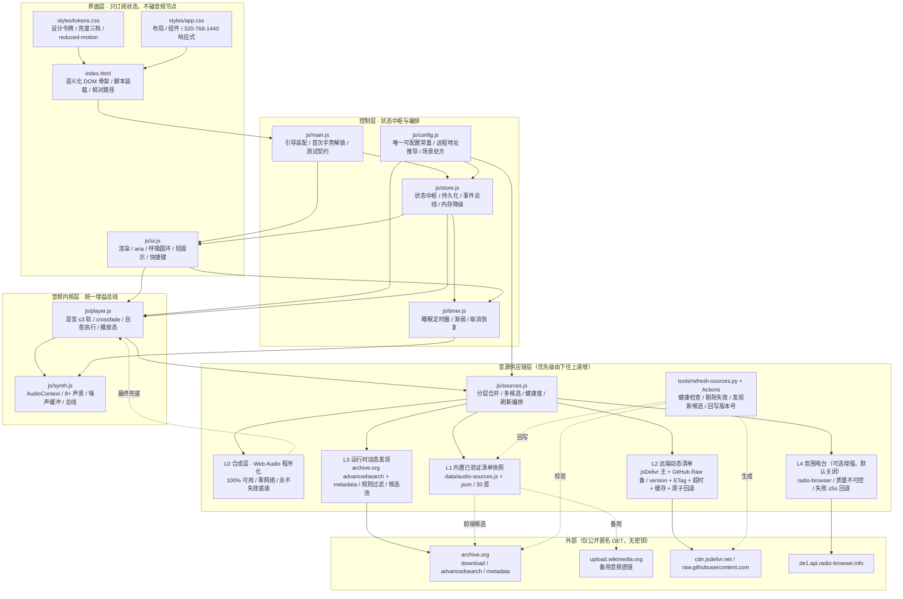
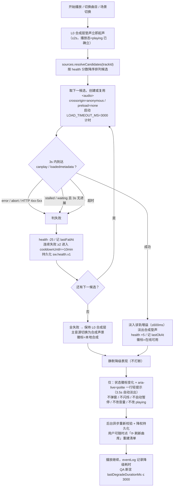
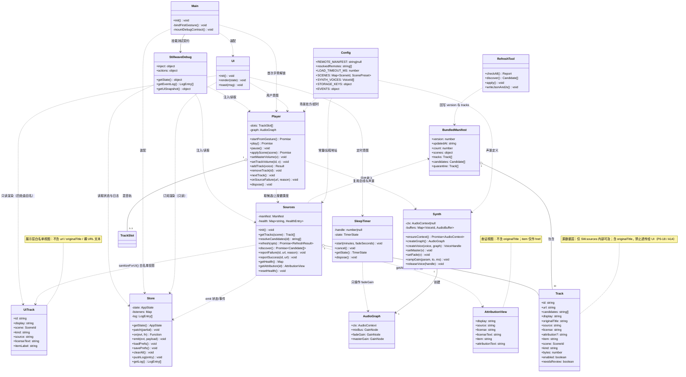
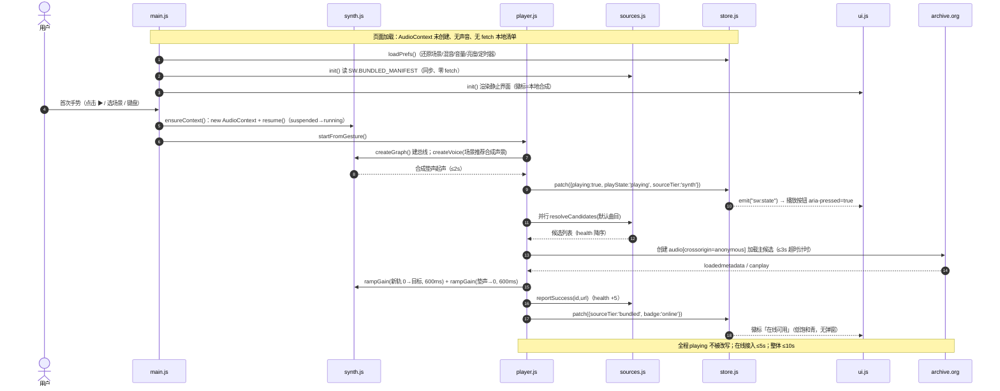
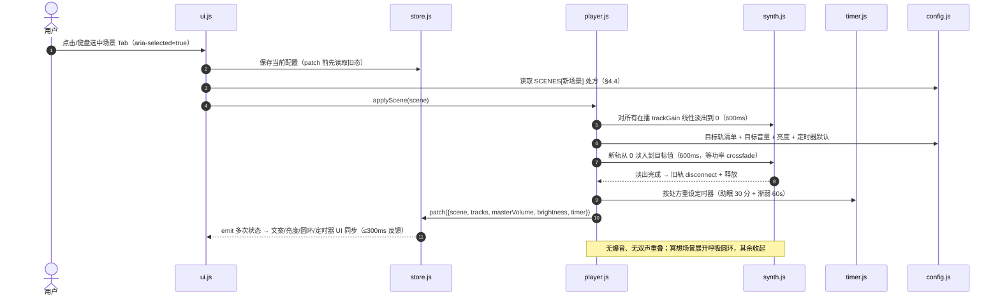
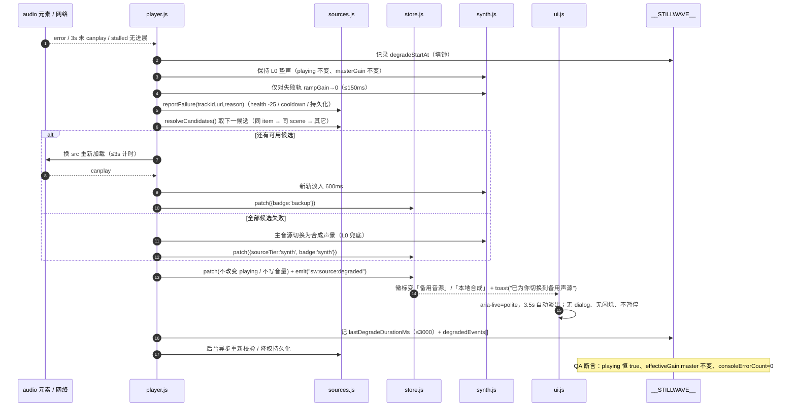
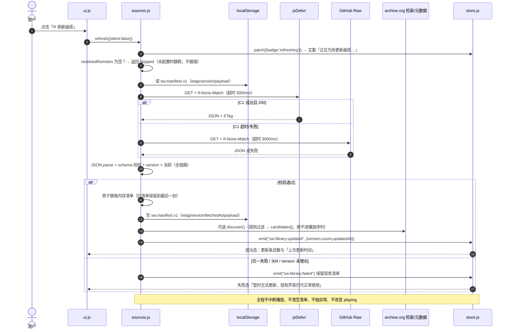
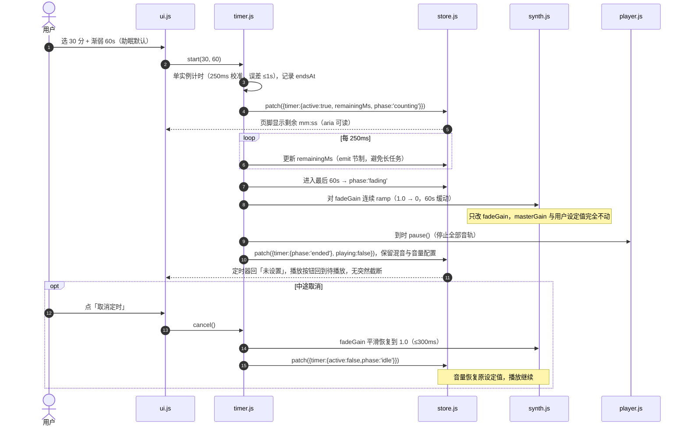
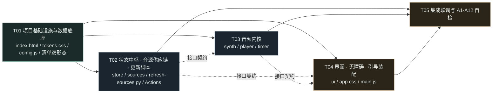

# 静澜 Stillwave · 系统架构设计与任务分解（第 2 阶段）

> 文档类型：系统架构设计（System Design）+ 有序任务分解（Task Breakdown）
> 阶段：第 2 阶段 ｜ 作者：架构师 高见远（Gao） ｜ 日期：2026-11-09 ｜ 语言：简体中文
> 上游输入（已完整通读）：`docs/01-prd.md`（687 行）、`docs/00-audio-sources-research.md`（含 §6 真实 Chrome 播放实测、§7 共享数据与环境事实）、`docs/00-verified-tracks.json`（30 首逐条实测可播）
> 下游消费者：工程师（照本文一次性实现）、QA 工程师（照本文 §4.5 测试契约与 §10 闸门映射做断言）
> 本文边界：**只做架构设计与任务分解**；不写实现代码、不写测试用例、不修改 PRD 与 `00-*` 文档。文中出现的 TypeScript 风格接口、JSON Schema、配置片段、伪代码均为**契约定义**，不是可运行实现。

---

## 0. 阅读指引与硬约束复核

### 0.1 不可违反的硬约束（优先级高于一切默认约定）

| # | 约束 | 来源 | 本文落实位置 |
|---|---|---|---|
| H1 | 纯静态前端，**禁止 Vite / React / MUI / Tailwind / 任何构建步骤 / 任何 npm 运行时依赖** | 用户原始需求 + 交付总监指令 + PRD D1 | §1.2、§7 |
| H2 | 原生 HTML + CSS + JavaScript，零构建、零依赖、**全部相对路径**，直接推 GitHub Pages（含 `/<repo>/` 子路径）即可运行 | 用户 + PRD NFR-01 / D19 / A12 | §1.3、§3、§8 |
| H3 | **兼容 `file://` 双击打开**，P0 功能全部可用、跨源受限时静默降级 | PRD NFR-02 / A4 / D7 | §1.3、§2.3、§2.6、§9 AD-01/AD-02/AD-15 |
| H4 | 必须**真实接入在线音乐**，且必须设计「动态获取 + 持续更新 + 失效自愈」机制；**接入本身已是可直接验收的客观事实**（R-01：风险只在链接日后失效） | 用户第二注 + PRD v1.1 S-01 / S-11 / R-01 / V1 | §2（整章）、§4.3 |
| H5 | 首次交互后才出声；降级不弹窗/不闪烁/不自动暂停/不改播放态 | PRD P0-11 / P0-14 / P0-17 / D13 | §2.6、§5.1、§5.3 |
| H6 | 许可与来源可查：`source` / `license` / `item` + 中文展示名可展开查证；**源数据模型严格按实测 8 字段**，`attribution` 只作派生展示文案、不虚构作者 | 交付总监指令 + PRD v1.1 S-06 / S-11 / P0-10 / P0-16 / A10 | §2.7、§4.1、§9 AD-22 |
| H7 | UI 展示**只能用 `display` 中文名**；`originalTitle` 仅作来源元数据，**在展示层零出现**（播放条 / 混音卡片 / 音源详情 / 分享文案四处） | PRD v1.1 P0-18 / S-12 / D22 / A14 / R-14 + `00` §7 | §2.7、§4.1、§8、§9 AD-06 / AD-21 |
| H8 | 内置清单以 **30 首逐条实测曲目**为准（21 `music` + 9 `nature`；focus 6 / sleep 3 / empty 17 / meditation 4），逐条可播、四场景全覆盖 | 交付总监指令 + PRD v1.1 S-11 / P0-15 / D23 / A13 + `00-verified-tracks.json` | §2.2 L1、§4.1、§9 AD-03 |
| H9 | 所有 API / 链接可用性以 `00-audio-sources-research.md` 实测为准，**不臆造未验证 URL** | 交付总监指令 + PRD S-07 | §2.2、§9 AD-05 |
| H10 | **PRD v1.1 基线**：P0 共 **18 条**（新增 P0-15~P0-18）、A 判据共 **14 条**（新增 A13 / A14）；S-11 / S-12、D22 / D23、R-14 同步生效 | 产品经理 v1.1 增补 + PRD §4 / §8.2 / §9 / §10 | §6 任务验收、§10 映射表、§9 AD-21~AD-25 |

### 0.2 与 PRD 的关系

PRD §9 明确授权「架构师如发现技术上有更优解，可在不违反用户硬约束与 P0 验收标准的前提下调整**实现方式**」，且 PRD §1「本文边界」声明「凡涉及实现的地方，只写必须做到什么，不写怎么实现」。因此：

- **产品结论（是否做、做到什么程度、默认处方的数值与结构）一律以 PRD 为准**，本文 §4.4 的场景处方表与 PRD §3.4 逐项对齐，未改动任何数值。
- **实现方式（模块划分、装载方式、清单双形态、候选构成、总线层级、脚本形态）由本文定稿**。
- 本文 §9 的 AD 系列决策均写明理由，**不向用户 / PM / 主理人提问**，符合用户「所有问题自行研究决定」。

### 0.3 一份必须正面回答的技术矛盾（见 §1.3、§9 AD-01/AD-02）

「ES Modules + `file://` 双击可用」在真实浏览器中**互斥**：Chrome / Firefox 对 `file://` 下的 module script 强制 CORS、`origin=null`，会拦截全部 `import`；同理 `fetch('./data/*.json')` 在本地文件协议下也会被拒。若照字面硬套，A4（双环境）与 NFR-02 必然失败白屏。本文给出不牺牲任何 P0 的解法，这是本次架构最关键的判断之一。

---

## 1. 架构总览与选型理由

### 1.1 一句话架构

> **一个零构建的静态页面，用「单命名空间 + 顺序装载的原生 JS 模块」驱动三层能力：音频内核（Web Audio 统一增益总线 + 合成底座）、音源目录（五层分级 + 自愈 + 持续更新）、界面状态机（场景 / 混音 / 定时 / 亮度 / 无障碍）**；所有网络能力都是「可选增强」，任何一层全挂时，合成层仍能在首次手势后 ≤2s 出声。

架构模式：**分层 + 发布订阅（事件总线）+ 单向状态中枢（Store）**。UI 只订阅 `SW.store` 的状态变更并渲染，不直接操作音频节点；音频内核只通过 Store 读配置、通过事件上报状态，不反向引用 DOM。数据（清单 / 场景处方 / 常量）与代码彻底分离（PRD NFR-12）。

### 1.2 为何放弃框架（并覆盖团队默认技术栈）

| 维度 | 默认栈（Vite + React + MUI + Tailwind） | 本项目（原生三件套） | 结论 |
|---|---|---|---|
| 构建 / 安装 | 必须 `npm install` + `vite build`，产物 `dist/` | **零步骤**，仓库即产物 | A12「从干净仓库直接推 Pages 即可运行」直接否决构建链 |
| `file://` 双击 | 打包产物多为绝对路径 / `type="module"` + `crossorigin`，本地协议下 CORS 与路径双双失败 | 相对路径 + 经典脚本，本地协议零差异 | A4 / NFR-02 否决 |
| 子路径 `/<repo>/` | 需配置 `base`，配错即整站 404 | 全部 `./` 相对引用，天然兼容 | NFR-01 / D19 否决 |
| 体积预算 | 仅 React + ReactDOM + MUI 运行时即远超 300KB（gzip 前） | 11 个运行时文件合计预计 < 120KB，清单约 12KB | NFR-07 / G3 / A7 否决 |
| 依赖寿命 | 框架与插件版本迭代、CI 产物、锁文件会「因工具链过时报废」 | 浏览器原生 API，无第三方 | US-14 / D1 明确要求 |
| 功能适配度 | 混音、包络、定时渐弱本质是命令式 Web Audio 操作，声明式虚拟 DOM 无收益反增抽象 | 直接 `GainNode` / `AudioBufferSourceNode` 建模 | 无收益 |
| 隐私 | 易引入字体 / 统计 CDN | 系统字体栈、零第三方请求 | P0-09 / NFR-10 |

**决策（AD-00）**：全面放弃框架与构建工具链，采用原生 HTML5 + CSS3 + ES2015+ JavaScript。这不是「降级」，而是把「零构建、双环境、<300KB、长期不失效」四个硬约束同时满足的**唯一**方案。

### 1.3 关键技术矛盾与正面解法（务必先读）

#### 矛盾 A：`type="module"` / `import` 与 `file://` 不兼容

实测事实（可复现）：Chrome / Firefox 从 `file://` 页面加载 `<script type="module" src="...">` 时，因 module script 强制 CORS 且文档 `origin` 为 `null`，报 *"Cross origin requests are only supported for protocol schemes: http, data, …"* 并拒绝加载；`import` 链全部中断 → 白屏。这与 A4（双击打开 P0 全通过）直接冲突。

**拍板解法（AD-01）**：采用 **「单命名空间 + 经典 `defer` 脚本顺序装载 + IIFE 模块封装」** 作为唯一运行时装载方式：

- `index.html` 末尾按依赖顺序列出 `<script defer src="./js/xxx.js"></script>`（全部为经典脚本，`defer` 保证 DOM 就绪且顺序执行）。
- 每个 JS 文件是一个严格模式 IIFE，把公开面挂到**唯一全局命名空间 `window.SW`**，不从其它文件 `import`，不产生任何其它全局。
- 源码仍采用 **ES Module 的组织规范与 ES2015+ 语法**：一文件一模块、显式导出面、无隐式全局、`const/let/class/Promise/async/await/Map/可选链`。
- 这些文件本身**不含 `import`/`export` 语句**，因此既可被经典脚本加载，也天然可被 `<script type="module">` 加载（显式 `window.SW` 赋值在两种作用域下行为一致）；部署者若只在 http(s) 下运行，可零改动切换装载方式。

> 说明：保留「模块化」的实质（高内聚、显式接口、零全局污染），放弃的只是浏览器原生 `import` 这一**装载语法**。这是 PRD §9 授权的「调整实现方式」，不触碰任何 P0 验收标准；A4 / NFR-02 / A12 因此全部可过。

#### 矛盾 B：`fetch('./data/audio-sources.json')` 在 `file://` 下同样被拒

**拍板解法（AD-02）**：内置清单提供**两种同源形态**，由 `tools/refresh-sources.py` 一次生成、永不手工维护：

| 形态 | 路径 | 消费者 | 读取方式 |
|---|---|---|---|
| 权威 JSON | `data/audio-sources.json` | 远端 CDN（jsDelivr / GitHub Raw）、刷新脚本、QA 断言、P1-07 详情面板统计 | http(s) 下 `fetch`；工具用 `json.load` |
| 内置快照 JS | `data/audio-sources.js` | **前端运行时（所有环境）** | `<script defer>` 加载后读 `window.SW.BUNDLED_MANIFEST`，**零 fetch** |

前端**永远不 fetch 本地清单**：`data/audio-sources.js` 随页面同步就绪，`file://` 下 100% 可用；`data/audio-sources.json` 只用于「远端动态清单分发」与「工具链」。两文件内容同源，脚本以原子写（临时文件 + `os.replace`）同步产出，避免不一致。

#### 由此确定的三环境行为

| 环境 | 装载 | 内置清单 | 远端清单 / 动态发现 | 在线音频 |
|---|---|---|---|---|
| `https://<user>.github.io/<repo>/`（含子路径） | 相对路径 | ✅ 快照 JS | ✅ 自动推导双 CDN + 发现层 | ✅ archive.org 直链（CORS `*`） |
| `https://` 自定义域 / `localhost` | 相对路径 | ✅ 快照 JS | 仅当 `config.REMOTE_MANIFEST` 显式配置时启用 | ✅ |
| `file://` 双击 | 相对路径 | ✅ 快照 JS | **静默跳过**（fetch 必失败，不发起、不报错、不 console.error） | ⚠️ 跨源受限 → 静默走内置候选；再失败 → 合成层 |

### 1.4 架构原则

1. **合成层优先出声**（F1「先出声、再升级」）：首次手势后合成层 ≤2s 起声，在线音乐异步就绪后 crossfade 接入 ≤5s，绝不「点了没反应」。
2. **网络能力一律可选**：任何 fetch / `<audio>` 跨域失败都降级为内部状态变化，绝不抛出、绝不弹窗、绝不改变播放态。
3. **原子回退**：清单替换、场景切换、候选切换都遵守「新数据全部校验通过才整体替换，否则保留上一份」，绝不出现空清单 / 空声轨。
4. **单一增益总线**：合成层与 `<audio>` 层接入同一 `AudioContext` 的同一条总线，使「分轨音量 × 主音量 × 定时渐弱 × 场景 crossfade」是纯乘法关系、互不干扰。
5. **数据驱动**：曲目、场景处方、超时阈值、CDN 顺序、过滤规则全部在 `config.js` / 清单里，新增音源不改业务逻辑（NFR-12）。
6. **可观测但克制**：内部状态对 QA 完全开放（`window.__STILLWAVE__`），对用户只暴露四态徽标 + 一行轻提示（S-10）。

### 1.5 性能预算的设计保证（NFR-07 / A7）

| 预算项 | 目标 | 架构保证手段 |
|---|---|---|
| 首屏本地资源 | < 300KB（不含在线音频） | 11 个运行时文件预计 < 120KB（HTML ≈ 18KB、CSS ≈ 30KB、JS ≈ 60KB、清单 ≈ 12KB）；**零图片 / 零字体文件 / 零 CDN 脚本**；光晕与圆环全部 CSS/SVG |
| DOMContentLoaded | < 1.5s | `defer` 装载、无同步长任务、首屏不建 AudioContext、不 fetch 本地清单、不预载音频（`preload="none"`） |
| 无长任务 > 100ms | 通过 | 噪声缓冲预生成分配到 `requestIdleCallback` 分片；30 首清单解析为单次 O(n) 小对象；动态发现结果上限 `rows=50` |
| 60 分钟无内存增长 | 通过 | 声轨硬上限 3；`MediaElementAudioSourceNode` 每 `<audio>` 元素仅创建一次并复用；移除轨必须 `disconnect()` + `src=''` + 释放引用；`AudioBuffer` 全局共享不重复分配；事件监听统一 `AbortController`；`__STILLWAVE__` 日志用上限 200 条的环形缓冲；定时器单实例、取消即 `clearInterval`；`requestAnimationFrame` 在暂停时停止 |

---

## 2. 分层架构、动态更新与音源自愈（本阶段核心命题）

### 2.1 分层架构图（Mermaid）



依赖方向严格单向：`UI → Store/编排 → 音频内核 → 音源供应链 → 外部`。`SYNTH` 不引用 `SOURCES`，`SOURCES` 不引用 `PLAYER`，双方仅通过 `SW.store` 事件与冻结接口通信（见 §4.3、§8.2）。

### 2.2 五层定义：触发时机 / 失败边界 / 优先级

> 优先级语义：**L0 是「立即且永远」的底座，L1 是「开箱即用」的默认在线源，L2/L3/L4 是「尽力而为」的增量增强**。上层失败永远向下沉，下沉只改变状态，不改变播放态。

| 层 | 名称 | 触发时机 | 成功产出 | 失败边界（如何处理） | 优先级 |
|---|---|---|---|---|---|
| **L0** | 合成层（Web Audio 程序化） | ① 首次用户手势后**立即**起声（≤2s）；② 在线音源加载期间的「垫声」；③ 任何上层全失败后的最终兜底；④ 叠加声景轨的常驻来源 | 永不失效的合成声（8+ 种，见 §4.3） | **无失败边界**：不依赖网络、不依赖 CORS、不依赖文件加载。这是 S-02 要求的「最终有一层永不失效」 | **P-0 底座（恒在）** |
| **L1** | 内置已验证清单快照（30 首） | 页面装载即同步就绪（`data/audio-sources.js` 随 `defer` 脚本注入，零 fetch）；首次手势后与 L0 并行启动候选解析 | 30 首逐条实测曲目：21 首 `music`（Jamendo CC）+ 9 首 `nature`（aporee），场景分布 focus 6 / sleep 3 / empty 17 / meditation 4 | 单条播放失败 → 切同条其它候选 → 同场景其它曲目 → L0；`file://` 跨源受限 → 静默继续依赖 L0，不报错 | **P-1 默认在线源** |
| **L2** | 远端动态清单（双 CDN） | ① 启动后 **静默后台探测一次**（`requestIdleCallback`，不阻塞首屏）；② 用户点「⟳ 刷新曲库」；③ 距上次成功 > `REMOTE_TTL_MS`（默认 24h）时的后台刷新 | `version` 更高的清单，整体替换内存目录 | 超时 3s / 非 200 / JSON 解析失败 / schema 校验失败 / `version` 不高于当前 / 两个 CDN 都失败 → **保留上一份清单**，`status` 记 `unchanged`，不抛错、不清空、不打断播放 | **P-2 尽力增强** |
| **L3** | 运行时动态发现（archive.org） | 仅在 L2 成功或用户点「刷新曲库」后**异步补充**，且仅在 http(s) 环境（CORS 可用） | 经规则过滤的**候选**（`needsReview:true`），仅进「发现候选池」与 P1-07 详情面板 | 检索 / 元数据任一失败 → 跳过本次；结果**禁止直播未校验条目**（S-05 / D6）：黑名单过滤 + identifier 白名单 + 未通过 HEAD 校验者一律不进播放序列 | **P-3 只补充、不替代** |
| **L4** | 氛围电台（radio-browser） | **默认关闭**（`config.ENABLE_RADIO=false`，D20）；仅用户在设置中显式开启且标注「电台（质量不可控）」后尝试 | 一条可选增强流 | 连接 / 静音 / 广告 / 语音 → ≤5s 回退到 L1/L0；不进入健康度主排序、不持久化 | **P-4 可选，默认不存在** |

**分层要点补充**

- **L1 固化全部 30 首的理由（AD-03）**：`00-verified-tracks.json` 是逐条 HTTP 206 + `audio/*` + CORS 实测结果，且 §6 已用真实 Chrome 确认 `<audio>` 能加载元数据。全部固化可让四场景各自拥有真实在线音乐（PRD §3.4 默认主音源仍是「晨雾」，`换一曲` 与场景候选池从对应 `scene` 取，见 §4.4），并让「多候选回退」有真实可用备选，而非只有 5 首时一挂全挂。分层使用它，不改变 PRD 默认处方的任何数值。
- **L2 双 CDN 的原子回退**：先 jsDelivr，失败（含超时）再 GitHub Raw；任一成功必须走完「`fetch` → `ETag/If-None-Match` 比对 → `JSON.parse` → schema 校验 → `version` 比较」全链路才整体替换；缓存写 `localStorage` 的 `sw.manifest.v1`（含 `etag` / `version` / `fetchedAt` / `payload`）。**缓存本身也是一层兜底**：网络全挂时若本地缓存存在且校验通过，仍按缓存清单工作。
- **L3 的规则过滤（硬性的，S-05 / D6 / P1-08）**：`advancedsearch.php?q=...&fl[]=identifier&rows=50&output=json` → `metadata/{id}` 展开 `files[]` → 过滤条件见 §2.4/§9 AD-10。**任何未通过 HEAD 校验的检索结果绝不作为氛围音乐播放**，只允许以 `candidate` 身份出现在详情面板。
- **L0 / L1 的关系不是「二选一」**：L0 垫声与 L1 在线音源在同一总线上，L1 就绪时 L0 的主音源垫声按 600ms 淡出（叠加声景轨不受影响），实现「先出声、再升级」且无双声重叠（P0-01）。

### 2.3 「未配置远程地址也要完整可用」（子命题 2）

远程清单 URL 在用户推 GitHub 前**必然未知**。设计把这件事收敛到**一处常量 + 一条自动推导链**：

```text
【配置示例 · 非实现代码】
SW.config.REMOTE_MANIFEST = null        // 唯一需要部署者填写的常量；null = 未配置
SW.config.REMOTE_TTL_MS  = 86400000
SW.config.REMOTE_TIMEOUT_MS = 3000
SW.config.REMOTE_BRANCHES = ["main", "master"]
```

推导策略（在 `config.js` 内一次性计算，结果冻结为 `SW.config.resolvedRemotes: string[]`）：

1. **显式配置优先**：`REMOTE_MANIFEST` 非空 → 以它为 jsDelivr 主 URL，并按同 `{user}/{repo}@{branch}/{path}` 自动派生 GitHub Raw 备用 URL。
2. **否则自动推导**：若 `location.hostname` 匹配 `<user>.github.io` 且 `location.pathname` 第一段非空 → 取 `user` 与 `repo`，为 `main` / `master` 两个分支各生成 jsDelivr 与 GitHub Raw 两个 URL（共 ≤4 个候选），逐个短超时探测；**探测失败静默忽略**。
3. **否则（`file://` / `localhost` / 自定义域未配置）→ `resolvedRemotes = []`，完全跳过 L2/L3**。

**可用性保证（不可协商）**：

| 场景 | 系统行为 |
|---|---|
| 未配置 + 非 github.io | 只用 L1 内置 30 首 + L0 合成；**功能 100% 完整**，无空白页、无报错、无「未配置」提示 |
| 未配置 + `file://` | 同上，且连 L2/L3 请求都不发起（避免 `file://` CORS 噪声，A6 控制台清洁） |
| 配置了但全挂 | 保留 L1 + 缓存清单；「刷新曲库」返回 `失败` 态，文案「暂时无法更新，现有声音仍可正常使用」（F6 / P0-13） |
| 推 GitHub 后 | **无需改前端代码**：自动推导生效；若想精确控制，只填 `REMOTE_MANIFEST` 一处常量 |
| 部署目录 | 站点根目录 `meditation/`；Pages 源选该目录即可。若用户希望以仓库根为源，把 `meditation/` 内文件整体上移一级，**所有相对路径不变**（零构建的收益） |

> 这正是 §7 上游事实「远程清单地址部署前未知，必须允许未配置时依然完整可用」的落地：`REMOTE_MANIFEST` 是**唯一**可配置点，且缺省值为「完整可用」。

### 2.4 持续更新机制（子命题 3）：仓库内脚本 + Actions + 前端消费

#### 2.4.1 `tools/refresh-sources.py`（仅 Python 标准库）

**职责**：探测 30 首链接 → 剔除/隔离失效项 → 从 archive.org 发现并校验新候选 → 回写 `data/audio-sources.json` + `version` + `updatedAt` → 同步生成 `data/audio-sources.js` → 输出机器可读报告供 QA 断言。

**探测规则（判定表）**

| 步骤 | 请求 | 通过条件 | 不通过处理 |
|---|---|---|---|
| 1 | `HEAD`（超时 8s，重试 1 次） | HTTP 200/206 | 改用 `GET` + `Range: bytes=0-1023` 复核 |
| 2 | `Range` 复核 | HTTP 200/206，且 `Content-Type` ∈ `audio/mpeg\|audio/ogg\|audio/mp4\|application/ogg` | 标记 `health=dead` |
| 3 | CORS 校验 | 响应含 `Access-Control-Allow-Origin`（`*` 或匹配） | 标记 `cors=false`，**不得进入 Web Audio 增益链路**（S-08；借鉴 Mixkit 教训） |
| 4 | 体积校验 | `Content-Range`/`Content-Length` 与清单 `bytes` 容差 ±5%（或仅记录偏差） | 记 `sizeMismatch` 警告，不删除 |
| 5 | 汇总 | 并发 6、单条总耗时上限 12s | 任一异常均不外抛，写入报告 |

**失效项处理（保证「更新失败不清空现有清单」）**

- 失败条目**不直接删除**：标记 `health:"dead"` 并移入 `quarantine[]`（保留可恢复），`tracks[]` 中该条置 `enabled:false`；连续 3 次失败或显式 `--prune` 才移除。
- 因此前端拿到的清单**始终 ≥ 上一版的可用子集 + L0 兜底**，绝无空清单。
- 报告含 `alive / dead / quarantined / promoted / versionBefore / versionAfter`。

**发现新候选（S-05 / D6 的规则过滤，禁止直播未校验结果）**

```text
【流程示意 · 伪代码，非实现】
advancedsearch.php
  q = "title:(ambient OR drone OR meditation OR soundscape) AND mediatype:audio
       AND -collection:podcasts AND -collection:audio_bookspoetry"
  fl[]=identifier, rows=50, output=json
→ metadata/{identifier} 展开 files[]
→ 逐条规则过滤：
    · 扩展名 ∈ {.mp3, .ogg, .m4a}
    · 体积 ∈ [0.5MB, 20MB]
    · identifier 前缀 ∈ {jamendo-, aporee_}（对齐已实测源，AD-05 不臆造新域）
    · 标题黑名单（大小写不敏感）：talk|lecture|dhamma|sermon|podcast|speech|guided|
      interview|radio|news|口播|讲座|播客|导词
    · 标题/元数据含电话号码、长地区串等杂质 → 剔除（对应 H7）
    · display 由清洗后的短名生成；无把握者标 needsReview=true 且 display="待审定"
→ 对通过者执行与 30 首相同的 HEAD/Range/CORS 校验
→ 写入 candidates[]，字段 verified=false / needsReview=true
→ 只有显式 --promote <id>（人工或 QA 确认）才升入 tracks[]
```

> **硬边界**：`candidates[]` 里的条目**永不进入前端播放序列**，只在 P1-07「音源详情面板」以「发现的候选（待校验）」列出。这与 PRD D6、S-05、P1-08 完全一致。

**回写与版本号**

- `version` 整数递增（`+1`），`updatedAt` 写 ISO 8601 UTC，同时更新 `count` 与 `scenes` 分布统计。
- 写 `data/audio-sources.json`：`ensure_ascii=False`、缩进 2、按 `scene` + `display` 稳定排序（保证 diff 可读、NFR-12）。
- 由同一份对象生成 `data/audio-sources.js`（一行包装：`window.SW = window.SW || {}; window.SW.BUNDLED_MANIFEST = {...};`），**两文件同源**。
- 全部采用「临时文件 + `os.replace`」原子写；中途异常不破坏上一版。

**QA 可实际运行验证（命令示例，非实现）**

```text
python3.9 tools/refresh-sources.py --offline --dry-run --json-report /tmp/report.json
  # 零联网：仅做 schema 校验 + .js 再生成 + 报告输出，QA 断言退出码 0、report.count==30
python3.9 tools/refresh-sources.py --check-only --json-report /tmp/health.json
  # 真实探测 30 首，断言 alive 数、dead 列表、cors 字段
python3.9 tools/refresh-sources.py --discover --max-new 10 --dry-run
  # 断言 candidates 全部 needsReview=true 且没有任何条目进入 tracks
python3.9 tools/refresh-sources.py --fail-inject "<url>=404" --check-only
  # 注入单个失效，断言该条进 quarantine 且 tracks 未被清空
python3.9 tools/refresh-sources.py --apply
  # 回写；断言 version 递增且 .json/.js 两文件内容一致
```

退出码约定：`0` 成功（含 `--dry-run`）、`2` schema 校验失败、`3` 网络全失败但**保留原文件**、`4` 参数错误。报告字段固定，供 QA 直接断言（见 §10 A7 / A10 / A12 映射）。环境用上游 §7 已确认的 `/opt/homebrew/opt/python@3.9/bin/python3.9`，**无需安装任何包**。

#### 2.4.2 `.github/workflows/refresh-sources.yml`

- 触发：每周一 03:00 UTC 定时 + `workflow_dispatch` 手动。
- 步骤：`actions/checkout` → 系统 Python 运行 `--check-only` → 有变更时 `--apply` → 若 `git diff` 非空则提交 `data/*` 并 push。
- 提交使用平台自带 `GITHUB_TOKEN`（**运维期凭据，不在前端代码中，不违反 NFR-03「代码里不存在任何凭据常量」与 P0-07「全站网络请求均为公开匿名 GET」**；见 AD-09）。
- 推送后 jsDelivr / GitHub Raw 自动可见新 `version`，前端下次静默探测或用户点「刷新曲库」即消费。**未部署 Actions 的 fork 也完全可用**（L1 + L0）。

#### 2.4.3 前端如何消费

```text
【消费顺序 · 伪代码示意】
启动 → 载入 SW.BUNDLED_MANIFEST（L1，同步就绪）
     → requestIdleCallback: sources.refresh({silent:true})
         ├─ resolvedRemotes 为空 → 直接 return {status:"skipped"}，不发起任何请求
         ├─ 有缓存且 ETag 命中 → 用缓存
         ├─ jsDelivr → GitHub Raw（各自 REMOTE_TIMEOUT_MS=3000）
         └─ 全链路校验通过且 version > 当前 → 原子替换 + 写 localStorage + emit("sw:library:updated")
     → L3 发现仅作为 candidates 追加，不触碰当前播放
用户点「⟳」→ sources.refresh({silent:false}) → UI 三态（进行中/成功/失败）
```

### 2.5 音源自愈流程图（Mermaid）



### 2.6 自愈链路细则（子命题 4）

#### 2.6.1 多候选 URL 的构成（AD-05：不臆造未验证链接）

每条在线音源的 `candidates[]` 由**已实测数据**构成，而不是编造镜像域名：

| 序 | 候选来源 | 说明 |
|---|---|---|
| 1 | 清单 `track.url`（archive.org `download/{id}/{file}.mp3`，实测 206 + `audio/mpeg` + CORS `*`） | 主源 |
| 2 | 同一 `item` 下的其它已验证音频文件（若清单中存在同 identifier 的多条记录） | 天然备选 |
| 3 | **同一 `scene` 的其它已验证曲目**（按 health 分数降序） | 语义上是「备用音源 / 换一曲」，最稳的兜底；30 首清单让这一层真实可用 |
| 4 | `upload.wikimedia.org` 备用直链（**仅当清单中显式登记了实测通过的备用 URL 才启用**；本次 30 首未登记，故默认不启用，避免臆造） | 备用源位（S-07 允许的备用层） |
| 5 | **L0 合成层** | 最终、永不失效 |

> 明确禁止：把 L3 动态发现的未校验结果、SomaFM、Google 声音库失效路径、Wikimedia Commons 查询 API 塞进候选链（PRD S-07）。Mixkit 类无 ACAO 资源**不得接入 Web Audio 增益链路**（S-08）。

#### 2.6.2 探测与超时

- 加载超时 `LOAD_TIMEOUT_MS = 3000`（`config.js` 可配；QA 可注入更小值加速验证，见 §4.5）。
- 监听事件：`loadstart` / `loadedmetadata` / `canplay` / `playing` / `error` / `stalled` / `waiting` / `abort` / `ended`。
- 失败判定：3s 内未到 `canplay` 或 `loadedmetadata`；或触发 `error`/`abort`；或 `stalled`/`waiting` 后 3s 内 `readyState` 无进展。
- **计时口径（供 QA 断言）**：`lastDegradeDurationMs` = 从「检测到故障的墙钟时刻」到「新声源 `canplay` 或 L0 合成垫声确认起声」的毫秒数，必须 ≤3000（P0-06）。

#### 2.6.3 健康度打分与降权持久化

```text
【状态结构 · 契约定义，非实现】
HealthEntry = {
  score: 0..100,          // 初始 100；成功 +5（上限 100）；失败 -25（下限 0）
  ok: number, fail: number,
  lastOkAt: ISO8601|null, lastFailAt: ISO8601|null,
  consecutiveFail: number,
  cooldownUntil: number|null   // 连续失败 ≥2 时 = Date.now() + 600000
}
持久化键：sw.health.v1（localStorage 不可用时退化到内存 Map，静默）
```

- 候选排序：`score` 降序 → `cooldownUntil` 未到期者排最后 → 同分按清单稳定顺序。
- 降权**跨会话生效**：刷新页面后仍优先选健康条目，避免反复撞死链。
- 「清除本地设置」同时清 `sw.health.v1`，恢复出厂排序。

#### 2.6.4 降级时的「不打断」硬约束（P0-14 / D13）

| 必须保持 | 实现方式 |
|---|---|
| **不改变播放态** | `SW.store.state.playing` 在整条自愈链路中**不被写入**；L0 垫声始终在响，无静音间隙 |
| **不自动暂停** | 自愈模块无 `pause()` 调用权限 |
| **不改音量** | `masterGain` / `trackGain` 用户设定值不写；候选切换只对「正在失败的轨」做 ≤150ms 淡出 + 新轨 ≤600ms 淡入 |
| **不弹窗 / 不闪烁** | 全站无 `alert` / `dialog` / `confirm`；徽标只换文字与低饱和色（青→琥珀→灰蓝），过渡 ≥600ms；轻提示 `aria-live="polite"`，3.5s 自动淡出 |
| **不改文案口吻** | 用「已为你切换到备用声源」/「当前使用本地合成声，随时可刷新曲库」，禁用「错误 / 失败 / 无法加载」等字样（S-10） |
| **控制台清洁** | 异常在模块内吞掉并转事件；生产模式零 `console.error`，仅 `?debug=1` 下允许 `console.warn`（A6） |

#### 2.6.5 场景切换的平滑过渡（P0-01、另一处关键设计）

统一增益总线（详见 §4.4）：

```text
trackGain（分轨音量）
   └→ mixBus（叠加混合）
        └→ fadeGain（睡眠定时器渐弱专用，默认 1.0）
             └→ masterGain（用户主音量 0..1）
                  └→ AudioContext.destination
```

- **场景切换**：所有在播轨 `trackGain.linearRampToValueAtTime(0, now + 0.6)`，新处方轨从 0 同步 ramp 到目标值，**等功率 crossfade ≥600ms**；旧轨在淡出完成后才 `disconnect()` 释放，避免爆音与双声重叠。
- **三者互不干扰**：用户主音量（`masterGain`）、定时渐弱（`fadeGain`）、场景 crossfade（`trackGain`）在不同节点上，是纯乘法关系；取消定时器只恢复 `fadeGain`，不碰用户设定值（P0-05）。
- **合成层与 `<audio>` 层共用同一总线**：合成声景用 `GainNode`，在线音源用 `MediaElementAudioSourceNode`，二者都接 `mixBus`，因此 crossfade / 渐弱 / 主音量对所有轨一致生效。
- `<audio>` 元素必须带 `crossorigin="anonymous"` 才能进 Web Audio；**仅对清单中已实测带 ACAO 的 URL 设置**（S-08）。

### 2.7 许可、署名与展示（子命题 6 / H6 / H7 · 按 PRD v1.1 修订）

**字段分层（本次 v1.1 修订的核心，AD-21 / AD-22）**：把「源数据层」「UI 展示层」「查证视图层」三者在数据层就分开，而不是靠 UI 自觉不渲染。

| 层 | 允许字段 | 说明 |
|---|---|---|
| **源数据层**（权威 JSON / 内置快照） | 实测 8 字段：`url` / `bytes` / `scene` / `display` / `originalTitle` / `license` / `item` / `source` / `kind` + 审计字段 `id` / `candidates` / `enabled` / `needsReview` / `health` / `cors` | `originalTitle` **只存在于此层**，用于溯源与许可查证（S-11 / R-14 保留要求）；`attribution` **非实测字段、非必填**，仅允许作为可选派生列存在 |
| **UI 展示层**（`UiTrack`） | `id` / `display` / `scene` / `kind` / `source` / `licenseText` / `itemLabel` | 由 `SW.sources.sanitizeForUI()` **白名单投影**产出；**不含 `url`、不含 `originalTitle`、不含任何原始 URL 文本**（S-10）。UI 模块在架构上拿不到原始标题，从根上杜绝 A14 泄露 |
| **查证视图层**（`AttributionView`） | `display` / `source` / `license` / `licenseText` / `item` / `itemLabel` / `attributionText` / `kind` | 「音源信息」展开区与 `__STILLWAVE__.getAttribution(id)` 的返回类型；**同样不含 `originalTitle`** |

- **`attribution` 双口径裁决（AD-22）**：交付总监要求「schema 含 `source`/`license`/`attribution`/`item` 且 UI 可展开查证」，PM v1.1 明确「实测数据没有 `attribution` 字段、按真实字段建数据模型」。裁决：**源数据模型严格照实测，不新增必填列、不虚构作者**；`attribution` 定义为「可选派生列 / 展示视图字段」，由 `display` + `source` + `license` 运行时组装（如「晨雾 · Internet Archive (Jamendo CC) · CC BY-NC-ND 3.0」）。查证能力由 `AttributionView` 提供，两方要求同时满足。
- **CC 许可本地化（P0-16）**：`license` 实测含 `CC (see item page)`、`by/3.0`、`by-nc-nd/3.0`、`by-sa/3.0`、`by-nc-sa/3.0` 等。前端 `licenseText` 统一映射为简体中文（如「CC 署名 3.0」「CC 署名-非商业-禁止演绎 3.0」「CC 署名-相同方式共享 3.0」「CC 署名-非商业-相同方式共享 3.0」「CC 授权，详见来源页」），**展示层不显示裸 URL / 错误码 / 堆栈**（S-10）；`item` 以「查看原始条目页 ↗」文字链接呈现（`href` 指向 `item`），可点击且可访问。
- **`originalTitle` 零泄露（P0-18 / S-12 / D22 / A14 / R-14）**：绝不渲染到播放条、混音卡片、音源详情、分享文案，也不写入 `aria-label` / `title` / `alt` / toast / 徽标 / 页面 `<title>` / `console` 用户态输出；`__STILLWAVE__` 亦不返回该字段（A14 检索对象为**渲染后 DOM 可见文本 + 四处曲目名**，数据源文件属元数据、不在展示层检索范围，QA 口径见 §4.5）。署名查证通过 `display` + `source` + `license` + `item` 链接完成，**不依赖渲染原始标题**。
- **9 首 `nature` 真实录音（A13）**：aporee soundmap 的 9 条 `kind:"nature"` 记录同样走 `<audio>` 真实在线播放，**不是合成声**；曲库规模、四场景分布与 `byKind` 统计须在 P1-07 音源详情面板可见（P0-15）。
- 页脚保留独立「音源许可与署名」区块，列出 Jamendo CC / aporee soundmap / Internet Archive 说明（D16）。

---

## 3. 完整文件清单表

> **所有路径相对站点根目录 `meditation/`**（团队文档 `docs/` 与站点目录同级，不参与部署）。共 15 个文件，其中**运行时源文件 11 个**（HTML 1 + CSS 2 + JS 8），满足「≤12 个源文件为宜」；另数据 2 个、工具/CI 2 个。全部为纯静态资源，**零构建、零 npm 依赖、无 `node_modules`**。

| # | 路径 | 类型 | 职责 | 依赖（方向） | 任务 |
|---|---|---|---|---|---|
| 1 | `index.html` | HTML | 唯一入口；语义化 DOM 骨架（顶栏/场景/主视觉/播放条/混音区/定时器/页脚 7 分区）；全部 `aria-*` 与 `role`；**按依赖顺序 `defer` 装载 9 个脚本**；全部 `./` 相对路径；无内联脚本逻辑 | 被所有 JS 读取 DOM | T01 / T05 |
| 2 | `styles/tokens.css` | CSS | 设计令牌：配色（PRD §5.5）、间距、字号、`--dur` 动效时长、亮度三档 `data-brightness` 变量、`prefers-reduced-motion` 归零、焦点环 | 无 | T01 |
| 3 | `styles/app.css` | CSS | 布局 / 组件 / 320-768-1440 三档响应式 / 触控 ≥44px / 徽标与轻提示 / 呼吸圆环 / 光晕 / 动效缓动 | 依赖 tokens.css | T04 |
| 4 | `js/config.js` | JS | **唯一可配置常量**：`REMOTE_MANIFEST` + 自动推导、CDN 顺序、全部超时阈值、场景处方表（§4.4）、8+ 声景定义、L3 过滤黑白名单、storage 键名、事件名常量 | 无（最先装载） | T01 |
| 5 | `data/audio-sources.json` | 数据 | **权威清单**：`version` / `updatedAt` / `count` / `scenes` / `tracks[30]` / `candidates[]` / `quarantine[]`；供远端 CDN 分发、脚本回写、QA 断言 | 与 #6 同源 | T01 |
| 6 | `data/audio-sources.js` | 数据 | 内置快照的 script-loadable 形态：`window.SW.BUNDLED_MANIFEST = {...}`；前端**唯一**的内置清单读取来源（零 fetch，`file://` 可用） | 由 #5 生成 | T01 |
| 7 | `js/store.js` | JS | 状态中枢（唯一真源）+ 事件总线 `on/off/emit` + `localStorage` 持久化（3 个键、可用性探测、内存降级）+ 状态机迁移 + 事件日志环形缓冲 | 依赖 config | T02 |
| 8 | `js/sources.js` | JS | 音源目录：L1 载入 / L2 双 CDN + ETag + 超时 + 缓存 + 原子回退 / L3 动态发现 + 规则过滤 / L4 电台开关 / 多候选解析 / 健康度打分与降权 / `refresh()` 编排 / 许可元数据查询 | 依赖 config、store | T02 |
| 9 | `tools/refresh-sources.py` | 工具 | 健康检查脚本（仅标准库）：HEAD/Range + content-type + CORS 探测、隔离失效项、发现并校验新候选、回写 JSON + version、生成 #6、输出 QA 报告 | 读写 #5/#6 | T02 |
| 10 | `.github/workflows/refresh-sources.yml` | CI | 每周定时 + 手动触发，运行脚本并在有变更时提交 `data/*`（平台 `GITHUB_TOKEN`，非前端凭据） | 调用 #9 | T02 |
| 11 | `js/synth.js` | JS | 音频内核：懒创建 `AudioContext`、构建统一增益总线、8+ 种程序化声景发生器、噪声缓冲生成与循环接缝处理、`createGraph()/createVoice()/setGain()` | 依赖 config | T03 |
| 12 | `js/player.js` | JS | 播放引擎：播放态机、≤3 轨混音（audio + synth）、分轨/主音量、crossfade 场景切换、**自愈链路执行**、换一曲、资源释放、首次手势后的「先出声再升级」编排 | 依赖 store、synth、sources、config | T03 |
| 13 | `js/timer.js` | JS | 睡眠定时器（15/30/45/60/90/自定义）、渐弱（关/30/60/120s）、`fadeGain` 连续下降、到时停止、取消恢复原音量、剩余时间广播、单实例 | 依赖 store、synth(fadeGain) | T03 |
| 14 | `js/ui.js` | JS | DOM 绑定与渲染：场景 Tab、播放条、混音卡片、定时器、亮度、音源信息展开、P1-01 呼吸圆环、P1-07 详情面板、P1-03 自动漂移开关、徽标/轻提示、P1-06 快捷键、全部 aria 同步 | 依赖 store 事件（不直接碰音频节点） | T04 |
| 15 | `js/main.js` | JS | 引导装配（init 顺序）、首次用户手势解锁 AudioContext、`visibilitychange` 恢复提示、挂载 **`window.__STILLWAVE__` 测试契约**、`?debug=1` 注入开关 | 依赖全部模块 | T04 / T05 |

**装载顺序（写死在 `index.html`，`defer` 保证顺序）**：
`config.js` → `data/audio-sources.js` → `store.js` → `sources.js` → `synth.js` → `player.js` → `timer.js` → `ui.js` → `main.js`。

**目录树（示意）**

```text
meditation/
├── index.html
├── styles/{tokens.css, app.css}
├── js/{config.js, store.js, sources.js, synth.js, player.js, timer.js, ui.js, main.js}
├── data/{audio-sources.json, audio-sources.js}
├── tools/refresh-sources.py
└── .github/workflows/refresh-sources.yml
```

**依赖方向约束（工程师必须遵守）**：`ui.js` 不得 `import`/调用 `synth.js` 内部节点；`sources.js` 不得引用 `player.js`；跨层只经 `SW.store.emit/on` 与 §4.3 冻结接口；**任何文件不得出现以 `/` 开头的绝对资源路径**（NFR-01 / D19）。

---

## 4. 数据结构与接口定义

> 以下为**契约**，用 TypeScript 风格接口 / JSDoc 描述；实现仍为原生 ES2015+ JS（IIFE + `window.SW` 命名空间），不含 `import`/`export`。

### 4.1 清单 JSON Schema（`data/audio-sources.json`）

```jsonc
// 【Schema 示例 · 数据结构定义，非实现代码】
{
  "schema": "stillwave-audio-manifest/v1",
  "version": 1,                          // 整数，每次 --apply 递增
  "updatedAt": "2026-11-09T15:40:00Z",  // ISO 8601 UTC
  "verifiedAt": "2026-11-09",
  "count": 30,
  "scenes": { "focus": 6, "sleep": 3, "empty": 17, "meditation": 4 },
  "tracks": [
    {
      "id": "jamendo-122281",            // 稳定标识 = item 末段，健康度主键
      "url": "https://archive.org/download/jamendo-122281/01-1038385-Ambient%20Sounddesign-Morning%20Fog.mp3",
      "candidates": [ "https://archive.org/download/jamendo-122281/01-1038385-Ambient%20Sounddesign-Morning%20Fog.mp3" ],
      "bytes": 7748351,
      "scene": "focus",
      "kind": "music",                   // music | nature
      "display": "晨雾",                 // ★ 唯一可展示名（简体中文）
      "originalTitle": "Morning Fog",    // ★ 仅来源元数据，禁止暴露给用户
      "license": "CC，详见来源页",        // 或完整 CC URL
      "attribution": "晨雾 · Internet Archive (Jamendo CC) · CC，详见来源页",  // ⭕ 可选派生列（AD-22）：非实测字段、非必填，由 display+source+license 组装，严禁虚构作者
      "item": "https://archive.org/details/jamendo-122281",
      "source": "Internet Archive (Jamendo CC)",
      "enabled": true,
      "needsReview": false,
      "health": "alive",                // alive | dead | unknown（由脚本维护）
      "cors": true                      // 是否可进 Web Audio 增益链路
    }
    // …共 30 条：8 个实测字段原样照抄 00-verified-tracks.json，另补审计字段与可选派生列
  ],
  "candidates": [],   // L3 动态发现结果：verified=false / needsReview=true，永不进播放序列
  "quarantine": []    // 失效隔离区，保留可恢复信息
}
```

**字段约束表**

| 字段 | 必填 | 约束 / 语义 |
|---|---|---|
| `schema` / `version` / `updatedAt` | ✅ | 前端用 `version` 比较决定原子替换；`updatedAt` 供「上次更新时间」展示（P0-13） |
| `tracks[].id` | ✅ | 稳定唯一，健康度与降权的主键 |
| `tracks[].url` / `candidates[]` | ✅ | 只填 `00` 文件实测通过的 HTTPS URL；`candidates[0] === url` |
| `tracks[].display` | ✅ | 简体中文、无地名/电话杂质；**UI 唯一可读曲名**（H7） |
| `tracks[].originalTitle` | 元数据（仅权威 JSON） | **只保存在 `data/audio-sources.json` 供溯源/许可查证**；经 `sanitizeForUI()` 白名单投影后，UI 可及视图中**不存在该字段**（AD-21 / P0-18 / A14 / R-14 保留要求） |
| `tracks[].source` / `license` / `item` | ✅ | **实测字段**，许可查证三件套（S-06 / S-11 / P0-10 / P0-16 / A10）；`license` 缺失回填「CC，详见来源页」，CC 类型本地化见 §2.7 |
| `tracks[].attribution` | ⭕ 可选派生 | **非实测字段、非必填**：由 `display` + `source` + `license` 组装的署名文案，可由脚本 `--apply` 预生成或前端运行时派生；**严禁虚构作者**（AD-22）。UI 查证统一走 `AttributionView` |
| `tracks[].scene` | ✅ | `focus\|sleep\|empty\|meditation`，分布 6 / 3 / 17 / 4（P0-15 / A13） |
| `tracks[].kind` | ✅ | `music`(21) / `nature`(9)；**9 首 nature 为真实野外录音，走 `<audio>` 在线播放而非合成声**（A13） |
| `tracks[].enabled` / `needsReview` / `health` / `cors` | ✅ | 供应链审计字段，前端按 `enabled && !needsReview && health!=="dead"` 过滤 |
| `candidates[]` / `quarantine[]` | ✅（可空） | 只进详情面板，**禁止直播**（S-05） |

**字段隔离契约（P0-18 / A14 的架构保证，见 §4.3）**：`SW.sources` 是**唯一**允许接触 `originalTitle` 的模块；它对外只暴露 `UiTrack` 与 `AttributionView` 两种白名单视图。`ui.js` 只接收 `UiTrack`，`player.js` 需要播放 URL 时通过 `resolveCandidates(id)` 单独取，**不把完整 `Track` 对象传给 UI**。任何渲染函数、模板字符串、aria 属性、toast、页面标题、`__STILLWAVE__` 用户态文案都不得拼接源数据对象。

### 4.2 内置快照形态（`data/audio-sources.js`）

```text
【生成物形态 · 示意】
window.SW = window.SW || {};
window.SW.BUNDLED_MANIFEST = { /* 与 audio-sources.json 完全相同的对象字面量 */ };
```
由 `refresh-sources.py` 从 JSON 一次生成；前端同步可读，**不发起任何本地 fetch**（AD-02）。

### 4.3 核心模块 API（冻结接口）

```typescript
// ===== 全局命名空间 =====
interface SWGlobal {
  config: typeof Config;
  BUNDLED_MANIFEST: Manifest;
  store: Store;
  sources: Sources;
  synth: Synth;
  player: Player;
  timer: SleepTimer;
  ui: UI;
  main: Main;
}

// ===== config.js =====
interface Config {
  readonly REMOTE_MANIFEST: string | null;   // 唯一可配置常量；null=未配置
  readonly resolvedRemotes: readonly string[]; // 自动推导结果，可能为空
  readonly REMOTE_TIMEOUT_MS: 3000;
  readonly REMOTE_TTL_MS: 86400000;
  readonly LOAD_TIMEOUT_MS: 3000;           // 音源加载超时（P0-06 ≤3s）
  readonly RADIO_TIMEOUT_MS: 5000;
  readonly CROSSFADE_MS: 600;
  readonly MAX_TRACKS: 3;
  readonly COOLDOWN_MS: 600000;
  readonly ENABLE_RADIO: false;             // 默认关闭（D20）
  readonly ENABLE_DISCOVERY: true;          // 仅候选，禁止直播
  readonly SCENES: Record<SceneId, ScenePreset>;  // §4.4
  readonly SYNTH_VOICES: readonly VoiceId[];     // ≥8 种
  readonly FILTER_BLACKLIST: readonly RegExp[]; // L3 规则过滤
  readonly STORAGE_KEYS: { prefs:'sw.prefs.v1'; health:'sw.health.v1'; manifest:'sw.manifest.v1' };
  readonly EVENTS: Record<string, string>;       // §8.3 事件名常量
}

type SceneId = 'focus' | 'sleep' | 'empty' | 'meditation';
type Tier    = 'synth' | 'bundled' | 'remote' | 'discovery' | 'radio';
type Badge   = 'online' | 'backup' | 'synth' | 'refreshing';
type VoiceId = 'white'|'pink'|'brown'|'rain'|'stream'|'wind'|'waves'|'bowl'|'fire'|'forest';

// ===== store.js =====
interface Store {
  getState(): Readonly<AppState>;              // 唯一真源快照
  patch(partial: Partial<AppState>): void;     // 唯一写入口，内部 emit("sw:state")
  on(event: string, handler: Function): () => void;  // 返回取消订阅
  off(event: string, handler: Function): void;
  emit(event: string, payload?: unknown): void;
  loadPrefs(): void;                          // localStorage 不可用 → 内存 Map，静默
  savePrefs(): void;
  clearAll(): void;                           // 「清除本地设置」→ 恢复出厂
  pushLog(entry: LogEntry): void;             // 环形缓冲，上限 200
  getLog(): readonly LogEntry[];
}
interface AppState {
  playing: boolean; playState: 'idle'|'starting'|'playing'|'paused'|'stopped';
  scene: SceneId; masterVolume: number;      // 0..1
  tracks: readonly TrackSlot[];              // ≤3
  sourceTier: Tier; badge: Badge;
  manifest: { version:number; updatedAt:string; count:number; source:'bundled'|'cache'|'remote' };
  brightness: 'normal'|'dark'|'extreme';
  timer: TimerState;
  autoDrift: boolean; breath: 'off'|'4-4'|'4-7-8';
  reducedMotion: boolean; debug: boolean;
}
interface TrackSlot { id:string; kind:'audio'|'synth'; voice?:VoiceId; trackId?:string; volume:number; display:string; }

// ===== sources.js =====
interface Sources {
  init(): void;                                        // 载入 BUNDLED_MANIFEST → 应用 health → 就绪
  getManifest(): Readonly<Manifest>;                   // 仅 sources 内部 / 工具侧使用，禁止透传给 UI
  getTracks(scene?: SceneId): readonly UiTrack[];      // ★ 一律返回白名单视图；enabled && !needsReview && health!=="dead"
  resolveCandidates(trackId: string): readonly string[]; // player 取播放 URL 的唯一入口（按 health 降序，§2.6.1）
  sanitizeForUI(track: Track): UiTrack;                // ★ 白名单投影：剥离 originalTitle / url / 技术字段（AD-21）
  refresh(opts: { silent:boolean }): Promise<RefreshResult>; // 双 CDN + ETag + 原子回退 + L3 补充
  discover(): Promise<readonly Candidate[]>;           // 规则过滤，结果只进 candidates[]
  reportFailure(trackId: string, url: string, reason: string): void; // health -25 / cooldown
  reportSuccess(trackId: string, url: string): void;   // health +5
  getHealth(): Readonly<Record<string, HealthEntry>>;
  getAttribution(trackId: string): AttributionView;    // 供 UI 展开 / QA 断言；返回值不含 originalTitle
  resetHealth(): void;
}
interface RefreshResult { status:'updated'|'unchanged'|'skipped'|'failed'; version:number; count:number; reason?:string; }

// ★ 展示层与元数据层隔离（PRD v1.1 P0-18 / S-12 / D22 / A14）
interface UiTrack {                 // UI 唯一可及的曲目视图
  id:string; display:string; scene:SceneId; kind:'music'|'nature';
  source:string; licenseText:string; itemLabel:'查看原始条目页';
  // 明确不含：url、originalTitle、bytes、health、candidates、任何原始 URL 文本
}
interface AttributionView {         // 「音源信息」展开区 / A10 / P0-16 / A14 断言对象
  display:string; source:string; license:string; licenseText:string;
  item:string; itemLabel:'查看原始条目页'; attributionText:string; kind:'music'|'nature';
  // 明确不含：originalTitle；原始 URL 仅作 href，不作可见文本（S-10）
}
// 许可本地化：CC 类型 → 简体中文 licenseText（§2.7）；item 以「查看原始条目页 ↗」文字链接呈现。

// ===== synth.js =====
interface Synth {
  ensureContext(): Promise<AudioContext>;   // 仅在用户手势后调用；suspended → resume
  getContext(): AudioContext | null;        // 加载态返回 null（P0-11）
  createGraph(): AudioGraph;                // trackGain→mixBus→fadeGain→masterGain→destination
  createVoice(voice: VoiceId, graph: AudioGraph): VoiceHandle; // 8+ 种，全部零网络
  setMaster(v: number): void; setFade(v: number): void; setTrackGain(h: VoiceHandle, v:number): void;
  rampGain(node: AudioParam, to:number, ms:number): void;  // 等功率 crossfade / 渐弱
  releaseVoice(h: VoiceHandle): void;       // disconnect + stop + 释放引用（防泄漏）
}
interface AudioGraph { ctx:AudioContext; mixBus:GainNode; fadeGain:GainNode; masterGain:GainNode; }

// ===== player.js =====
interface Player {
  startFromGesture(): Promise<void>;        // 首次手势：L0 立即出声 → 并行解析 L1 → crossfade 升级
  play(): Promise<void>; pause(): void; toggle(): Promise<void>;
  applyScene(scene: SceneId): Promise<void>;// 保存旧配置 → 载入处方 → ≥600ms crossfade
  setMasterVolume(v:number): void; setTrackVolume(slotId:string, v:number): void;
  addTrack(voice:VoiceId|string): {ok:boolean; reason?:'limit'};  // 上限 3，超限明确提示不崩溃
  removeTrack(slotId:string): void;         // 释放资源、无残留
  nextTrack(): void;                        // 「换一曲」，优先同场景健康条目
  onSourceFailure(url:string, reason:string): void; // 自愈链路入口（不改变 playing）
  getActiveTrackCount(): number;
  dispose(): void;
}

// ===== timer.js =====
interface SleepTimer {
  start(minutes:number, fadeSeconds:0|30|60|120): void;
  cancel(): void;                           // fadeGain 平滑恢复，用户音量设定值不变
  getState(): Readonly<TimerState>;         // {active, remainingMs, phase:'idle'|'counting'|'fading'|'ended', fadeSeconds}
  dispose(): void;
}

// ===== ui.js / main.js =====
interface UI { init(): void; render(state:Readonly<AppState>): void; toast(msg:string): void; /* 3.5s 自动淡出 */ }
interface Main { init(): void; /* 装配 + 手势监听 + 契约挂载 */ }
```

**合成声景层（≥8 种，全部 Web Audio 零网络）**：白噪 / 粉噪 / 棕噪 / 雨 / 溪流 / 风 / 海浪 / 颂钵 / 篝火 / 林风（10 种，超额满足 P2-03 的「至少 8 种」）。

| 类别 | 生成方式（设计要点） |
|---|---|
| 白噪 | 预生成 6–8s `AudioBuffer`（`Math.random()*2-1`），**全局复用**，不随播放时长重复分配 |
| 粉噪 / 棕噪 | 白噪经 1/f 滤波（粉噪用多阶一阶低通叠加 / Voss 近似）；棕噪用带泄漏积分，低频更宜夜间（对齐 PRD §3.4 声学处方） |
| 雨 / 溪流 / 风 / 海浪 / 林风 | 噪声源 + 带通/低通滤波 + 缓慢 LFO 调制增益（周期 ≥8s），模拟自然演化，避免机械重复（P1-03） |
| 篝火 / 颂钵 | 篝火 = 稀疏随机脉冲经低通；颂钵 = 多个正弦分音 + 指数衰减包络，按呼吸节拍触发（冥想场景） |
| **循环接缝处理** | 采用 **双缓冲错相重叠循环**：两个 `AudioBufferSourceNode` 错开半个缓冲周期，在循环边界做等功率 crossfade（各 150–300ms 淡入淡出），使 `loop=true` 的接缝不可辨；长时播放再叠加 ±15% 缓慢自动漂移（P1-03），60 分钟无可辨识硬切（NFR-09 / A7） |

### 4.4 场景处方表与统一增益总线

**处方表与 PRD §3.4 逐项对齐，未改动任何数值**（P0-01 验收以本表为准）：

| 场景 | 主音源 | 叠加声景（合成层） | 主音量 | 定时器 | 渐弱 | 亮度 | 呼吸圆环 |
|---|---|---|---|---|---|---|---|
| `focus` 学习 | 「晨雾」`jamendo-122281` | 细雨 30% + 棕噪 15% | 45% | 45 分 | 关 | 中低（暗） | 隐藏 |
| `sleep` 助眠 | 同曲，低通更柔（≈2.2kHz） | 绵雨 35% | 30% | 30 分 | **60s 开** | **极暗熄屏** | 隐藏 |
| `empty` 放空 | 同曲 | 林风 40% + 溪流 25% | 40% | 关 | 关 | 常规 | 隐藏 |
| `meditation` 冥想 | **关闭 / 极轻底噪** | 颂钵 20% | 25% | 10 分 | 关 | 常规 | **显示（默认 4-4）** |

> 「换一曲」与场景候选池：按 `scene` 从 L1 的 30 首中取（`focus` 6 / `sleep` 3 / `empty` 17 / `meditation` 4），并按 health 降序；这让 30 首全部被实际使用，同时默认处方与 PRD 完全一致（AD-03）。

**总线与增益语义**

```text
trackGain_i（分轨音量 0..1，用户可调，跨场景 crossfade 在此节点）
   └→ mixBus（所有轨混合，≤3）
        └→ fadeGain（定时器渐弱专用，默认 1.0；取消定时器时平滑恢复 1.0）
             └→ masterGain（用户主音量 0..1）
                  └→ AudioContext.destination
effective_i = trackGain_i × fadeGain × masterGain × drift(±15%, 可选)
```
- 分轨 0% → 该轨完全静默（P0-03）；主音量与分轨音量是**相乘**关系（P0-03）。
- 定时渐弱只改 `fadeGain`，**不写回用户音量设定值**，因此取消后能精确恢复（P0-05）。
- 场景切换只改 `trackGain`，与定时器渐弱并存不打架。

### 4.5 `window.__STILLWAVE__` 测试契约（子命题 5 · QA 断言依据）

**设计目标**：QA 能在真实浏览器（Playwright 1.60 + 本机 Chrome/Firefox/Safari，上游 §7 已确认环境）里做三类故障注入（主源 404 / 模拟超时 / 断网），并**读取内部状态**断言 P0-06 / P0-14 / A3 / A6。

**开启规则（AD-08）**：

- **只读状态与事件日志始终可用**（任何环境、任何 URL）。
- **受控注入方法仅在 URL 带 `?debug=1` 时挂载**（如 `index.html?debug=1`、`file:///.../index.html?debug=1`），避免生产环境误触；未开启时 `inject` 为 `undefined`，`getState()` 仍完整返回。
- 契约本身不产生任何网络请求、不修改 `localStorage`（除显式调用 `clearStorage`）、不改变 UI 布局。

```typescript
interface StillwaveDebug {
  readonly version: string;          // "stillwave-debug/1"
  readonly debugEnabled: boolean;

  // ---- 只读状态（QA 断言主入口）----
  getState(): {
    playState: string; playing: boolean; scene: SceneId;
    masterVolume: number; activeTrackCount: number;
    tracks: readonly { id:string; kind:string; volume:number; display:string; url?:string }[];
    sourceTier: Tier; badge: Badge; badgeText: string;
    currentSource: { trackId:string|null; url:string|null; tier:Tier; status:string };
    audioContext: 'none'|'suspended'|'running'|'closed';
    manifest: { version:number; updatedAt:string; count:number; source:string };
    remoteConfigured: boolean; resolvedRemotes: readonly string[];
    health: Readonly<Record<string, HealthEntry>>;
    timer: TimerState; brightness: string; reducedMotion: boolean;
    effectiveGain: { master:number; fade:number };   // 断言「降级不改音量」
    lastDegradeDurationMs: number|null;              // ★ 断言 ≤3000
    degradedEvents: readonly DegradeEvent[];         // ★ 断言次数/原因/前后 tier
    consoleErrorCount: number;                       // ★ 断言 A6 控制台清洁
    storageMode: 'localStorage'|'memory';            // ★ 断言 P0-12 静默降级
  };
  getEventLog(): readonly LogEntry[];                // 环形，上限 200，含时间戳
  getUiSnapshot(): {                                // ★ 断言 P0-14「不弹窗/不闪烁」
    badgeText:string; toastText:string|null;
    hasDialog:boolean; hasModal:boolean; ariaLive:'polite'|'assertive'|null;
    flashingElements:number;
  };
  getAttribution(trackId:string): AttributionView;   // ★ 断言 A10 / P0-16 许可四要素齐全
  getManifestSummary(): {                            // ★ 断言 A13 / P0-15 曲库规模与构成
    version:number; count:number; byScene:Record<string,number>;
    byKind:{music:number; nature:number}; updatedAt:string;
  };
  getVisibleTextSnapshot(): {                        // ★ A14 / P0-18 全站检索零泄露的唯一判据入口
    allVisibleText:string;                          // 渲染后 DOM 可见文本（排除 script/style/hidden/aria-hidden）
    trackNames:{ player:string; mixer:string[]; details:string[]; share:string }; // 四处曲目名
    originalTitleHits:string[];                      // 命中即失败，必须为空数组
    impurityHits:string[];                           // 地区名/地名/编号/繁体等杂质命中，必须为空数组
  };
  getShareText(): string;                            // ★ A14 第四处「分享文案」：只由 display 组装
                                                     // 注：P2-01「分享当前混音（可复制 URL 参数）」UI 不实现（AD-18），但契约须可断言
                                                     // 边界：未来若启用 P2-01，URL 参数只允许清单 id / 序号 / 音量等数值，
                                                     // 严禁拼入 originalTitle、裸 URL 文本或任何用户标识（S-10 / A14 / P0-09）

  // ---- 受控注入（仅 ?debug=1）----
  inject: {
    setManifestOverride(tracks: Array<{ id:string; url:string; display?:string }>): void;
      // 把指定条目的内存 URL 改成任意值（QA 填 404 地址）；不改磁盘文件；可 reset
    resetManifestOverride(): void;
    setLoadTimeout(ms:number): void;        // 加速超时验证，如 300
    forceTimeoutNext(n:number): void;       // 让接下来 n 次加载强制超时
    forceFailureOnce(kind:'404'|'timeout'|'network'): void; // 一次性故障
    setOffline(flag:boolean): void;         // ★ 断网：拦截全部 fetch + 让 <audio> 立即 error
    setStorageUnavailable(flag:boolean): void; // ★ 断言 P0-12 内存降级
    forceTier(tier:'synth'|'online'): void; // 直接切层，验证徽标与提示
    resetHealth(): void;
  };

  // ---- 受控动作（供自动化驱动，等价于用户操作）----
  actions: {
    start(): Promise<void>; setScene(id:SceneId): Promise<void>;
    play(): Promise<void>; pause(): void; nextTrack(): void;
    setMasterVolume(v:number): void; addTrack(voice:VoiceId): void; removeTrack(id:string): void;
    setTimer(minutes:number, fadeSeconds:0|30|60|120): void; cancelTimer(): void;
    setBrightness(b:'normal'|'dark'|'extreme'): void;
    refreshLibrary(): Promise<RefreshResult>;  // 程序化触发「⟳」
    clearStorage(): void;
  };
}
declare global { interface Window { __STILLWAVE__: StillwaveDebug; } }
```

**QA 断言映射（示例，非测试用例）**

| 故障 | 注入方式 | 断言字段 |
|---|---|---|
| 主源 404 | `inject.setManifestOverride([{id:'jamendo-122281', url:'https://archive.org/__not_found__.mp3'}])` → `actions.start()` | `lastDegradeDurationMs ≤ 3000`、`playing === true`（前后不变）、`sourceTier ∈ {bundled,synth}`、`consoleErrorCount === 0` |
| 模拟超时 | `inject.setLoadTimeout(400)` + `inject.forceTimeoutNext(1)` | 同上；`degradedEvents[].reason === 'timeout'` |
| 断网 | `inject.setOffline(true)` | 徽标变为 `synth`、`getUiSnapshot().hasDialog === false`、`ariaLive === 'polite'`、播放连续 |
| 不闪烁/不弹窗 | 任意降级后取 `getUiSnapshot()` | `hasDialog/hasModal/flashingElements === false/0`，`toastText` 为「已为你切换…」类中文且不含「错误」 |
| 音量不变 | 降级前后比较 `effectiveGain.master` | 完全相等 |
| 许可（P0-16 / A10） | `getAttribution(id)` | 含 `display/source/license/licenseText/item/itemLabel/attributionText`；`licenseText` 为简体中文；返回对象中**不存在 `originalTitle` 键** |
| 曲库规模（P0-15 / A13） | `getManifestSummary()` | `count>=30`、`byScene={focus:6,sleep:3,empty:17,meditation:4}`、`byKind.nature===9`；QA 再对 30 首逐条用真实浏览器抽检实际出声 |
| 中文展示名（P0-18 / A14） | `getVisibleTextSnapshot()` + `getShareText()` | `originalTitleHits===[]`、`impurityHits===[]`、四处 `trackNames` 全部命中 `display`；`getShareText()` 不含任何源数据原始标题 |
| 端到端回退（P0-17） | 三类注入 + `actions.setScene/addTrack/setTimer` | 回退后仍可继续切场景 / 调音量 / 设定时器，`playing` 与 `effectiveGain.master` 不变 |
| 刷新曲库 | `actions.refreshLibrary()` | `status ∈ {updated,unchanged,skipped,failed}`；失败时 `manifest.count` 不清零、播放不中断 |

### 4.6 类图（Mermaid · 模块关系）



---

## 5. 程序调用流程时序图（5 个关键流程）

### 5.1 首次播放（「先出声、再升级」/ P0-11 / F1 / G1）



### 5.2 场景切换（P0-01 / crossfade / 处方）



### 5.3 音源失效回退（P0-06 / P0-14 / F5 / A3）



### 5.4 刷新曲库（P0-13 / F6 / L2 原子回退）



### 5.5 睡眠定时器渐弱（P0-05 / F4）



---

## 6. 有序任务列表（工程师照此一次性实现）

> **硬约束**：5 个任务、按依赖顺序、每任务 ≥3 个相关文件、按功能模块/层次分组、T01 为项目基础设施。**接口在 T01 与 §4.3 先行冻结**，因此 T02 / T03 / T04 可并行开发，T05 做集成与闸门自检（依赖是「契约依赖」而非强制串行）。

### T01 · 项目基础设施与数据底座

- **涉及文件**：`index.html`、`styles/tokens.css`、`js/config.js`、`data/audio-sources.json`、`data/audio-sources.js`
- **依赖任务**：无
- **优先级**：P0
- **实现要点**：按 §3 装载顺序写 `defer` 脚本；全部 `./` 相对路径、无任何绝对根路径；DOM 七分区 + 全部 `role`/`aria-*`；`tokens.css` 建立配色/间距/`--dur`/亮度三档变量/`prefers-reduced-motion` 归零；`config.js` 冻结 §4.3 全部常量 + 远程地址推导（§2.3）+ §4.4 处方表 + L3 黑白名单 + storage 键名 + 事件名；把 `00-verified-tracks.json` 的 **30 首全部** 转成 §4.1 schema（补 `id/candidates/enabled/needsReview/health/cors/attribution`，`license` 缺失回填「CC，详见来源页」），生成 `.json` 与 `.js` 双形态。
- **验收要点**：`file://` 双击打开无白屏、控制台无红错（A4/A6 前置）；`window.SW.BUNDLED_MANIFEST.tracks.length === 30`、`byKind = {music:21, nature:9}`、`focus/sleep/empty/meditation = 6/3/17/4`（P0-15 / A13 / D23）；**30 条源数据严格照实测 8 字段**、`display` 全为简体中文、`originalTitle` 仅存权威 JSON；`sanitizeForUI()` 产出的 `UiTrack` 不含 `originalTitle` / `url`；`REMOTE_MANIFEST=null` 时 `resolvedRemotes` 可为空且页面完整；仓库内无 `node_modules`/构建配置/服务端代码/凭据常量（P0-07 / NFR-03）。

### T02 · 状态中枢、音源供应链与持续更新脚本

- **涉及文件**：`js/store.js`、`js/sources.js`、`tools/refresh-sources.py`、`.github/workflows/refresh-sources.yml`
- **依赖任务**：T01
- **优先级**：P0
- **实现要点**：`store.js` 实现唯一状态真源 + 发布订阅 + 3 个 storage 键 + 可用性探测与**静默内存降级** + 环形日志（200 条）+ 状态机；`sources.js` 实现 §2.2 五层分级、§2.3 未配置完整可用、§2.4 双 CDN/ETag/超时/缓存/**原子回退**、L3 `advancedsearch+metadata`+规则过滤（结果只进 `candidates[]`）、§2.6 多候选/健康度/降权持久化、L4 电台默认关；`refresh-sources.py` 实现 §2.4 判定表/隔离/发现/`--offline --dry-run`/`--check-only`/`--discover`/`--fail-inject`/`--apply` 与 JSON 报告、原子双写、退出码；Actions 每周定时 + 手动触发。
- **验收要点**：未配置远程时「刷新曲库」返回 `skipped` 且曲库 30 首可用（子命题 2）；三类故障下清单**不被清空**；`python3.9 tools/refresh-sources.py --offline --dry-run --json-report ...` 退出码 0 且报告 `count===30`、`.json` 与 `.js` 内容同源（子命题 3，QA 可实跑）；`--discover` 结果 `needsReview===true` 且 0 条进入 `tracks`（S-05 / D6 / P1-08）；`getAttribution(id)` 返回 `AttributionView` 且**不含 `originalTitle`**、CC 许可本地化为简体中文（P0-16 / A10）；`getManifestSummary().byKind.nature===9`（A13）；**30 首逐条实际出声由 QA 用真实浏览器抽检，脚本 HEAD/Range 仅为前置校验**（P0-15）；health 降权在刷新页面后仍生效；无 `console.error`。

### T03 · 音频内核：合成层、混音引擎、自愈执行与定时器

- **涉及文件**：`js/synth.js`、`js/player.js`、`js/timer.js`
- **依赖任务**：T01（契约）、T02（store/sources 接口冻结）
- **优先级**：P0
- **实现要点**：`synth.js` 懒创建 AudioContext（**仅手势后**）、§4.4 四级总线、10 种程序化声景、共享噪声缓冲 + 双缓冲错相循环消除接缝、`rampGain` 等功率包络、`releaseVoice` 释放；`player.js` ≤3 轨混音（audio+synth 统一总线）、分轨/主音量相乘、≥600ms 场景 crossfade、§2.6 完整自愈链路（**全程不写 `playing`、不改音量**）、「先出声再升级」、换一曲、资源释放；`timer.js` 15/30/45/60/90/自定义 + 渐弱 30/60/120/关 + 单实例 + 只操作 `fadeGain` + 取消恢复。
- **验收要点**：首次手势前 `getContext()===null` 且无声（P0-11）；合成层 ≤2s 出声；≥3 轨独立音量、上限 3 超限明确提示不崩溃、移除无残留（P0-03/P0-04）；场景切换无爆音/双声重叠（P0-01）；404/超时/断网三类均 ≤3s 回退且 `playing` 恒 `true`、回退后仍可切场景/调音量/设定时器（P0-06 / **P0-17** / A3）；定时器误差 ≤1s、渐弱连续、取消恢复原音量（P0-05）；60 分钟无内存增长设计到位（§1.5）。

### T04 · 界面层、无障碍与引导装配

- **涉及文件**：`js/ui.js`、`styles/app.css`、`js/main.js`
- **依赖任务**：T01（DOM/令牌）、T03（player/timer 接口冻结）
- **优先级**：P0
- **实现要点**：`ui.js` 订阅 Store 渲染全部七分区、aria 同步（`aria-pressed`/`aria-valuenow`/`role="tablist"`/`aria-live="polite"`）、徽标四态 + 3.5s 轻提示、**P1-01 呼吸圆环（4-4 / 4-7-8，reduced-motion 降级静态文字）**、**P1-07 音源详情面板（条目数/健康状态/来源域名/上次更新时间/许可展开，不暴露技术堆栈）**、**P1-03 自动漂移开关 ±15%**、P1-06 快捷键、亮度三档；`app.css` 320/768/1440 三档、触控 ≥44px、动效 ≥600ms、reduced-motion 归零、WCAG AA 对比度；`main.js` 装配顺序、首次手势解锁、`visibilitychange` 前台恢复提示、**挂载 `window.__STILLWAVE__` 契约（§4.5）与 `?debug=1` 注入开关**。
- **验收要点**：全部控件 Tab 可达、读屏可获知播放态/音量/音源状态/剩余时间（NFR-06/A8）；三档视口无溢出无重叠（P0-08/A5）；降级仅徽标 + 一行中文轻提示、无 dialog/无闪烁/无「错误」字样（P0-14 / P0-17）；亮度三档与助眠默认极暗生效；**播放条 / 混音卡片 / 音源详情 / 分享文案四处曲目名 100% 来自 `display`，`getVisibleTextSnapshot().originalTitleHits===[]` 且 `impurityHits===[]`（P0-18 / A14 / D22），`getShareText()` 零泄露**；**详情面板显示条目数、四场景分布与 21 music / 9 nature 构成**（P0-15 / A13）；`__STILLWAVE__.getState()/getUiSnapshot()/getVisibleTextSnapshot()/getShareText()/inject.*` 契约完整可用（A3 / A14 前置）。

### T05 · 集成联调、契约冻结与 A1~A14 自检

- **涉及文件**：`index.html`（脚本顺序与挂点终校）、`js/config.js`（常量冻结/远程地址说明注释）、`js/main.js`（契约字段与事件日志收口）
- **依赖任务**：T01、T02、T03、T04
- **优先级**：P0
- **实现要点**：跨模块联调 5 条时序（§5.1~§5.5）；核对所有事件名、状态机迁移、错误语义（§8）；`file://` 与 https 双环境走通；确认无任何绝对根路径、`crossorigin` 只加在已实测 ACAO 的 URL 上；补齐 `__STILLWAVE__` 的 `lastDegradeDurationMs`/`consoleErrorCount`/`storageMode` 统计；**不新增功能**。
- **验收要点**：§10 映射表中 **A1~A14 共 14 条**每条均有明确支撑模块与可断言字段，**P0-01~P0-18 共 18 条**逐条有归属；控制台全流程零未捕获异常、零 404（除故意注入）、零混合内容警告（A6）；首屏 <300KB / DCL <1.5s（A7）；仓库零构建直接推 Pages 可运行（A12）；A14 全站检索与 A13 逐条抽检在真实浏览器留痕。

### 6.1 任务依赖图（Mermaid）



> 虚线表示「接口契约冻结后的并行开发」：T01 与 §4.3 已把公开面写死，T02/T03/T04 可同时进行，仅 T05 必须等全部完成。

---

## 7. 依赖包列表

**运行时依赖：零。**

```text
- 无任何 npm / yarn / pnpm 依赖，无 package.json，无 node_modules
- 无任何 CDN 脚本、字体、图片、第三方 SDK、统计/广告代码
- 无框架、无构建工具、无转译、无 polyfill（目标浏览器为最近 2 个主版本，PRD D15/NFR-08）
- 浏览器原生 API：Web Audio API、HTMLMediaElement、ES2015+、localStorage、matchMedia、Fetch（仅 http(s) 环境）
```

**工具链依赖：仅 Python 3.9+ 标准库（不属于前端运行时依赖）**

```text
- Python 3.9（上游 §7 已确认 /opt/homebrew/opt/python@3.9/bin/python3.9 可用）
- 标准库：urllib.request / json / argparse / concurrent.futures / datetime / os / re / hashlib / tempfile
- GitHub Actions：actions/checkout（平台提供）+ 运行时自带 Python + GITHUB_TOKEN（运维凭据，非前端常量）
- QA 验证环境：Playwright 1.60（上游 §7 已确认已安装，本阶段不新增安装项）
```

> `refresh-sources.py` 与 workflow **不在部署产物中参与运行**；删掉它们，站点功能依然 100% 完整（L1 + L0 兜底），符合「零构建零依赖」。

---

## 8. 共享知识 / 跨文件约定（工程师必须逐条遵守）

### 8.1 命名空间与装载

- 唯一全局 `window.SW`；**仅** `window.__STILLWAVE__` 作为测试契约例外。每个 JS 文件形如 `;(function(){ 'use strict'; … window.SW.X = {...}; })();`，不产生其它全局、不含 `import`/`export`（AD-01）。
- `index.html` 按 §3 固定顺序 `defer` 装载 9 个脚本；`config.js` 必须最先，`main.js` 最后。
- **所有资源路径以 `./` 开头，严禁以 `/` 开头**；无 URL 硬编码主机名前缀用于本地资源（NFR-01 / D19）。
- 编码 UTF-8、2 空格缩进、每个公开函数写 JSDoc、`const` 优先。

### 8.2 模块公开面冻结（跨任务并行的依据）

| 模块 | 公开面（其它模块只允许调用这些） | 禁止 |
|---|---|---|
| `SW.config` | 只读常量对象（§4.3） | 运行时改写任何常量 |
| `SW.BUNDLED_MANIFEST` | 只读数据对象 | 运行时写回磁盘 |
| `SW.store` | `getState/patch/on/off/emit/loadPrefs/savePrefs/clearAll/pushLog/getLog` | 直接改 `state` |
| `SW.sources` | `init/getTracks/resolveCandidates/sanitizeForUI/refresh/discover/reportFailure/reportSuccess/getHealth/getAttribution/resetHealth`；**对外只吐 `UiTrack` / `AttributionView`** | 引用 `player`/`ui`；**把完整 `Track`（含 `originalTitle`）透传给 UI**（P0-18 / A14） |
| `SW.synth` | `ensureContext/getContext/createGraph/createVoice/setMaster/setFade/setTrackGain/rampGain/releaseVoice` | 引用 `sources` |
| `SW.player` | `startFromGesture/play/pause/toggle/applyScene/setMasterVolume/setTrackVolume/addTrack/removeTrack/nextTrack/onSourceFailure/getActiveTrackCount/dispose` | 直接操作 DOM |
| `SW.timer` | `start/cancel/getState/dispose` | 改写 `masterGain` |
| `SW.ui` | `init/render/toast` | 直接访问 `AudioContext`/音频节点 |
| `SW.main` | `init` | — |

### 8.3 事件命名与状态机

- 事件名统一 `sw:<domain>:<action>`，全部在 `config.EVENTS` 常量里：
  `sw:state`、`sw:play:changed`、`sw:scene:changed`、`sw:volume:changed`、`sw:track:added`、`sw:track:removed`、`sw:source:degraded`、`sw:source:recovered`、`sw:library:updated`、`sw:library:failed`、`sw:library:refreshing`、`sw:timer:tick`、`sw:timer:fading`、`sw:timer:ended`、`sw:brightness:changed`、`sw:toast`。
- **播放态机**：`idle → starting → playing ⇄ paused → stopped`。`degraded` **不是**状态，是正交标记（`badge`/`sourceTier`），因此降级绝不触发状态迁移（P0-14）。
- **音源层**：`synth | bundled | remote | discovery | radio`；**徽标态**：`online | backup | synth | refreshing`（与 PRD §7.4 四态一一对应）。
- UI 只订阅 `sw:state` 等事件重渲染；**不允许**在渲染函数里做音频操作。

### 8.4 错误语义（A6 控制台清洁的保证）

1. 所有 `fetch` / `<audio>` / `AudioContext` / `localStorage` 异常**在所属模块内部捕获并吞掉**，转成 `health` 打分 + 事件 + 徽标；**禁止 `throw` 出模块、禁止 `console.error`、禁止 `alert/confirm/dialog`**。
2. `?debug=1` 时可 `console.warn` 输出诊断；生产模式零控制台噪声。
3. 「刷新曲库」失败是**正常业务结果**（`status:'failed'`），不是异常；文案「暂时无法更新，现有声音仍可正常使用」（F6）。
4. 用户可见文案一律简体中文、克制、无技术细节、无 URL、无错误码、无堆栈（S-10）。

### 8.5 常量与时间

| 常量 | 值 | 依据 |
|---|---|---|
| `LOAD_TIMEOUT_MS` | 3000 | P0-06 ≤3s 回退 |
| `REMOTE_TIMEOUT_MS` | 3000 | 双 CDN 短超时 |
| `RADIO_TIMEOUT_MS` | 5000 | P1-09 ≤5s 回退 |
| `CROSSFADE_MS` | 600 | PRD §5.5 / F2 ≥600ms |
| `MAX_TRACKS` | 3 | PRD D8 / P0-04 |
| `COOLDOWN_MS` | 600000 | 死链降权 10 分钟 |
| `LOG_LIMIT` | 200 | 环形缓冲，防 60 分钟内存增长 |
| 计时 | 墙钟 `Date.now()`（ms）；持久化 ISO 8601 UTC；音频时间 `ctx.currentTime`（s） | 统一口径 |

### 8.6 持久化与隐私

- 三个键：`sw.prefs.v1`（scene/mix/volumes/brightness/timerPrefs/autoDrift/breath）、`sw.health.v1`、`sw.manifest.v1`（etag/version/fetchedAt/payload）。
- 写入前用 try/catch 探测可用性；不可用（隐私模式 / `file://` 部分浏览器）→ 内存 `Map`，**静默、不提示、不报错**（P0-12）。
- 「清除本地设置」清三键并恢复出厂默认（P0-09 / P0-12）。
- 零 cookie、零第三方上报、零登录表单、零统计脚本（P0-09 / NFR-10）。

### 8.7 无障碍与响应式

- 播放按钮 `aria-pressed`；滑块 `role="slider"` + `aria-valuenow`；场景 `role="tablist"/"tab"/"aria-selected"`；徽标与轻提示 `aria-live="polite"`（**禁用 `assertive`**，避免打断读屏）；图标按钮 `aria-label`；装饰图形 `aria-hidden="true"`。
- 状态**不靠颜色单独传达**（徽标必有文字）；焦点环 `:focus-visible` 清晰但低刺激；正文对比度 ≥4.5:1。
- `prefers-reduced-motion: reduce`：CSS `--dur: 0ms`，JS 读 `matchMedia` 停呼吸圆环动画并改静态文字提示（P1-01）。
- 移动优先，媒体查询 320 / 768 / 1440 三档；触控目标 ≥44×44px；单手可完成播放/暂停/音量（US-06 / A5）。
- 亮度用 `<html data-brightness="normal|dark|extreme">` 切换 CSS 变量，**不改布局与控件位置**；「极暗熄屏」仍保留播放/暂停轮廓。

### 8.8 自动播放与跨源

- 页面加载阶段：不创建 AudioContext、不 resume、不 `<audio autoplay>`、`preload="none"`、不发起任何音频请求（P0-11 / NFR-05）。
- `AudioContext` 在首次 `pointerdown`/`keydown` 后 `new` + `resume()`；`file://` 下跨源清单/发现层静默跳过（AD-15）。
- `crossorigin="anonymous"` **只**设置在清单中 `cors===true` 的已实测 URL；无 CORS 的资源绝不接入 Web Audio 增益链路（S-08，Mixkit 教训）。
- 标签页后台挂起后回前台：`visibilitychange` 给出明确状态提示，不伪装成支持系统级后台播放（R-08）。

---

## 9. 待明确事项及我自行拍板的决策（不提问，全部定稿）

> 用户与 PM 均要求「所有问题自行研究决定，不向用户提问」。以下 AD 为我在不违反 **P0-01~P0-18 共 18 条** / **S-01~S-12** / **D1~D23** / **A1~A14** 前提下自行拍板的**实现方式**决策；产品结论一律沿用 PRD v1.1。AD-21~AD-25 为本次针对 PM v1.1 增补的修订决策。

| ID | 待明确事项 | 我的决策 | 理由 |
|---|---|---|---|
| AD-00 | 是否沿用默认 Vite/React/MUI/Tailwind | **全面放弃**，原生 HTML+CSS+ES2015+ JS | H1 + A12 + A4 + A7 同时否决构建链；详见 §1.2 |
| AD-01 | 「ES Modules」与 `file://` 互斥怎么办 | 用**单命名空间 `window.SW` + 经典 `defer` 脚本顺序装载 + IIFE 模块封装**；源码保持 ES Module 的组织规范与 ES2015+ 语法，但不含 `import`/`export` 语句 | Chrome/Firefox 对 `file://` module script 强制 CORS（origin=null）会拦截全部 import → 白屏，直接违反 A4/NFR-02。此解法保留模块化实质、放弃的只是装载语法，属 PRD §9 授权范围；且这些文件天然也能被 module script 加载，部署者若只用 http(s) 可零改动切换 |
| AD-02 | 本地清单如何读（`fetch` 在 `file://` 被拒） | 清单双形态：权威 `.json`（供远端 CDN/脚本/QA）+ script-loadable `.js`（前端唯一内置读取来源，**零 fetch**），由刷新脚本原子同步生成 | 同时满足「双击即用」与「远端动态清单分发」；两文件同源，不增加维护成本 |
| AD-03 | 内置清单固化 5 首还是 30 首 | **固化全部 30 首**（21 music + 9 nature），按 `scene` 分组使用；默认主音源仍为「晨雾」，与 PRD §3.4 完全一致 | 上游 §7 明确以 30 首为准且逐条实测；多候选回退需要真实备选池；四场景都能有真实在线音乐（A11）。仅细化「换一曲/候选池」实现，不改任何产品处方数值 |
| AD-04 | 远程地址未配置如何保证完整可用 | 收敛到 `config.REMOTE_MANIFEST` **一处常量**（默认 `null`）+ `*.github.io` 自动推导（main/master 双分支 × 双 CDN）；未配置/非 github.io/`file://` → `resolvedRemotes=[]`，只用 L1+L0 | 上游 §7「部署前远程地址未知」；零配置即完整可用，推 GitHub 后无需改前端代码 |
| AD-05 | 「多候选 URL」的候选从哪来 | 由**已实测数据**构成：主 URL → 同 item 其它已验证文件 → 同 scene 其它已验证曲目（health 降序）→ 合成层；备用直链仅在清单显式登记实测 URL 时启用 | 严禁臆造未验证链接（H9 / S-07）；30 首清单让「同场景候选」真实可用，最稳 |
| AD-06 | `originalTitle` 会不会泄露 | **展示层零出现**：权威 JSON 保留该字段供溯源/许可查证（S-11 / R-14），但 `SW.sources` 是唯一接触它的模块，经 `sanitizeForUI()` 白名单投影后 UI 只拿到 `UiTrack`；`AttributionView` / `__STILLWAVE__` / 四处曲目名 / 分享文案一律不含（旧版「详情折叠区例外」已按 v1.1 撤销，见 AD-21） | PRD v1.1 P0-18 / S-12 / D22 / A14：原始标题含地区名、地名、编号、繁体字；靠架构隔离而非 UI 自觉，才能过 A14 全站检索 |
| AD-07 | 音量、渐弱、crossfade 如何不打架 | 四级统一总线 `trackGain → mixBus → fadeGain → masterGain → destination`；三者在不同节点上是纯乘法 | 保证取消定时器恢复原音量（P0-05）、场景切换无爆音（P0-01）、主音量×分轨正确（P0-03） |
| AD-08 | 测试契约是否会污染生产 | 只读状态/日志**始终可用**；`inject.*` 仅在 `?debug=1` 挂载 | QA 需故障注入（A3），但生产环境不应暴露写接口；`file://.../index.html?debug=1` 亦有效 |
| AD-09 | Actions 用 `GITHUB_TOKEN` 是否违反「无 API key」 | **不违反**：它是 CI 运维期平台自带凭据，不存在于前端代码、不参与运行时请求 | NFR-03/P0-07 约束的是「全站网络请求公开匿名 GET、代码无凭据常量」；区分运维期与运行时 |
| AD-10 | 动态发现结果能否直接播 | **不能**。`candidates[]` 标 `verified:false / needsReview:true`，需 `--promote` 才升 `tracks[]`；前端永不把 candidate 放进播放序列 | S-05 / D6 / P1-08：archive.org 检索混有 Dhamma talk 等语音，直接播会毁掉体验 |
| AD-11 | 是否引入 Service Worker / PWA | **不引入**，沿用 PRD D11 | `file://` 不可用且复杂化；离线能力由 L0 天然提供 |
| AD-12 | 电台是否默认开 | **默认关闭**（`ENABLE_RADIO=false`），仅预留 provider 接口与「电台（质量不可控）」标注 | PRD D20 / P1-09；默认开启会引入不可预期静音/广告/语音，违反 V1 |
| AD-13 | 「先出声」用什么声音 | 用**当前场景推荐的合成声景**（学习=细雨+棕噪、助眠=绵雨…），而非刺耳纯白噪 | 保证 ≤2s 出声的同时不惊吓用户，且升级为在线音乐时音色过渡自然 |
| AD-14 | 定时渐弱是否改写用户音量 | **不改写**，只操作独立 `fadeGain`；取消时恢复 1.0 | P0-05「取消后音量恢复原设定值」的最简保证 |
| AD-15 | `file://` 下远端/发现层怎么处理 | **静默跳过，连请求都不发起** | 避免 `file://` CORS 噪声破坏 A6 控制台清洁；L1+L0 已保证功能完整（NFR-02） |
| AD-16 | 「≤3s 回退」从何时计时 | 从**检测到故障的墙钟时刻**到「新候选 `canplay` 或 L0 垫声确认起声」，记录为 `lastDegradeDurationMs` | 给 QA 一个无歧义、可断言的口径（A3 / P0-06） |
| AD-17 | 亮度档如何实现 | `<html data-brightness>` 切 CSS 变量，不改布局与控件位置；「极暗熄屏」保留播放/暂停轮廓 | PRD §5.5 降亮度实现原则 |
| AD-18 | P1/P2 实现范围如何冻结 | **必做**：P1-01 呼吸圆环、P1-03 自动漂移/接缝、P1-07 详情面板（A1 要求）；**顺带做**：P1-06 快捷键、P1-08 动态发现（T02 已含，边际成本低）；**仅预留接口不启用**：P1-09 电台；**记录不实现**：P1-02 预设保存、P1-04 番茄钟、P1-05 间隔钟声、**P2-01（分享 URL 参数）/ P2-02（每日一句）/ P2-04（意境可视化）/ P2-05（本地匿名统计）** | A1 允许「未完成的 P1/P2 明确记录且不破坏 P0」；把精力集中在 V1「永不静音」与 P0 全通过 |
| AD-19 | 部署目录与 Pages 源 | 站点根目录 `meditation/`，Pages 源选该目录；若需以仓库根为源，文件整体上移一级即可（相对路径不变） | 交付总监指定站点根为 `meditation/`；零构建让目录搬迁零成本 |
| AD-20 | 30 首里 `nature` 类能否当「主音源」 | 可作叠加/换一曲，但**默认主音源取 `kind:"music"`**（「晨雾」） | PRD §3.4 明确主音源为氛围音乐；A11 要求默认路径实际播放 archive.org MP3；nature 用于放空/叠加更贴切 |
| AD-21 | PM v1.1 把「中文展示名」升级为 P0-18 / A14 硬判据，旧设计允许在详情折叠区出现 `originalTitle` 怎么办 | **撤销旧例外**：改为「源数据层 / UI 展示层 / 查证视图层」三层字段隔离，新增 `SW.sources.sanitizeForUI()` 白名单投影，UI 在架构上拿不到 `originalTitle`；A14 检索口径 = 渲染后 DOM 可见文本 + 播放条/混音卡片/音源详情/分享文案四处曲目名（**数据源文件属元数据，不在展示层检索范围**） | PM v1.1 明确「绝不渲染到音源详情」且 A14 全站检索零泄露；R-14 的署名查证改由 `display + source + license + item 链接` 满足，不依赖渲染原始标题 |
| AD-22 | 交付总监要求清单 schema 含 `attribution`，PM v1.1 说实测数据没有该字段，两者如何调和 | **双口径裁决**：源数据模型严格按 `00-verified-tracks.json` 的 8 个实测字段，**不新增必填列、不虚构作者**；`attribution` 降级为「可选派生列 / 展示视图字段」，由 `display + source + license` 运行时组装；查证能力统一由 `AttributionView` 提供 | 两方要求的实质都是「UI 可展开查证来源与许可」；尊重实测数据事实，同时不丢失交付总监要求的四件套查证能力 |
| AD-23 | P0-16 要求展示许可，但 S-10 又要求展示层不暴露 URL | `license` 的多种 CC 值（BY / BY-NC-ND / BY-SA / BY-NC-SA / see item page）本地化为简体中文 `licenseText`；`item` 只以「查看原始条目页 ↗」文字链接呈现（`href` 指向 `item`），**页面不显示任何裸 URL / 错误码 / 堆栈** | P0-16 / A10 / S-10 同时满足；也避免地区名/路径杂质从 URL 文本泄露（A14） |
| AD-24 | v1.1 把 P0 从 14 条扩到 18 条、A 判据从 12 条扩到 14 条，如何对齐 | 本文 §0.1 H10 / §6 任务验收 / §10 映射表 / §4.5 测试契约全部按 **P0 18 条 + A1~A14 共 14 条**更新；新增 `getManifestSummary()` / `getVisibleTextSnapshot()` / `getShareText()` 三个断言入口；R-01 定位按 PM 修正为「接入已是客观事实，风险只在链接日后失效」 | D21 规定「稳定通过」以 A1~A14 为准；架构与验收口径必须同源，否则 QA 会漏判 |
| AD-25 | A14 的「分享文案」与 A13 的「9 首真实自然录音」如何落到可断言实体 | **分享**：**P2-01**「分享当前混音（可复制 URL 参数）」UI 仍不实现（AD-18；注意 P2-05 是「使用时长与场景选择的本地匿名统计」，属另一条），但 `__STILLWAVE__.getShareText()` 返回只由 `display` 组装的声景摘要，使第四处有可断言对象；**URL 参数若未来启用只允许清单 id / 序号 / 音量数值，严禁拼入 `originalTitle`、裸 URL 文本或用户标识**（S-10 / A14 / P0-09）；**自然录音**：9 首 `kind:"nature"` 同样走 `<audio>` 真实在线播放，详情面板显示 `byKind`，QA 逐条抽检 | 零新增功能、零隐私成本即可覆盖 A13 / A14 两处判据 |

**仍存在但已由设计消化的不确定性（无需提问）**：archive.org 限流频率（→ 3s 超时 + 健康度降权 + 10 分钟 cooldown 消化）、jsDelivr 缓存刷新延迟（→ `version` 比较 + 双 CDN + 手动刷新消化）、fork 后 user/repo 变化（→ 自动推导 + 一处常量消化）、`file://` 下 `localStorage` 差异（→ 内存降级消化）、移动端后台挂起（→ R-08 明确不承诺 + 前台状态提示消化）、**`attribution` 字段口径分歧（→ AD-22 双口径裁决消化）**、**`originalTitle` 零泄露（→ AD-06 / AD-21 字段隔离消化）**、**「真实接入在线音乐」的定位（→ 按 PM v1.1 / R-01，已是 30 首实测落地、可直接验收的能力，不再列为风险或待确认项）**。

---

## 10. 与 PRD v1.1 A1~A14 验收闸门的映射表（共 14 条）

| 闸门 | 要求 | 支撑模块 / 文件 | 测试契约断言入口 | 任务 |
|---|---|---|---|---|
| **A1** | **P0 全 18 条**（P0-01~P0-18）+ P1-01/03/07 | 全模块；P0 逐条见下；P1-01 `ui.js`、P1-03 `synth.js`+`ui.js`、P1-07 `ui.js`+`sources.js` | `__STILLWAVE__.getState()` 逐项 + `getUiSnapshot()`；P1 完成清单见 AD-18 | T01–T05 |
| **A2** | 真实浏览器四场景完整路径（含最低亮度、渐弱到停） | `ui.js` / `player.js` / `timer.js` / `app.css` | `actions.setScene/start/setTimer/cancelTimer` + `getState().timer.phase` | T03/T04/T05 |
| **A3** | 故障注入 404 / 超时 / 断网，均自动回退且播放不中断（含 **P0-17** 端到端） | `sources.js`（候选+健康度）、`player.js`（自愈执行）、`synth.js`（L0） | `inject.setManifestOverride / setLoadTimeout+forceTimeoutNext / setOffline`；断言 `lastDegradeDurationMs≤3000`、`playing===true`、`consoleErrorCount===0`、`degradedEvents[]`；回退后 `actions.setScene/addTrack/setTimer` 仍可用 | T02/T03/T04/T05 |
| **A4** | `file://` 与 GitHub Pages https 子路径双环境 P0 全通过 | `index.html`（相对路径 + 经典 defer）、`config.js`（自动推导）、`data/audio-sources.js`（零 fetch）、`sources.js`（file:// 跳过远端） | `getState().remoteConfigured / resolvedRemotes / storageMode`；两环境分别打开同一 URL | T01/T02/T05 |
| **A5** | 320px 视口无溢出、控件 ≥44px、单手操作 | `app.css`（三档响应式）、`ui.js`（大触控区） | 浏览器设 320px + `getUiSnapshot()`；DOM 几何断言 | T04 |
| **A6** | 控制台零未捕获异常 / 零 404（除注入）/ 零混合内容 | 全模块错误语义（§8.4）、仅实测 HTTPS+CORS 源 | `getState().consoleErrorCount`；除故意注入外为 0 | T05 |
| **A7** | 首屏 <300KB / DCL <1.5s / 60 分钟无内存泄漏 | §1.5 全部手段 + `synth.js` 缓冲复用 + `player.dispose` + 日志环形缓冲 | `getState().activeTrackCount≤3`、Performance API；脚本 `--offline` 报告不计入首屏 | T01/T03/T05 |
| **A8** | 键盘走通全部 P0 / reduced-motion / 读屏可知状态 | `ui.js`（aria 全量）、`app.css`（焦点环 / reduced-motion） | `getUiSnapshot().ariaLive==='polite'`；`getState().reducedMotion` | T04 |
| **A9** | 无登录/统计/广告/带标识上报；无 API key | `config.js`（无凭据）、`sources.js`（公开匿名 GET）、`store.js`（仅 localStorage） | 抓网络请求；`getState().resolvedRemotes` 可核对域名白名单 | T01/T02/T05 |
| **A10** | 每条在线曲目可查「中文展示名 + 来源 + 许可 + 原始条目页」，链接可访问（**P0-16**） | `data/audio-sources.json`（实测字段）、`sources.getAttribution` → `AttributionView`、`ui.js` 音源信息展开、页脚署名区块 | `__STILLWAVE__.getAttribution(id)` → `display/source/license/licenseText/item/itemLabel/attributionText` 齐全、`licenseText` 为简体中文、返回对象**无 `originalTitle` 键** | T01/T02/T04 |
| **A11** | 默认路径实际播放 archive.org MP3，而非只有合成音 | L1 内置 30 首 + `player.startFromGesture` 升级链路 | `getState().currentSource.url` 以 `https://archive.org/download/` 开头且 `sourceTier!=='synth'` | T01/T03 |
| **A12** | 干净仓库直接推 Pages，无 `npm install` / 构建 | §1.2 / §3 全相对路径 / §7 零依赖 / `refresh-sources.py` 仅标准库 | 仓库文件树断言（无 `node_modules`、无构建配置、无服务端代码）；`python3.9 tools/refresh-sources.py --offline --dry-run` 可跑 | T01/T02/T05 |
| **A13** | **（v1.1）**30 首全部接入且逐条抽检可播、四场景 6/3/17/4 均有在线曲目，确认含 9 首真实自然环境录音而非全为合成音（**P0-15**） | L1 内置 30 首、`sources.getManifestSummary`、`ui.js` 详情面板（`byScene` / `byKind`） | `getManifestSummary()` → `count>=30`、`byScene={focus:6,sleep:3,empty:17,meditation:4}`、`byKind.nature===9`；QA 用真实浏览器对 30 首逐条抽检**实际出声**（脚本 HEAD/Range 仅为前置校验） | T01/T02/T04/T05 |
| **A14** | **（v1.1）**播放条 / 混音卡片 / 音源详情 / 分享文案四处曲目名 100% 来自 `display`；全站检索 `originalTitle` 零泄露、无地名/编号/繁体杂质（**P0-18** / S-12 / D22） | `sources.sanitizeForUI()` 白名单投影、`UiTrack` / `AttributionView`、`ui.js` 四处渲染 | `getVisibleTextSnapshot()` → `originalTitleHits===[]`、`impurityHits===[]`、四处 `trackNames` 全命中 `display`；`getShareText()` 零泄露；`getAttribution()` 无 `originalTitle` 键 | T01/T02/T04/T05 |

**P0 逐条支撑速查**：P0-01 `player.applyScene`+`synth.rampGain` ｜ P0-02 `player.play/pause`+`ui aria-pressed` ｜ P0-03 四级总线 ｜ P0-04 `player.addTrack/removeTrack`（≤3）｜ P0-05 `timer.start/cancel`+`fadeGain` ｜ P0-06 §2.6 自愈链路 ｜ P0-07 §7 零依赖 ｜ P0-08 `app.css`+`tokens.css` ｜ P0-09 `store`/`config` ｜ P0-10 L1 + 实测字段三件套 ｜ P0-11 `main` 首次手势解锁 ｜ P0-12 `store` 持久化与内存降级 ｜ P0-13 `sources.refresh`+`ui` 三态 ｜ P0-14 徽标+`toast`（§2.6.4）｜ **P0-15 L1 30 首 + `getManifestSummary` + 详情面板 `byScene`/`byKind`（A13）** ｜ **P0-16 `AttributionView` + `licenseText` 本地化 + 页脚署名区块（A10 / AD-23）** ｜ **P0-17 §2.6 自愈链路端到端 + 回退后仍可切场景/调音量/设定时器（A3）** ｜ **P0-18 `sanitizeForUI` 字段隔离 + 四处 `display` + A14 全站检索（A14 / AD-06 / AD-21）**。

---

## 11. 交付边界声明

1. 本文**未编写任何实现代码、未编写测试用例、未修改 PRD 与 `00-*` 文档**；文中 TS 接口、JSON Schema、配置片段、伪代码均为契约与示意。
2. 所有 API / 链接可用性以 `docs/00-audio-sources-research.md` 实测结论为准；内置曲目以 `docs/00-verified-tracks.json` 的 30 首为准；**未臆造任何未经实测的 URL**。
3. 工程师应**照 §6 五个任务一次性实现**，实现时以 §4.3 冻结接口、§8 跨文件约定为准；QA 以 §4.5 测试契约与 §10 映射表为断言依据。
4. 全部不确定项已在 §9 自行拍板并写明理由，**无待用户 / PM / 主理人确认的事项**。
5. **v1.1 修订记录（2026-11-09，响应产品经理许清楚的 PRD v1.1 增补）**：已按磁盘上最新版 `docs/01-prd.md`（723 行）核对齐，本文同步更新为 **P0 18 条 / S-01~S-12 / D1~D23 / A1~A14** 基线。实质修订 5 处：① `attribution` 由「必填存储字段」改为「可选派生展示字段」，源数据模型严格按实测 8 字段（AD-22）；② 撤销旧版「`originalTitle` 可在详情折叠区出现」的例外，改为 `sanitizeForUI()` 白名单投影的三层字段隔离（AD-06 / AD-21）；③ 测试契约新增 `getManifestSummary()` / `getVisibleTextSnapshot()` / `getShareText()` 三个断言入口（A13 / A14 / P0-15 / P0-16 / P0-18）；④ §6 任务验收与 §10 闸门映射表补齐 P0-15~P0-18、A13 / A14；⑤ R-01 定位按 PM 修正为「接入已是客观事实、风险只在链接日后失效」。**其余架构结论（五层分级、双 CDN 原子回退、刷新脚本、自愈链路、统一增益总线、T01~T05 任务划分、零依赖）全部不变**。本文未修改 PRD 与 `00-*` 文档。
6. **v1.1a 编号订正（响应 PM 复核）**：PRD §4.3 中 **P2-01 = 分享当前混音为可复制 URL 参数**、**P2-05 = 使用时长与场景选择的本地匿名统计**。本文 §4.5 注释与 AD-25 原把社交分享误归到 P2-05 名下，现统一订正为 **P2-01**，并在 AD-18 中补齐各 P2 条的中文名称以免回查混淆。同时按 PM 的边界提醒明确：**P2-01 若未来启用，URL 参数只允许清单 `id` / 序号 / 音量等数值，严禁拼入 `originalTitle`、裸 URL 文本或任何用户标识**（S-10 / A14 / P0-09）；`getShareText()` 本身只由 `display` 组装、零新增 UI 的做法不变。
